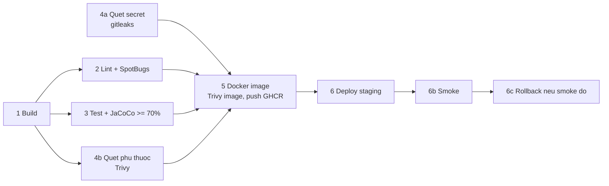

# LMS-API

Backend của **Hệ thống quản lý, đo lường và phân tích chuẩn đầu ra chương trình đào tạo** (Learning Outcomes
Management and Analytics System, LOMS). Tiểu luận chuyên ngành CNTT, Trường HCM-UTE.

Hệ thống tiếp nhận kết quả có sẵn sau khi thi (điểm theo từng câu hỏi/tiêu chí) và đo lường mức đạt theo chuỗi
*câu hỏi/tiêu chí → CLO → PI → PLO → báo cáo → hành động cải tiến*, có phiên bản và truy vết về dữ liệu gốc.
Không tổ chức thi, không sinh đề, không lưu bài làm của sinh viên.

> **Trạng thái:** đang phát triển (khung dự án). Chưa có API nghiệp vụ.

## Công nghệ

Java, Spring Boot 4.1.0 (Maven), Spring Data MongoDB, Spring Security, Bean Validation, MongoDB (replica set).
Frontend: repo riêng `LMS-UI` (Angular 21 + TypeScript).

## Yêu cầu môi trường

| Thành phần | Phiên bản | Ghi chú |
|---|---|---|
| JDK | 25 (đang cấu hình trong `pom.xml`) | Chờ xác nhận bộ phiên bản với Trung tâm CNPM |
| Docker | bản gần đây | Cách nhanh nhất để có MongoDB replica set kèm dữ liệu ban đầu (xem bên dưới) |
| MongoDB | 8.x, chạy dạng **replica set** | Cần cho transaction khi xác nhận nhập điểm; thiết kế đã thử trên 8.2.6. Image Docker dùng `mongo:8.0` |
| `mongosh` | bản đi kèm MongoDB | Chỉ cần khi cài MongoDB trực tiếp trên máy, không dùng Docker |
| Maven | dùng wrapper `mvnw` đi kèm | Không cần cài riêng |

## Cài đặt và chạy

1. **Cấu hình.** Sao chép file mẫu (file thật bị `.gitignore`, không commit):

   ```
   copy src\main\resources\application.properties.example src\main\resources\application.properties
   ```

   Spring Boot 4 đọc kết nối MongoDB từ `spring.mongodb.uri`. Mặc định là
   `mongodb://localhost:27017/learning_outcomes?replicaSet=rs0`, khớp image Docker ở mục dưới, nên chạy
   container với cổng mặc định thì **không cần đặt gì thêm**. Chỉ đặt biến `MONGODB_URI` khi dùng cổng hoặc
   máy khác, ví dụ `set MONGODB_URI=mongodb://localhost:27018/learning_outcomes?replicaSet=rs0`.

2. **MongoDB + nạp CSDL ban đầu** — chọn một trong hai cách (xem mục [MongoDB bằng Docker](#mongodb-bằng-docker)
   và [MongoDB cài sẵn trên máy](#mongodb-cài-sẵn-trên-máy)). Script dựng **26 collection** (thiết kế CSDL v0.6,
   đã loại bỏ `ml_experiments` do ML nằm ngoài phạm vi đồ án) kèm validator và chỉ mục. Dữ liệu khởi tạo gồm 1 chương trình,
   7 PLO, 17 PI, 1 học phần, 4 dòng ma trận I/R/M và một bản quy tắc đo lường nháp (ngưỡng/trọng số để trống).
   Chi tiết: `doc/GiaiThich_CoSoDuLieu.md` §7, §9 (tóm tắt thay đổi v0.4 → v0.5 ở §0).

3. **Chạy ứng dụng:**

   ```
   mvnw.cmd spring-boot:run      # Windows
   ./mvnw spring-boot:run        # Linux/macOS
   ```

## MongoDB bằng Docker

Image `lms-mongo` (định nghĩa ở `docker/mongo/`) gói sẵn MongoDB 8 chạy **replica set một node `rs0`** và tự
nạp `doc/database_import.js` mỗi lần container khởi động. Chỉ cần Docker, không cần cài MongoDB hay `mongosh`.

```
docker build -f docker/mongo/Dockerfile -t lms-mongo .
docker run -d --name lms-mongo -p 27017:27017 -v lms-mongo-data:/data/db lms-mongo
```

Sau khoảng 10–20 giây MongoDB sẵn sàng (xem `docker logs lms-mongo`, dòng cuối có `HOÀN TẤT` và `Tổng số collection: 30`). Chuỗi kết nối
`mongodb://localhost:27017/learning_outcomes?replicaSet=rs0` đã là mặc định của ứng dụng.

| Việc | Lệnh |
|---|---|
| Tắt / bật lại (dữ liệu giữ nguyên trong volume) | `docker stop lms-mongo` / `docker start lms-mongo` |
| Mở shell vào CSDL | `docker exec -it lms-mongo mongosh "mongodb://localhost:27017/learning_outcomes?replicaSet=rs0"` |
| Xóa sạch và nạp lại từ đầu | `docker rm -f lms-mongo && docker volume rm lms-mongo-data`, rồi `docker run` lại |

Tùy chọn (truyền bằng `-e` khi `docker run`):

| Biến | Mặc định | Ý nghĩa |
|---|---|---|
| `MONGO_PORT` | `27017` | Cổng MongoDB. **Phải trùng cổng publish** (`-p N:N`), vì replica set quảng bá địa chỉ `localhost:N` cho client. |
| `LOMS_DB` | `learning_outcomes` | Tên CSDL. |
| `LOMS_SAMPLE` | không đặt | Đặt `1` để nạp thêm dữ liệu minh họa (CLO ví dụ của học phần OOP). Mặc định không nạp để không lẫn với dữ liệu chính thức. |

Ví dụ khi cổng 27017 đã bị MongoDB khác trên máy chiếm, dùng 27018:

```
docker run -d --name lms-mongo -e MONGO_PORT=27018 -p 27018:27018 -v lms-mongo-data:/data/db lms-mongo
```

rồi đặt `MONGODB_URI=mongodb://localhost:27018/learning_outcomes?replicaSet=rs0`.

Lưu ý: container **không bật xác thực**, chỉ dùng cho phát triển trên máy cá nhân; không mở cổng này ra mạng ngoài.
Sửa `doc/database_import.js` xong thì build lại image (`docker build` như trên) rồi chạy lại container; script
chạy lại an toàn, chỉ cập nhật validator và chèn dữ liệu khởi tạo còn thiếu.

**Khi thiết kế CSDL đổi phiên bản** (ví dụ v0.4 → v0.5) cần dựng lại từ đầu, vì script *không sửa* bản ghi khởi tạo
đã có (PLO cũ vẫn thiếu trường `category`, phiên bản CTĐT cũ thiếu `totalCredits`…). Các bước, lưu ý chúng **xóa
toàn bộ dữ liệu trong volume**, nên chỉ làm khi trong đó chỉ có dữ liệu khởi tạo hoặc dữ liệu thử nghiệm:

```
docker build -f docker/mongo/Dockerfile -t lms-mongo .
docker rm -f lms-mongo
docker volume rm lms-mongo-data
docker run -d --name lms-mongo -p 27017:27017 -v lms-mongo-data:/data/db lms-mongo
```

## MongoDB cài sẵn trên máy

Dành cho trường hợp không dùng Docker. Cần MongoDB 8.x và `mongosh`.

1. Chạy `mongod` với `--replSet rs0`, rồi khởi tạo replica set một lần:

   ```
   mongosh --eval "rs.initiate()"
   ```

2. Nạp CSDL ban đầu (chạy lại nhiều lần được, không xóa dữ liệu; đổi tên CSDL bằng biến `LOMS_DB`):

   ```
   mongosh "mongodb://localhost:27017" --file doc/database_import.js
   ```

## Kiểm thử và build

```
mvnw.cmd verify      # build + test
```

Hiện chỉ có một test khởi động ngữ cảnh (`LmsApiApplicationTests`); test nghiệp vụ sẽ được bổ sung theo
`doc/ke-hoach-xay-dung.md`. Kết quả CI và coverage sẽ được công bố khi pipeline đầy đủ.

## Docker, CI/CD và triển khai

### Chạy ứng dụng bằng Docker

`Dockerfile` ở gốc repo dựng image đa tầng (build JDK 25 Temurin, chạy JRE 25 Alpine, user không phải root,
`HEALTHCHECK` tới `/actuator/health`). Không có secret trong image; mọi cấu hình đi qua biến môi trường
(`application.properties.example`). Ví dụ chạy cạnh container MongoDB của mục trên (dùng chung mạng của container Mongo để
địa chỉ `localhost:27017` mà replica set quảng bá vẫn đúng):

```
docker build -t lms-api:local .
docker run -d --name lms-api --network container:lms-mongo -e JWT_SECRET=<chuỗi ngẫu nhiên >= 32 byte> lms-api:local
```

Cổng 8080 khi đó nằm trên container `lms-mongo`, nên cần publish `-p 8080:8080` lúc tạo container Mongo.

### Pipeline CI (`.github/workflows/ci.yml`)



| Chặng | Job | Ghi chú |
|---|---|---|
| 1 | `build` | `./mvnw -DskipTests package` |
| 2 | `lint` | `test-compile spotless:check spotbugs:check pmd:cpd-check` (cấu hình trong `pom.xml` của nhóm static-analysis); Sonar chỉ chạy khi có secret `SONAR_TOKEN` — **chưa có token nên chưa quét Sonar** |
| 3 | `test` | MongoDB 8.0 replica set `rs0` + `./mvnw verify` (cổng JaCoCo ≥ 70% có trong `pom.xml` nhưng đang `haltOnFailure=false` nên chưa chặn); báo cáo JaCoCo là artifact `jacoco-report` |
| 4 | `secret-scan`, `dependency-scan` | gitleaks (toàn bộ lịch sử); Trivy trên JAR |
| 5 | `package-image` | build image, Trivy quét image, đẩy GHCR **chỉ** khi push vào `main` hoặc tag `v*.*.*`; PR chỉ build + quét |
| 6 | `deploy-staging`, `smoke-staging`, `rollback-staging` | chỉ ở `main` và khi biến repository `STAGING_ENABLED == 'true'`; **hiện chưa có nền tảng staging nên bị bỏ qua** |

Tag image: `sha-<7 ký tự commit>` (dùng để deploy/rollback) và `<YYYYMMDD>-<7 ký tự commit>`; không có `latest`.
Thời gian commit → image: **chưa đo** (chưa có lần chạy trên GitHub; workflow ghi số thật vào job summary khi chạy trên `main`).
Chặng `lint` phụ thuộc PR `chore/f00-static-analysis`, và chặng 4b/5 phụ thuộc phiên bản Spring Boot đủ mới để Trivy không báo
HIGH/CRITICAL; chi tiết ở `doc/adr/0006-ci-cd-va-staging.md`.

### Staging

Khung triển khai (Docker Compose, `deploy.sh`, `rollback.sh`, `smoke.sh`) ở `deploy/staging/`, hướng dẫn đầy đủ ở
`doc/deploy/staging.md`: quy trình, health check (US-39), rollback, xem log, cảnh báo, danh sách biến môi trường, secret/variable cần tạo.
Nền tảng staging chưa được chọn (Q06, Q07) nên chưa có môi trường chạy thật.

## Cấu trúc

Dự án áp dụng mô hình kiến trúc phân tầng 3 lớp (**Package-by-Layer**) trực tiếp dưới `com.hcmute.lms.lmsapi` kết hợp các package `.impl` và interface trừu tượng nhằm tuân thủ nghiêm ngặt 5 nguyên lý **SOLID**:

```
src/main/java/com/hcmute/lms/lmsapi/
├── controller/         # Tầng Presentation: REST Controller (chỉ phụ thuộc Service interface)
├── dto/                # Data Transfer Objects (ErrorResponse, FieldErrorDetail, request/response DTOs)
├── service/            # Tầng Business Logic: Interfaces nghiệp vụ (AuditService)
│   └── impl/           # Hiện thực nghiệp vụ (AuditServiceImpl - tiêm Repository, Mapper, @Transactional)
├── repository/         # Tầng Data Access: Interfaces truy cập MongoDB (AuditLogRepository, AuditLogRepositoryCustom)
│   └── impl/           # Hiện thực truy vấn mở rộng dùng MongoTemplate (AuditLogRepositoryCustomImpl)
├── document/           # Domain Models & MongoDB Documents (AuditLog, AuditEntity, AuditAction)
├── mapper/             # Interfaces chuyển đổi dữ liệu (AuditLogMapper)
│   └── impl/           # Hiện thực mapper & sanitize dữ liệu nhạy cảm độc lập theo SRP (AuditLogMapperImpl)
├── exception/          # Xử lý lỗi tập trung: AppException, ErrorCode, GlobalExceptionHandler
├── config/             # Cấu hình Spring Beans: MongoConfig (TransactionManager), SecurityConfig
└── filter/             # Bộ lọc HTTP: CorrelationIdFilter (MDC logging, X-Correlation-Id)

src/main/resources/     # Cấu hình môi trường (application.properties.example)
docker/mongo/           # Cấu hình Docker MongoDB replica set dev
Dockerfile              # Image ứng dụng (đa tầng, user không root)
deploy/staging/         # Khung triển khai staging: compose, deploy.sh, rollback.sh, smoke.sh
.github/                # Workflow CI (ci.yml) và composite action (install-trivy, staging-ssh)
doc/                    # Tài liệu kỹ thuật, kiến trúc ADR, kế hoạch thực hiện
logsAI/                 # Nhật ký sử dụng AI (Rubric TC2.3)
```

## Tài liệu chính

- `doc/GiaiThich_CoSoDuLieu.md` — thiết kế CSDL MongoDB v0.6 (26 collection, 15 nguyên tắc); `doc/PLO_DB_UPDATE.md`
  là đặc tả nguồn của các thay đổi v0.5; `doc/database_import.js` là script dựng CSDL.
- `doc/ke-hoach-xay-dung.md` — kế hoạch v0.3, backlog, lộ trình, rủi ro; `doc/plan/` — kế hoạch tách theo từng feature (F01…F08) để giao cho LLM hỗ trợ code.
- `doc/chot-feature-do-an.md` — đề xuất chốt danh sách tính năng (chưa ký); `doc/tom-tat-du-an-de-thao-luan.md` — tóm tắt để thảo luận.
- `doc/cam-ket-san-pham-metric.md` — bản cam kết Bước 3 (dự thảo).
- `doc/adr/` — quyết định thiết kế (ADR 0001: duyệt ma trận đề thi, đã bị ADR 0013 thay thế; ADR 0013: giảng viên tự khóa ma trận, bỏ ngân hàng câu hỏi, điểm theo từng CLO; ADR 0006: CI/CD và staging).
- `doc/deploy/staging.md` — triển khai staging, health check, rollback, log, biến môi trường.
- `doc/coding-convention.md`, `doc/tech-debt.md`, `doc/rubric-checklist.md`.
- `doc/BS.md`, `doc/Misa.md` — kế hoạch và hướng dẫn đọc CTĐT.

## Quy trình đóng góp

Nhánh theo tác vụ (`feat/…`, `fix/…`), commit theo Conventional Commits, mở Pull Request, **sinh viên còn lại review**
trước khi merge vào `main`. Không commit secret hay dữ liệu sinh viên thật. Hai sinh viên cùng làm; xem
`doc/quy-trinh/phan-cong.md`.
