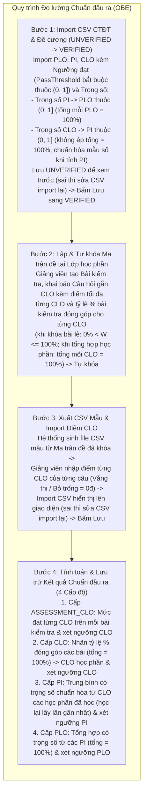

# Đặc tả Nghiệp vụ Hệ thống và Phương pháp Tính toán Mức độ Đạt Chuẩn đầu ra (CLO – PI – PLO)

> **Mục đích tài liệu:** Trình bày luồng nghiệp vụ vận hành hệ thống và công thức toán học tính toán mức độ đạt chuẩn đầu ra theo chuỗi khép kín 4 cấp độ từ **Câu hỏi kiểm tra $\to$ CLO từng bài kiểm tra (`ASSESSMENT_CLO`) $\to$ CLO toàn học phần (`CLO`) $\to$ Chỉ số thực hiện (`PI`) $\to$ Chuẩn đầu ra chương trình (`PLO`)**, phục vụ báo cáo và xin ý kiến xem xét của Giảng viên hướng dẫn (GVHD).  
> **Ngày lập:** 11/11/2026

---

## 1. Phạm vi và Nguyên tắc Nghiệp vụ Cốt lõi

Hệ thống được thiết kế chuyên biệt cho bài toán **Quản lý, đo lường và phân tích chuẩn đầu ra chương trình đào tạo (OBE — Outcome-Based Education)** theo 6 nguyên tắc cốt lõi:

1. **Khởi tạo Chuẩn đầu ra, Trọng số đóng góp và Ngưỡng đạt bắt buộc bằng Import CSV (`UNVERIFIED` $\to$ `VERIFIED`):**
   - Một vai trò quản lý học thuật được cấp quyền (Quản lý Chương trình đào tạo / Giáo vụ Khoa) thực hiện **Import tệp CSV Chương trình đào tạo (CTĐT)** và **Import tệp CSV Đề cương chi tiết học phần**.
   - Các thông số cấu hình đo lường sau được quy định và **Import sẵn trong tệp CSV chuẩn hóa (bắt buộc điền đầy đủ, không được để trống)**:
     - Danh sách **PLO**, **PI**, **CLO** kèm **Ngưỡng đạt (`PassThreshold`)** riêng của từng `PLO`, từng `PI` và từng `CLO` (bắt buộc thuộc khoảng $(0, 1]$, tức $> 0\%$ và $\le 100\%$).
     - **Trọng số đóng góp của từng PI lên PLO cha ($W_{PI \to PLO} \in (0, 1]$):** sao cho tổng trọng số các PI thuộc cùng một PLO luôn bằng **$1.0$ ($100\%$)**.
     - **Trọng số đóng góp của từng CLO lên PI ($W_{CLO \to PI} \in (0, 1]$):** mỗi CLO liên kết với một PI có trọng số thuộc khoảng $(0, 1]$ (**không ép buộc tổng trọng số các CLO của mọi học phần vào một PI phải bằng $1.0$**, vì trong CTĐT có các nhóm học phần tự chọn và đề cương từng học phần được Import độc lập; khi tính điểm PI, hệ thống tự động chia chuẩn hóa theo tổng trọng số của các CLO mà sinh viên đã học).
   - Khi vừa Import, dữ liệu được lưu vào cơ sở dữ liệu ở trạng thái **`UNVERIFIED` (Chưa xác nhận)** để hiển thị lên giao diện cho người dùng kiểm tra:
     - **Nếu phát hiện sai sót:** Người dùng **chỉnh sửa lại trên tệp CSV rồi thực hiện Import lại** (hệ thống ghi đè lên bản `UNVERIFIED`).
     - **Nếu dữ liệu đã chính xác:** Người dùng bấm **"Lưu / Xác nhận"** trên giao diện để chuyển trạng thái sang **`VERIFIED` (Đã xác nhận)**. Chỉ dữ liệu `VERIFIED` mới được dùng để tính toán chuẩn đầu ra.
2. **Thiết lập Bài kiểm tra, Ma trận đề và Tỷ trọng đóng góp CLO tại Lớp học phần:**
   - Giảng viên phụ trách lớp học phần tạo các bài kiểm tra trong học kỳ, thiết lập **ma trận đề** (danh sách các câu hỏi gắn với các CLO và điểm tối đa của từng CLO trong mỗi câu hỏi).
   - Vì mỗi bài kiểm tra có độ khó, quy mô và mức độ quan trọng đối với từng CLO khác nhau (bài dễ, bài khó, hoặc bài không đánh giá một số CLO), giảng viên quy định **tỷ lệ phần trăm đóng góp ($W_{p,j} \in (0, 1]$) của mỗi bài kiểm tra đối với từng CLO** sao cho khi hoàn tất các bài kiểm tra trong học phần, **tổng tỷ lệ đóng góp của các bài kiểm tra cho mỗi CLO luôn bằng $1.0$ ($100\%$)**.
   - Sau khi thiết lập xong từng bài kiểm tra, giảng viên **tự khóa ma trận đề** của bài đó để xuất tệp CSV mẫu và nhập kết quả.
3. **Bảo mật đề thi — Không lưu nội dung câu hỏi:** Hệ thống **tuyệt đối không lưu nội dung câu hỏi, đề bài hay đáp án** dưới mọi hình thức nhằm loại bỏ nguy cơ lộ đề thi. Mỗi câu hỏi trong ma trận đề chỉ lưu nhãn định danh (ví dụ: `Câu 1`, `Câu 2`) và cấu trúc điểm tối đa theo từng CLO.
4. **Xuất tệp CSV mẫu từ Ma trận đề đã khóa và Nhập điểm CLO trực tiếp theo từng câu hỏi:**
   - Dựa trên ma trận đề đã khóa và danh sách sinh viên đang theo học của lớp học phần, hệ thống **tự động sinh tệp CSV mẫu** trong đó mỗi cột điểm tương ứng với một cặp `(Câu hỏi, CLO, Điểm tối đa)`.
   - Giảng viên nhập trực tiếp điểm đạt của từng CLO tại từng câu hỏi vào tệp CSV rồi Import vào hệ thống. **Nếu 1 câu hỏi đánh giá nhiều CLO**, tệp CSV tự động tách thành các cột riêng cho từng CLO của câu hỏi đó.
   - **Nếu sinh viên vắng thi hoặc bỏ trống câu hỏi:** Điểm của sinh viên tại các mục đó được ghi nhận trực tiếp bằng **`0` điểm** (`0.0`).
   - Khi Import tệp CSV điểm, hệ thống hiển thị bảng điểm lên giao diện để giảng viên kiểm tra trước; **nếu sai thì giảng viên sửa tệp CSV rồi Import lại**, nếu đúng thì bấm **Lưu** để ghi nhận chính thức vào cơ sở dữ liệu.
5. **Tính đồng nhất toán học ở mọi cấp độ tổng hợp (Trung bình có trọng số thuộc $(0, 1]$):**
   Mọi bước tổng hợp chuẩn đầu ra trong hệ thống đều dùng chung thang trọng số $(0, 1]$:
   - Từ **các Bài kiểm tra $\to$ CLO học phần:** $W_{p,j} \in (0, 1]$, tổng tỷ lệ đóng góp của các bài kiểm tra trong học phần cho mỗi CLO bằng **$1.0$ ($100\%$)**.
   - Từ **các CLO (một hoặc nhiều học phần) $\to$ PI:** $W_{CLO_{c,j} \to PI_m} \in (0, 1]$ (không ép tổng bằng $1.0$ khi thiết kế do có môn tự chọn); khi tính toán, hệ thống chia chuẩn hóa cho mẫu số $\sum_{\text{Evaluated}} W_{CLO_{c,j} \to PI_m}$ nên tổng tỷ trọng thực tế của các CLO mà sinh viên đã học luôn bằng **$1.0$ ($100\%$)**.
   - Từ **các PI $\to$ PLO:** $W_{PI_m \to PLO_q} \in (0, 1]$, tổng trọng số đóng góp của các PI cho mỗi PLO bằng **$1.0$ ($100\%$)**.
6. **Chỉ đo lường Chuẩn đầu ra (4 cấp độ) — Loại bỏ cách tính điểm môn học cũ:**
   - Hệ thống **bỏ hoàn toàn** các thông số điểm học vụ không phục vụ đo lường OBE (bỏ trọng số bài kiểm tra trong môn học `weightInCourse`, bỏ tổng điểm bài kiểm tra `totalPoints`, bỏ trọng số CLO mặc định `defaultWeight`, bỏ cấp kết quả `COURSE` và bảng `measurement_rules` rời rạc).
   - Hệ thống tính toán và lưu trữ kết quả chuẩn đầu ra xuyên suốt 4 cấp độ (`RESULT_LEVELS`):
     1. **`ASSESSMENT_CLO` (Cấp độ 1):** Mức độ đạt từng CLO trên từng bài kiểm tra đơn lẻ.
     2. **`CLO` (Cấp độ 2):** Mức độ đạt từng CLO trên toàn học phần.
     3. **`PI` (Cấp độ 3):** Mức độ đạt từng Chỉ số thực hiện PI.
     4. **`PLO` (Cấp độ 4):** Mức độ đạt từng Chuẩn đầu ra chương trình đào tạo PLO.

---

## 2. Tổng quan Luồng Nghiệp vụ Hệ thống



---

## 3. Đặc tả Chi tiết Các Bước Nghiệp vụ

### 3.1. Import Chương trình Đào tạo & Đề cương Học phần (`UNVERIFIED` $\to$ `VERIFIED`)

Hệ thống tập trung quyền khởi tạo dữ liệu chuẩn đầu ra cho **một vai trò quản lý học thuật duy nhất (Quản lý CTĐT / Giáo vụ Khoa)** thông qua chức năng Import tệp CSV chuẩn hóa (trong đó các cột trọng số đóng góp và ngưỡng đạt là thông số cấu hình đo lường bắt buộc do Khoa/CTĐT quy định trong tệp CSV):

#### 1. Nội dung Import Chương trình Đào tạo (CTĐT)
- **Danh sách Chuẩn đầu ra chương trình (`PLO`):**
  - Mã PLO (`PLO1`, `PLO2`, ...), nội dung mô tả.
  - **Ngưỡng đạt của từng PLO ($\text{PassThreshold}(PLO_q) \in (0, 1]$, bắt buộc không được để trống):** ví dụ `0.60` ($60\%$).
- **Danh sách Chỉ số thực hiện (`PI`) thuộc từng PLO:**
  - Mã PI (`PI1.1`, `PI1.2`, ...), nội dung mô tả, mã `PLO` cha mà PI đó trực thuộc.
  - **Trọng số đóng góp của từng PI lên PLO cha ($W_{PI_m \to PLO_q} \in (0, 1]$, bắt buộc không được để trống):** sao cho tổng trọng số của tất cả các PI thuộc cùng một $PLO_q$ luôn bằng **$1.0$ ($100\%$):**
    $$\sum_{m \in PI(PLO_q)} W_{PI_m \to PLO_q} = 1.0 \quad (100\%)$$
  - **Ngưỡng đạt của từng PI ($\text{PassThreshold}(PI_m) \in (0, 1]$, bắt buộc không được để trống):** ví dụ `0.60` ($60\%$).
- **Danh mục Học phần trong CTĐT:** Mã học phần, tên học phần, số tín chỉ, học kỳ dự kiến.

**Ví dụ minh họa dữ liệu Import PLO & PI trong CTĐT:**

| Mã PLO | Ngưỡng đạt PLO (`PassThreshold`) | Mã PI thuộc PLO | Trọng số PI đóng góp lên PLO ($W_{PI \to PLO}$) | Tổng trọng số các PI trong PLO | Ngưỡng đạt PI (`PassThreshold`) |
|:---:|:---:|:---:|:---:|:---:|:---:|
| **`PLO1`** | **`0.60` ($60\%$)** | `PI1.1`<br>`PI1.2` | **`0.40` ($40\%$)**<br>**`0.60` ($60\%$)** | $0.40 + 0.60 = \mathbf{1.00\ (100\%)}$ | **`0.60` ($60\%$)**<br>**`0.60` ($60\%$)** |
| **`PLO2`** | **`0.60` ($60\%$)** | `PI2.1`<br>`PI2.2`<br>`PI2.3` | **`0.30` ($30\%$)**<br>**`0.30` ($30\%$)**<br>**`0.40` ($40\%$)** | $0.30 + 0.30 + 0.40 = \mathbf{1.00\ (100\%)}$ | **`0.60` ($60\%$)**<br>**`0.60` ($60\%$)**<br>**`0.60` ($60\%$)** |

#### 2. Nội dung Import Đề cương Chi tiết Học phần & Ma trận liên kết `CLO – PI`
- **Danh sách Chuẩn đầu ra học phần (`CLO`):**
  - Mã học phần ($c$), mã CLO (`CLO1`, `CLO2`, ...), nội dung mô tả, mức nhận thức Bloom.
  - **Ngưỡng đạt của từng CLO ($\text{PassThreshold}(CLO_{c,j}) \in (0, 1]$, bắt buộc không được để trống):** ví dụ `0.60` ($60\%$).
- **Ma trận liên kết `CLO – PI` kèm Trọng số đóng góp ($W_{CLO_{c,j} \to PI_m} \in (0, 1]$):**
  - Trong một Chương trình đào tạo, **một chỉ số thực hiện $PI_m$ có thể được tổng hợp từ các `CLO` thuộc một hoặc nhiều học phần khác nhau** (bao gồm cả các học phần bắt buộc và các học phần tự chọn).
  - Khai báo mỗi chuẩn đầu ra $CLO_{c,j}$ (của học phần $c$) đóng góp vào những $PI_m$ nào và **trọng số đóng góp $W_{CLO_{c,j} \to PI_m} \in (0, 1]$** (tức $0 < W_{CLO_{c,j} \to PI_m} \le 1.0$, bắt buộc không được để trống) của $CLO_{c,j}$ đối với $PI_m$ đó.
  - **Không bắt buộc tổng trọng số $\sum W_{CLO_{c,j} \to PI_m}$ qua mọi học phần phải bằng $1.0$ ($100\%$):** Vì sinh viên chỉ học một số học phần trong nhóm tự chọn và đề cương từng học phần được Import độc lập, mỗi liên kết `CLO -> PI` chỉ cần khai báo trọng số tương đối thuộc $(0, 1]$. Khi tính mức đạt $PI_m$ của từng sinh viên (Mục 4.4), hệ thống tự động chia chuẩn hóa cho mẫu số là tổng trọng số của các CLO mà sinh viên đó đã học ($\sum_{\text{Evaluated}} W_{CLO_{c,j} \to PI_m}$), đảm bảo tổng tỷ trọng thực tế luôn bằng đúng $100\%$.

**Ví dụ minh họa dữ liệu Import CLO (từ nhiều học phần) & Liên kết `CLO -> PI`:**

| Mã PI nhận đóng góp | Học phần ($c$) | Mã CLO liên kết đóng góp vào PI | Ngưỡng đạt của CLO (`PassThreshold`) | Trọng số CLO đóng góp lên PI ($W_{CLO_{c,j} \to PI} \in (0, 1]$) | Ghi chú chuẩn hóa khi tính PI |
|:---:|:---|:---:|:---:|:---:|:---|
| **`PI1.1`** | Học phần A *(Bắt buộc)*<br>Học phần A *(Bắt buộc)*<br>Học phần B *(Bắt buộc)*<br>Học phần C *(Tự chọn)* | `CLO1` *(HP A)*<br>`CLO2` *(HP A)*<br>`CLO1` *(HP B)*<br>`CLO1` *(HP C)* | `0.60` ($60\%$)<br>`0.60` ($60\%$)<br>`0.60` ($60\%$)<br>`0.60` ($60\%$) | **`0.30`**<br>**`0.30`**<br>**`0.40`**<br>**`0.40`** | - Nếu SV học HP A & HP B: mẫu số $= 0.30 + 0.30 + 0.40 = 1.00$.<br>- Nếu SV học thêm HP C: mẫu số $= 1.40$ (tự động chuẩn hóa về $100\%$). |
| **`PI1.2`** | Học phần A *(Bắt buộc)*<br>Học phần B *(Bắt buộc)* | `CLO3` *(HP A)*<br>`CLO2` *(HP B)* | `0.60` ($60\%$)<br>`0.60` ($60\%$) | **`0.50`**<br>**`0.50`** | Nếu SV học đủ HP A & HP B: mẫu số $= 0.50 + 0.50 = 1.00$. |

#### 3. Cơ chế Kiểm tra và Xác nhận sau Import (`UNVERIFIED` $\to$ `VERIFIED`)
- **Kiểm tra dữ liệu khi tải CSV lên:**
  - Hệ thống kiểm tra không có bất kỳ trường `PassThreshold` hoặc `Weight` nào bị bỏ trống và mọi giá trị đều nằm trong khoảng $(0, 1]$ ($0 < \text{giá trị} \le 1.0$).
  - Với tệp CSV CTĐT: kiểm tra tổng trọng số các PI trong từng PLO bằng đúng $1.0$ ($100\%$).
  - Với tệp CSV Đề cương học phần: kiểm tra mỗi trọng số liên kết $W_{CLO_{c,j} \to PI_m} \in (0, 1]$ và ngưỡng đạt $\text{PassThreshold}(CLO_{c,j}) \in (0, 1]$ (cho phép Import từng đề cương học phần độc lập mà không bị chặn bởi tổng trọng số của các môn khác).
- **Lưu tạm `UNVERIFIED` để xem trước trên giao diện:**
  - Sau khi tải tệp CSV hợp lệ, dữ liệu được lưu vào cơ sở dữ liệu với trạng thái **`UNVERIFIED` (Chưa xác nhận)** và hiển thị toàn bộ bảng dữ liệu lên giao diện để người dùng đối chiếu.
  - **Nếu phát hiện sai sót:** Người dùng chỉnh sửa trực tiếp trên tệp CSV gốc rồi thực hiện **Import lại** (hệ thống cập nhật đè lên dữ liệu `UNVERIFIED`).
  - **Nếu dữ liệu đã chính xác:** Người dùng bấm nút **"Lưu / Xác nhận"** để chuyển dữ liệu sang trạng thái **`VERIFIED` (Đã xác nhận)**. Chỉ dữ liệu đã `VERIFIED` mới được đưa vào giảng dạy và tính toán chuẩn đầu ra.

---

### 3.2. Thiết lập Bài kiểm tra, Tỷ trọng Đóng góp CLO và Tự khóa Ma trận đề tại Lớp học phần

Trong mỗi học kỳ, giảng viên phụ trách lớp học phần thực hiện thiết lập các bài kiểm tra của lớp mình:

1. **Khởi tạo Bài kiểm tra:**
   - Giảng viên tạo các bài kiểm tra trong học kỳ (ví dụ: *Bài kiểm tra 1*, *Bài kiểm tra 2*, *Thi cuối kỳ*).
   - Khai báo thông tin định danh bài kiểm tra: mã bài, tên bài, loại/giai đoạn đánh giá (quá trình / giữa kỳ / cuối kỳ).

2. **Thiết lập Ma trận đề (`Câu hỏi × CLO`):**
   - Trong mỗi bài kiểm tra, giảng viên khai báo danh sách các câu hỏi (`Câu 1`, `Câu 2`, ..., `Câu K`).
   - **Không nhập và không lưu nội dung đề bài hay đáp án.**
   - Tại mỗi câu hỏi $k$, giảng viên gắn một hoặc nhiều chuẩn đầu ra $CLO_j$ mà câu hỏi đó đánh giá, đồng thời **nhập trực tiếp điểm tối đa của từng CLO trong câu hỏi đó** ($MaxScore_{p,k,j} > 0$):
     - *Trường hợp câu hỏi đánh giá 1 CLO:* Ví dụ `Câu 1` đánh giá `CLO1` với điểm tối đa là $2.0$ điểm.
     - *Trường hợp câu hỏi đánh giá nhiều CLO:* Ví dụ `Câu 4` đánh giá đồng thời `CLO2` và `CLO3`, giảng viên nhập riêng điểm tối đa cho phần `CLO2` (ví dụ $1.5$ điểm) và điểm tối đa cho phần `CLO3` (ví dụ $0.5$ điểm).

3. **Thiết lập Tỷ lệ % Đóng góp của từng Bài kiểm tra cho từng CLO ($\sum_{p} W_{p,j} = 100\%$):**
   - Vì mỗi bài kiểm tra có độ khó và tầm quan trọng khác nhau đối với từng CLO (bài dễ, bài khó, hoặc bài không đánh giá một số CLO), trên mỗi bài kiểm tra $A_p$, giảng viên quy định **tỷ lệ đóng góp $W_{p,j}$** của bài kiểm tra $A_p$ vào kết quả toàn học phần của từng $CLO_j$:
     - Nếu bài kiểm tra $A_p$ **có câu hỏi đánh giá** $CLO_j$ ($p \in P(CLO_j)$), giảng viên bắt buộc nhập $W_{p,j} \in (0, 1]$ (tức $0\% < W_{p,j} \le 100\%$).
     - Nếu bài kiểm tra $A_p$ **không đánh giá** $CLO_j$ ($p \notin P(CLO_j)$), tỷ lệ đóng góp của bài $A_p$ cho $CLO_j$ mặc định bằng **$0$** ($W_{p,j} = 0\%$).
     - Trên toàn học phần, đối với mỗi chuẩn đầu ra $CLO_j$, **tổng tỷ lệ đóng góp từ tất cả các bài kiểm tra có đánh giá $CLO_j$ bằng đúng $1.0$ ($100\%$):**
       $$\sum_{p \in P(CLO_j)} W_{p,j} = 1.0 \quad (100\%)$$

4. **Giảng viên tự khóa Ma trận đề và Quy tắc kiểm tra theo thời điểm:**
   - Giảng viên có thể tạo và khóa từng bài kiểm tra theo tiến độ học kỳ (ví dụ: khóa *Bài kiểm tra 1* ở tuần 5 để chấm điểm trước khi tạo *Bài thi cuối kỳ* ở tuần 15).
   - **Tại thời điểm khóa một bài kiểm tra đơn lẻ $A_p$:** Hệ thống kiểm tra bài kiểm tra có ít nhất 1 câu hỏi, mọi CLO xuất hiện trong câu hỏi của bài $A_p$ đều được khai báo $W_{p,j} \in (0, 1]$, và tổng tỷ lệ đóng góp tích lũy của mỗi $CLO_j$ qua các bài kiểm tra đã khóa trong lớp học phần **không vượt quá $1.0$ ($100\%$)** ($\sum_{p} W_{p,j} \le 1.0$).
   - **Tại thời điểm chạy tính tổng hợp CLO toàn học phần (Cấp độ 2):** Hệ thống kiểm tra tổng tỷ lệ đóng góp qua các bài kiểm tra của mỗi $CLO_j$ phải **bằng đúng $1.0$ ($100\%$)** ($\sum_{p \in P(CLO_j)} W_{p,j} = 1.0$).
   - Ngay sau khi khóa ma trận đề của bài $A_p$, giảng viên có thể tải tệp CSV mẫu theo đúng cấu trúc ma trận vừa khóa để nhập điểm (nếu bài kiểm tra chưa có điểm lưu thì giảng viên có thể tự mở khóa để chỉnh sửa).

**Ví dụ minh họa Ma trận đề của một bài kiểm tra do Giảng viên thiết lập:**

| Câu hỏi | Các CLO được đánh giá trong câu hỏi | Điểm tối đa `CLO1` ($MaxScore_{k,CLO1}$) | Điểm tối đa `CLO2` ($MaxScore_{k,CLO2}$) | Điểm tối đa `CLO3` ($MaxScore_{k,CLO3}$) |
|:---:|:---|:---:|:---:|:---:|
| **Câu 1** | Đánh giá `CLO1` | **2.0 đ** | — | — |
| **Câu 2** | Đánh giá `CLO1` | **3.0 đ** | — | — |
| **Câu 3** | Đánh giá `CLO2` | — | **3.0 đ** | — |
| **Câu 4** | Đánh giá `CLO2` và `CLO3` *(thiết lập điểm riêng cho từng CLO)* | — | **1.5 đ** | **0.5 đ** |
| **Tổng điểm tối đa của từng CLO trong bài kiểm tra ($MaxScore_{p,j}$)** | | **$5.0$ đ** | **$4.5$ đ** | **$0.5$ đ** |

**Ví dụ minh họa Bảng phân bổ Tỷ lệ % Đóng góp ($W_{p,j}$) của các Bài kiểm tra cho từng CLO trong Học phần:**

| Chuẩn đầu ra học phần | Bài kiểm tra 1 ($A_1$ — Dễ) | Bài kiểm tra 2 ($A_2$ — Trung bình) | Bài kiểm tra 3 ($A_3$ — Cuối kỳ, Khó) | **Tổng tỷ lệ đóng góp cho CLO ($\sum_{p} W_{p,j}$)** |
|:---:|:---:|:---:|:---:|:---:|
| **`CLO1`** | Chiếm **`0.20` ($20\%$)** của `CLO1` | Chiếm **`0.30` ($30\%$)** của `CLO1` | Chiếm **`0.50` ($50\%$)** của `CLO1` | $0.20 + 0.30 + 0.50 = \mathbf{1.00\ (100\%)}$ |
| **`CLO2`** | *Không đánh giá ($0\%$)* | Chiếm **`0.40` ($40\%$)** của `CLO2` | Chiếm **`0.60` ($60\%$)** của `CLO2` | $0 + 0.40 + 0.60 = \mathbf{1.00\ (100\%)}$ |
| **`CLO3`** | *Không đánh giá ($0\%$)* | *Không đánh giá ($0\%$)* | Chiếm **`1.00` ($100\%$)** của `CLO3` | $0 + 0 + 1.00 = \mathbf{1.00\ (100\%)}$ |

---

### 3.3. Xuất tệp CSV Mẫu từ Ma trận đề và Import Điểm CLO trực tiếp theo từng câu hỏi

Sau khi ma trận đề của bài kiểm tra đã được khóa, quá trình nhập điểm của giảng viên diễn ra theo quy trình chuẩn hóa sau:

#### A. Hệ thống tự động tạo tệp CSV mẫu dựa trên Ma trận đề đã khóa
- Khi giảng viên bấm **"Tải tệp CSV mẫu nhập điểm"**, hệ thống dựa vào danh sách sinh viên đang theo học (`ENROLLED`) của lớp học phần và ma trận đề đã khóa để sinh ra một tệp `.csv` (mã hóa UTF-8 BOM để mở trực tiếp bằng Microsoft Excel tiếng Việt).
- **Cấu trúc cột tự động theo ma trận đề:**
  - 2 cột định danh sinh viên: `MaSV`, `HoTen` (được điền sẵn danh sách sinh viên đang theo học trong lớp; `MaSV` được xử lý dạng chuỗi văn bản để bảo toàn số `0` ở đầu nếu có).
  - Các cột điểm tiếp theo được sinh tự động cho từng cặp `(Câu hỏi, CLO)` kèm điểm tối đa ngay trên tiêu đề cột theo mẫu `<Mã câu> - <Mã CLO> (Max: <Điểm tối đa>)`. Nếu một câu hỏi gắn nhiều CLO (như `Câu 4` ở bảng trên), hệ thống tự động tách thành các cột riêng biệt cho từng CLO của câu hỏi đó.

**Minh họa nội dung tệp CSV mẫu do hệ thống sinh ra và giảng viên điền điểm:**

```csv
MaSV,HoTen,Cau 1 - CLO1 (Max: 2.0),Cau 2 - CLO1 (Max: 3.0),Cau 3 - CLO2 (Max: 3.0),Cau 4 - CLO2 (Max: 1.5),Cau 4 - CLO3 (Max: 0.5)
22110001,Nguyễn Văn A,1.5,2.5,2.0,1.5,0.0
22110002,Trần Thị B,2.0,2.0,2.5,1.0,0.5
22110003,Lê Văn C (Vắng thi),0.0,0.0,0.0,0.0,0.0
```

| Mã sinh viên | Họ và tên | Câu 1 — `CLO1`<br>*(Max: 2.0)* | Câu 2 — `CLO1`<br>*(Max: 3.0)* | Câu 3 — `CLO2`<br>*(Max: 3.0)* | Câu 4 — `CLO2`<br>*(Max: 1.5)* | Câu 4 — `CLO3`<br>*(Max: 0.5)* |
|:---:|:---|:---:|:---:|:---:|:---:|:---:|
| `22110001` | Nguyễn Văn A | `1.5` | `2.5` | `2.0` | `1.5` | `0.0` |
| `22110002` | Trần Thị B | `2.0` | `2.0` | `2.5` | `1.0` | `0.5` |
| `22110003` | Lê Văn C *(Vắng thi)* | `0.0` | `0.0` | `0.0` | `0.0` | `0.0` |

#### B. Nguyên tắc nhập điểm, xử lý vắng thi và Import CSV
- **Nhập trực tiếp theo từng CLO của từng câu hỏi:** Giảng viên nhập điểm đạt được của sinh viên tại từng cột `(Câu hỏi k, CLO j)`, thỏa mãn $0 \le Score_{s,p,k,j} \le MaxScore_{p,k,j}$ (sử dụng dấu chấm thập phân `.`).
- **Sinh viên vắng thi hoặc bỏ trống câu hỏi tính bằng `0` điểm:** Nếu sinh viên vắng thi hoặc bỏ trống phần câu hỏi nào, điểm đạt của sinh viên tại các ô đó được ghi nhận trực tiếp bằng **`0` điểm** ($Score_{s,p,k,j} = 0.0$; nếu giảng viên để trống ô trong tệp CSV thì khi Import hệ thống tự động quy về `0.0`). Hệ thống không sử dụng các trạng thái điểm rỗng (`ABSENT`, `EXEMPT`, `MISSING`); toàn bộ $N_{\text{section}}$ sinh viên đang theo học trong lớp học phần đều tham gia đầy đủ vào mẫu số đánh giá.
- **Xem trước trên giao diện và Lưu bảng điểm:** Khi giảng viên chọn tệp CSV để Import, hệ thống kiểm tra tính hợp lệ của các cột `(Câu hỏi, CLO, MaxScore)` và hiển thị bảng điểm lên giao diện để giảng viên kiểm tra trước. **Nếu phát hiện sai sót, giảng viên sửa lại trên tệp CSV rồi thực hiện Import lại**; khi đã chính xác, giảng viên bấm **Lưu** để hệ thống ghi nhận chính thức vào bảng `scores` (không dùng trạng thái `UNVERIFIED` cho bảng điểm).

---

## 4. Phương pháp Tính toán Mức độ Đạt Chuẩn đầu ra (CLO – PI – PLO)

### 4.1. Ký hiệu Toán học

1. **Ký hiệu Tập sinh viên và Sĩ số đánh giá ($N_{\text{section}}$ và $N_{\text{cohort}}$):**
   - $N_{\text{section}}$: Tổng số sinh viên đang theo học hợp lệ (`status = ENROLLED`, không tính sinh viên đã rút học phần `WITHDRAWN`) của một **lớp học phần** đang xét ($s \in \{1, \dots, N_{\text{section}}\}$). Dùng làm mẫu số thống kê ở **Cấp độ 1 (`ASSESSMENT_CLO`)** và **Cấp độ 2 (`CLO`)**.
   - $N_{\text{cohort}}$: Tổng số sinh viên thuộc **khóa tuyển sinh / Chương trình đào tạo** có dữ liệu đánh giá trong phạm vi đợt tính toán. Dùng làm mẫu số thống kê ở **Cấp độ 3 (`PI`)** và **Cấp độ 4 (`PLO`)**.

2. **Ở cấp Bài kiểm tra & Câu hỏi (`ASSESSMENT_CLO`):**
   - $K_p(CLO_j)$: Tập hợp các câu hỏi trong bài kiểm tra $A_p$ có đánh giá chuẩn đầu ra $CLO_j$.
   - $MaxScore_{p,k,j} > 0$: Điểm tối đa của $CLO_j$ tại câu hỏi $k$ thuộc bài kiểm tra $A_p$.
   - $Score_{s,p,k,j} \in [0, MaxScore_{p,k,j}]$: Điểm đạt $CLO_j$ của sinh viên $s$ tại câu hỏi $k$ thuộc bài kiểm tra $A_p$ *(sinh viên vắng thi hoặc bỏ trống câu hỏi thì $Score_{s,p,k,j} = 0$)*.
   - Tổng điểm tối đa và tổng điểm đạt của $CLO_j$ trong bài kiểm tra $A_p$:
     $$MaxScore_{p,j} = \sum_{k \in K_p(CLO_j)} MaxScore_{p,k,j}, \qquad Score_{s,p,j} = \sum_{k \in K_p(CLO_j)} Score_{s,p,k,j}$$

3. **Ở cấp Học phần (`CLO`):**
   - $P(CLO_j)$: Tập hợp các bài kiểm tra trong học phần có đánh giá $CLO_j$ ($MaxScore_{p,j} > 0$).
   - $W_{p,j}$: **Tỷ lệ đóng góp của bài kiểm tra $A_p$ cho $CLO_j$** do giảng viên thiết lập, được xác định trên hai miền rõ ràng:
     $$\begin{cases} W_{p,j} \in (0, 1] & \text{nếu } p \in P(CLO_j) \text{ (bài kiểm tra } A_p \text{ có đánh giá } CLO_j\text{)} \\ W_{p,j} = 0 & \text{nếu } p \notin P(CLO_j) \text{ (bài kiểm tra } A_p \text{ không đánh giá } CLO_j\text{)} \end{cases}$$
     thỏa mãn khi tổng hợp học phần:
     $$\sum_{p \in P(CLO_j)} W_{p,j} = 1.0 \quad (100\%)$$
   - $\text{PassThreshold}(CLO_j) \in (0, 1]$: **Ngưỡng đạt bắt buộc của $CLO_j$** (được Import sẵn từ CSV Đề cương học phần).

4. **Ở cấp Chỉ số thực hiện (`PI` — Tổng hợp từ các CLO của một hoặc nhiều học phần):**
   - $CLO(PI_m)$: Tập hợp tất cả các chuẩn đầu ra học phần $CLO_{c,j}$ (thuộc học phần $c$) có liên kết đóng góp vào chỉ số $PI_m$ trong CTĐT.
   - $W_{CLO_{c,j} \to PI_m} \in (0, 1]$: **Trọng số đóng góp của chuẩn đầu ra $CLO_{c,j}$ (học phần $c$) lên $PI_m$** (được Import sẵn từ CSV Đề cương; mỗi trọng số thuộc khoảng $(0, 1]$ và không bắt buộc tổng qua mọi học phần phải bằng $1.0$).
   - $\text{Evaluated}(s, PI_m) \subseteq CLO(PI_m)$: Tập hợp các chuẩn đầu ra $CLO_{c,j} \in CLO(PI_m)$ thuộc các học phần $c$ mà sinh viên $s$ **đã học và đã có kết quả CLO toàn học phần**.
     - **Quy tắc khi sinh viên học lại / học cải thiện học phần $c$ (`LATEST`):** Nếu sinh viên $s$ học học phần $c$ nhiều lần ở các học kỳ khác nhau, giá trị $Value(CLO_{s,c,j})$ được lấy từ **lần học hợp lệ gần nhất (`LATEST`)**.
   - $\text{PassThreshold}(PI_m) \in (0, 1]$: **Ngưỡng đạt bắt buộc của $PI_m$** (được Import sẵn từ CSV CTĐT).

5. **Ở cấp Chuẩn đầu ra Chương trình đào tạo (`PLO`):**
   - $PI(PLO_q)$: Tập hợp các chỉ số thực hiện $PI_m$ trực thuộc $PLO_q$.
   - $W_{PI_m \to PLO_q} \in (0, 1]$: **Trọng số đóng góp của $PI_m$ lên $PLO_q$** (được Import sẵn từ CSV CTĐT), thỏa mãn:
     $$\sum_{m \in PI(PLO_q)} W_{PI_m \to PLO_q} = 1.0 \quad (100\%)$$
   - $\text{Evaluated}(s, PLO_q) \subseteq PI(PLO_q)$: Tập hợp các chỉ số $PI_m \in PI(PLO_q)$ mà sinh viên $s$ đã có kết quả.
   - $\text{PassThreshold}(PLO_q) \in (0, 1]$: **Ngưỡng đạt bắt buộc của $PLO_q$** (được Import sẵn từ CSV CTĐT).

---

### 4.2. Cấp độ 1 (`level = ASSESSMENT_CLO`): Tính mức độ đạt từng CLO trên MỘT bài kiểm tra ($A_p$)

Với mỗi chuẩn đầu ra $CLO_j$ xuất hiện trong ma trận đề của bài kiểm tra $A_p$ ($p \in P(CLO_j)$), kết quả được tính và lưu vào cơ sở dữ liệu với `level = 'ASSESSMENT_CLO'` kèm định danh `assessmentId` của bài kiểm tra $A_p$:

1. **Mức độ đạt $CLO_j$ của từng sinh viên $s$ trên bài kiểm tra $A_p$:**
   $$CLO_{s,p,j} = \frac{Score_{s,p,j}}{MaxScore_{p,j}} = \frac{\sum_{k \in K_p(CLO_j)} Score_{s,p,k,j}}{\sum_{k \in K_p(CLO_j)} MaxScore_{p,k,j}} \in [0, 1]$$

2. **Kiểm tra qua ngưỡng Đạt / Chưa đạt $CLO_j$ tại bài kiểm tra $A_p$:**
   $$\text{Passed}(CLO_{s,p,j}) = \begin{cases} \text{Đạt (true)} & \text{nếu } CLO_{s,p,j} \ge \text{PassThreshold}(CLO_j) \\ \text{Chưa đạt (false)} & \text{nếu } CLO_{s,p,j} < \text{PassThreshold}(CLO_j) \end{cases}$$

3. **Mức độ đạt trung bình và Tỷ lệ sinh viên đạt $CLO_j$ của lớp học phần ($N_{\text{section}}$ sinh viên) trên bài kiểm tra $A_p$:**
   $$\overline{CLO}_{p,j} = \frac{1}{N_{\text{section}}} \sum_{s=1}^{N_{\text{section}}} CLO_{s,p,j}, \qquad \text{PassRate}(CLO_{p,j}) = \frac{\text{Số sinh viên có } CLO_{s,p,j} \ge \text{PassThreshold}(CLO_j)}{N_{\text{section}}} \times 100\%$$

---

### 4.3. Cấp độ 2 (`level = CLO`): Tổng hợp mức độ đạt từng CLO trên TOÀN HỌC PHẦN từ các bài kiểm tra ($\sum_{p} W_{p,j} = 100\%$)

Khi kết thúc các bài kiểm tra trong học kỳ, mức độ đạt của mỗi chuẩn đầu ra $CLO_j$ trên **toàn học phần** được tổng hợp từ các bài kiểm tra $p \in P(CLO_j)$ theo tỷ lệ đóng góp $W_{p,j}$ ($\sum_{p \in P(CLO_j)} W_{p,j} = 1.0$) và lưu vào cơ sở dữ liệu với `level = 'CLO'` (`assessmentId = null`):

1. **Mức độ đạt $CLO_j$ toàn học phần của từng sinh viên $s$:**
   Tại mỗi bài kiểm tra $A_p$, phần trăm thực đạt đóng góp vào $CLO_j$ toàn học phần là $W_{p,j} \times CLO_{s,p,j}$. Cộng tổng qua tất cả các bài kiểm tra:
   $$Value(CLO_{s,j}) = \sum_{p \in P(CLO_j)} \big( W_{p,j} \times CLO_{s,p,j} \big) = \sum_{p \in P(CLO_j)} \left( W_{p,j} \times \frac{\sum_{k \in K_p(CLO_j)} Score_{s,p,k,j}}{\sum_{k \in K_p(CLO_j)} MaxScore_{p,k,j}} \right) \in [0, 1]$$

2. **Kiểm tra qua ngưỡng Đạt / Chưa đạt $CLO_j$ toàn học phần (so với $\text{PassThreshold}(CLO_j)$ đã Import):**
   $$\text{Passed}(CLO_{s,j}) = \begin{cases} \text{Đạt (true)} & \text{nếu } Value(CLO_{s,j}) \ge \text{PassThreshold}(CLO_j) \\ \text{Chưa đạt (false)} & \text{nếu } Value(CLO_{s,j}) < \text{PassThreshold}(CLO_j) \end{cases}$$

3. **Mức độ đạt trung bình và Tỷ lệ sinh viên đạt $CLO_j$ trên toàn lớp học phần ($N_{\text{section}}$ sinh viên):**
   $$\overline{CLO}_{j} = \frac{1}{N_{\text{section}}} \sum_{s=1}^{N_{\text{section}}} Value(CLO_{s,j}), \qquad \text{PassRate}(CLO_j) = \frac{\text{Số sinh viên có } Value(CLO_{s,j}) \ge \text{PassThreshold}(CLO_j)}{N_{\text{section}}} \times 100\%$$

---

### 4.4. Cấp độ 3 (`level = PI`): Tổng hợp mức độ đạt từng `PI` từ các `CLO` của một hoặc nhiều học phần ($W_{CLO_{c,j} \to PI_m} \in (0, 1]$)

Từ kết quả $Value(CLO_{s,c,j})$ toàn học phần (nếu học lại học phần $c$ thì lấy **lần học gần nhất `LATEST`**) của các học phần mà sinh viên $s$ đã học thuộc tập $\text{Evaluated}(s, PI_m)$ và bộ trọng số đóng góp $W_{CLO_{c,j} \to PI_m} \in (0, 1]$ đã được Import sẵn, kết quả được tính và lưu với `level = 'PI'`:

1. **Mức độ đạt chỉ số $PI_m$ của từng sinh viên $s$ (Công thức trung bình có trọng số chuẩn hóa):**
   - Với mỗi sinh viên $s$, mức độ đạt $Value(PI_{s,m})$ được tính bằng trung bình có trọng số chuẩn hóa trên tập các CLO mà sinh viên đó đã có kết quả đánh giá ($\text{Evaluated}(s, PI_m)$):
     $$Value(PI_{s,m}) = \frac{\sum_{(c, j) \in \text{Evaluated}(s, PI_m)} \Big( W_{CLO_{c,j} \to PI_m} \times Value(CLO_{s,c,j}) \Big)}{\sum_{(c, j) \in \text{Evaluated}(s, PI_m)} W_{CLO_{c,j} \to PI_m}} \in [0, 1]$$
   - **Ý nghĩa toán học:**
     - Nếu đặt trọng số chuẩn hóa thực tế của từng CLO đối với sinh viên $s$ là:
       $$\widetilde{W}_{CLO_{c,j} \to PI_m} = \frac{W_{CLO_{c,j} \to PI_m}}{\sum_{(c, j) \in \text{Evaluated}(s, PI_m)} W_{CLO_{c,j} \to PI_m}} \implies \sum_{(c, j) \in \text{Evaluated}(s, PI_m)} \widetilde{W}_{CLO_{c,j} \to PI_m} = 1.0 \quad (100\%)$$
     - Nhờ phép chia chuẩn hóa này, người thiết kế CTĐT chỉ cần gán cho mỗi liên kết `CLO -> PI` một trọng số $W_{CLO_{c,j} \to PI_m} \in (0, 1]$ mà không bị ép buộc tổng qua mọi môn học phải bằng $1.0$; dù sinh viên học lộ trình tự chọn nào hay đang ở học kỳ nào (hoặc khi tổng các $W_{CLO_{c,j} \to PI_m}$ đã học vừa đúng bằng $1.0$), tỷ trọng đóng góp thực tế đều tự động chuẩn hóa về đúng $100\%$.

2. **Kiểm tra qua ngưỡng Đạt / Chưa đạt $PI_m$ cho từng sinh viên $s$ (so với $\text{PassThreshold}(PI_m)$ đã Import):**
   $$\text{Passed}(PI_{s,m}) = \begin{cases} \text{Đạt (true)} & \text{nếu } Value(PI_{s,m}) \ge \text{PassThreshold}(PI_m) \\ \text{Chưa đạt (false)} & \text{nếu } Value(PI_{s,m}) < \text{PassThreshold}(PI_m) \end{cases}$$

3. **Mức độ đạt trung bình và Tỷ lệ phần trăm sinh viên đạt chuẩn $PI_m$ cấp Khóa / CTĐT ($N_{\text{cohort}}$ sinh viên):**
   $$\overline{PI}_{m} = \frac{1}{N_{\text{cohort}}} \sum_{s=1}^{N_{\text{cohort}}} Value(PI_{s,m}), \qquad \text{PassRate}(PI_m) = \frac{\text{Số sinh viên có } Value(PI_{s,m}) \ge \text{PassThreshold}(PI_m)}{N_{\text{cohort}}} \times 100\%$$

---

### 4.5. Cấp độ 4 (`level = PLO`): Tổng hợp mức độ đạt từng `PLO` từ các `PI` ($\sum_{m} W_{PI_m \to PLO_q} = 100\%$)

Từ kết quả $Value(PI_{s,m})$ ở Mục 4.4 và bộ trọng số đóng góp $W_{PI_m \to PLO_q} \in (0, 1]$ của các PI thuộc cùng một $PLO_q$ đã được Import sẵn từ CTĐT ($\sum_{m \in PI(PLO_q)} W_{PI_m \to PLO_q} = 1.0$), kết quả được tính và lưu với `level = 'PLO'`:

1. **Mức độ đạt chuẩn đầu ra chương trình $PLO_q$ của từng sinh viên $s$:**
   $$Value(PLO_{s,q}) = \frac{\sum_{m \in \text{Evaluated}(s, PLO_q)} \big( W_{PI_m \to PLO_q} \times Value(PI_{s,m}) \big)}{\sum_{m \in \text{Evaluated}(s, PLO_q)} W_{PI_m \to PLO_q}} \in [0, 1]$$
   Khi tất cả các $PI_m \in PI(PLO_q)$ đều đã có kết quả ($\sum_{m \in PI(PLO_q)} W_{PI_m \to PLO_q} = 1.0$), mẫu số bằng $1.0$ và công thức thu gọn về:
   $$Value(PLO_{s,q}) = \sum_{m \in PI(PLO_q)} \big( W_{PI_m \to PLO_q} \times Value(PI_{s,m}) \big) \in [0, 1]$$

2. **Kiểm tra qua ngưỡng Đạt / Chưa đạt $PLO_q$ cho từng sinh viên $s$ (so với $\text{PassThreshold}(PLO_q)$ đã Import):**
   $$\text{Passed}(PLO_{s,q}) = \begin{cases} \text{Đạt (true)} & \text{nếu } Value(PLO_{s,q}) \ge \text{PassThreshold}(PLO_q) \\ \text{Chưa đạt (false)} & \text{nếu } Value(PLO_{s,q}) < \text{PassThreshold}(PLO_q) \end{cases}$$

3. **Mức độ đạt trung bình và Tỷ lệ phần trăm sinh viên đạt chuẩn $PLO_q$ cấp Khóa / CTĐT ($N_{\text{cohort}}$ sinh viên):**
   $$\overline{PLO}_{q} = \frac{1}{N_{\text{cohort}}} \sum_{s=1}^{N_{\text{cohort}}} Value(PLO_{s,q}), \qquad \text{PassRate}(PLO_q) = \frac{\text{Số sinh viên có } Value(PLO_{s,q}) \ge \text{PassThreshold}(PLO_q)}{N_{\text{cohort}}} \times 100\%$$

---

### 4.6. Quy tắc xử lý các trường hợp biên khi tính toán

| Tình huống thực tế | Quy tắc xử lý |
|---|---|
| **1. Sinh viên vắng thi hoặc bỏ trống phần câu hỏi thuộc $CLO_j$** | Điểm đạt của sinh viên tại các ô câu hỏi đó được ghi nhận trực tiếp bằng `0` ($Score_{s,p,k,j} = 0.0$), điểm tối đa $MaxScore_{p,k,j}$ vẫn giữ nguyên ở mẫu số. Toàn bộ $N_{\text{section}}$ sinh viên đang theo học (`ENROLLED`) trong lớp đều được tính toán thống nhất. |
| **2. Dữ liệu CTĐT / Đề cương vừa được Import nhưng đang ở trạng thái `UNVERIFIED`** | Dữ liệu `UNVERIFIED` chỉ hiển thị trên giao diện để người Quản lý CTĐT kiểm tra (nếu sai thì sửa tệp CSV rồi Import lại); hệ thống chỉ sử dụng các chuẩn đầu ra, trọng số và ngưỡng đạt đã chuyển sang trạng thái `VERIFIED` để tính toán chính thức. |
| **3. Một bài kiểm tra không có câu hỏi nào đánh giá $CLO_j$ & Khóa từng bài lẻ trong học kỳ** | Nếu bài kiểm tra $A_p$ không đánh giá $CLO_j$ thì $W_{p,j} = 0$. Khi khóa từng bài kiểm tra đơn lẻ giữa kỳ, hệ thống chỉ yêu cầu $W_{p,j} \in (0, 1]$ cho các CLO có trong bài đó và tổng tích lũy $\le 1.0$; khi chạy tổng hợp CLO toàn học phần (Cấp độ 2), hệ thống bắt buộc tổng $\sum_{p \in P(CLO_j)} W_{p,j} = 1.0$. |
| **4. Trọng số $W_{CLO \to PI} \in (0, 1]$ với các học phần tự chọn hoặc khi sinh viên chưa học đủ môn** | Không ép tổng $\sum W_{CLO \to PI}$ phải bằng $1.0$ khi thiết kế đề cương. Khi tính $Value(PI_{s,m})$, hệ thống tự động chia chuẩn hóa cho mẫu số $\sum_{(c, j) \in \text{Evaluated}(s, PI_m)} W_{CLO_{c,j} \to PI_m}$ (tổng trọng số các CLO mà sinh viên đã có kết quả), đảm bảo tổng tỷ trọng thực tế luôn bằng $100\%$. |
| **5. Sinh viên học lại hoặc học cải thiện một học phần $c$ nhiều lần** | Khi tổng hợp từ `CLO` lên `PI` (Mục 4.4), hệ thống tự động chọn kết quả $Value(CLO_{s,c,j})$ từ **lần học hợp lệ gần nhất (`LATEST`)** của sinh viên đối với học phần $c$. |
| **6. Một đối tượng chuẩn đầu ra chưa có dữ liệu đánh giá ($\text{Evaluated} = \varnothing$)** | Hệ thống không thực hiện phép chia cho $0$, bỏ qua đối tượng chưa có dữ liệu đánh giá và hiển thị cảnh báo độ phủ trên báo cáo. |

---

## 5. Ví dụ Minh họa Tính toán Chi tiết Xuyên suốt 4 Cấp độ (Worked Example)

*(Lưu ý: Các con số dưới đây là dữ liệu giả định nhằm minh họa trực quan toàn bộ các bước tính toán của hệ thống từ Câu hỏi $\to$ `ASSESSMENT_CLO` $\to$ `CLO` $\to$ `PI` $\to$ `PLO`).*

### 5.1. Dữ liệu Chuẩn đầu ra, Trọng số và Ngưỡng đạt đã được Import (`VERIFIED`)

Giả sử ở Bước 1, Quản lý CTĐT đã Import và xác nhận (`VERIFIED`) cấu trúc chuẩn đầu ra như sau:
- **Cấp `PLO`:** Chuẩn đầu ra **`PLO1`** có ngưỡng đạt bắt buộc $\text{PassThreshold}(PLO_1) = \mathbf{0.60}$ ($60\%$), bao gồm 2 chỉ số thực hiện là `PI1.1` và `PI1.2` với trọng số đóng góp ($\sum = 1.0$):
  - $W_{PI_{1.1} \to PLO_1} = \mathbf{0.40}$ ($40\%$), ngưỡng đạt $\text{PassThreshold}(PI_{1.1}) = \mathbf{0.60}$ ($60\%$)
  - $W_{PI_{1.2} \to PLO_1} = \mathbf{0.60}$ ($60\%$), ngưỡng đạt $\text{PassThreshold}(PI_{1.2}) = \mathbf{0.60}$ ($60\%$)
- **Cấp `CLO` và liên kết `CLO -> PI` (với trọng số $W_{CLO_{c,j} \to PI_m} \in (0, 1]$):**
  Giả sử `PI1.1` và `PI1.2` nhận đóng góp từ các CLO của **Học phần A** (có `CLO1`, `CLO2`, `CLO3`) và **Học phần B** (có `CLO1`, `CLO2`), tất cả đều có ngưỡng đạt $\text{PassThreshold}(CLO) = \mathbf{0.60}$ ($60\%$):
  - Đóng góp vào **`PI1.1`**:
    - `CLO1` *(Học phần A)*: trọng số $W = \mathbf{0.30}$
    - `CLO2` *(Học phần A)*: trọng số $W = \mathbf{0.30}$
    - `CLO1` *(Học phần B)*: trọng số $W = \mathbf{0.40}$
  - Đóng góp vào **`PI1.2`**:
    - `CLO3` *(Học phần A)*: trọng số $W = \mathbf{0.50}$
    - `CLO2` *(Học phần B)*: trọng số $W = \mathbf{0.50}$

---

### 5.2. Giảng viên thiết lập Ma trận đề và Tỷ lệ % Đóng góp của 3 Bài kiểm tra trong Học phần A

Trong học kỳ, giảng viên phụ trách Học phần A tạo và khóa ma trận đề cho **3 bài kiểm tra** ($A_1$ dễ, $A_2$ trung bình, $A_3$ thi cuối kỳ khó) như sau:

1. **Bài kiểm tra 1 ($A_1$ — Kiểm tra thường xuyên, mức dễ):**
   - **Câu 1:** đánh giá `CLO1` — tối đa **4.0 đ**
   - **Câu 2:** đánh giá `CLO1` — tối đa **6.0 đ**
   - $\implies$ Tổng điểm tối đa trong bài $A_1$: $MaxScore_{1,CLO1} = 4.0 + 6.0 = \mathbf{10.0}$ **đ** *(không đánh giá `CLO2`, `CLO3`)*.
   - **Tỷ lệ đóng góp của Bài $A_1$:** Đóng góp **$W_{1,CLO1} = 0.20$ ($20\%$)** cho `CLO1` ($W_{1,CLO2} = 0$, $W_{1,CLO3} = 0$).

2. **Bài kiểm tra 2 ($A_2$ — Kiểm tra giữa kỳ, mức trung bình):**
   - **Câu 1:** đánh giá `CLO1` — tối đa **5.0 đ**
   - **Câu 2:** đánh giá `CLO2` — tối đa **5.0 đ**
   - $\implies$ Tổng điểm tối đa trong bài $A_2$: $MaxScore_{2,CLO1} = \mathbf{5.0}$ **đ**; $MaxScore_{2,CLO2} = \mathbf{5.0}$ **đ** *(không đánh giá `CLO3`)*.
   - **Tỷ lệ đóng góp của Bài $A_2$:** Đóng góp **$W_{2,CLO1} = 0.30$ ($30\%$)** cho `CLO1` và **$W_{2,CLO2} = 0.40$ ($40\%$)** cho `CLO2` ($W_{2,CLO3} = 0$).

3. **Bài kiểm tra 3 ($A_3$ — Thi cuối kỳ, mức khó/tổng hợp):**
   - **Câu 1:** đánh giá `CLO1` — tối đa **2.0 đ**
   - **Câu 2:** đánh giá `CLO2` — tối đa **4.0 đ**
   - **Câu 3** *(Câu hỏi đánh giá nhiều CLO — giảng viên quy định điểm tối đa riêng cho từng CLO)*:
      - Phần `CLO2` của Câu 3: tối đa **2.0 đ**
      - Phần `CLO3` của Câu 3: tối đa **2.0 đ**
   - $\implies$ Tổng điểm tối đa trong bài $A_3$: $MaxScore_{3,CLO1} = \mathbf{2.0}$ **đ**; $MaxScore_{3,CLO2} = 4.0 + 2.0 = \mathbf{6.0}$ **đ**; $MaxScore_{3,CLO3} = \mathbf{2.0}$ **đ**.
   - **Tỷ lệ đóng góp của Bài $A_3$:** Đóng góp **$W_{3,CLO1} = 0.50$ ($50\%$)** cho `CLO1`, **$W_{3,CLO2} = 0.60$ ($60\%$)** cho `CLO2`, và **$W_{3,CLO3} = 1.00$ ($100\%$)** cho `CLO3`.

> **Kiểm tra tổng tỷ lệ đóng góp của từng CLO qua 3 bài kiểm tra khi tổng hợp Học phần A:**
> - `CLO1`: $0.20\ (A_1) + 0.30\ (A_2) + 0.50\ (A_3) = \mathbf{1.00\ (100\%)}$
> - `CLO2`: $0\ (A_1) + 0.40\ (A_2) + 0.60\ (A_3) = \mathbf{1.00\ (100\%)}$
> - `CLO3`: $0\ (A_1) + 0\ (A_2) + 1.00\ (A_3) = \mathbf{1.00\ (100\%)}$

---

### 5.3. Cấp độ 1 (`level = ASSESSMENT_CLO`): Giảng viên Import điểm CSV và Hệ thống tính mức đạt CLO trên TỪNG bài kiểm tra

Giả sử đối với sinh viên $s$, giảng viên nhập điểm vào tệp CSV mẫu của từng bài kiểm tra và bấm Lưu vào hệ thống. Hệ thống tính và lưu kết quả Cấp độ 1 (`ASSESSMENT_CLO`) như bảng dưới đây:

| Bài kiểm tra | Câu hỏi & CLO (Cột trong CSV) | Điểm tối đa của CLO tại câu hỏi ($MaxScore_{p,k,j}$) | Điểm CLO do Giảng viên nhập ($Score_{s,p,k,j}$) | Tổng điểm CLO đạt / tối đa trong bài ($Score_{s,p,j} / MaxScore_{p,j}$) | **Mức độ đạt từng CLO trên bài kiểm tra ($CLO_{s,p,j}$)** |
|---|---|---:|---:|---|---|
| **Bài $A_1$** | Câu 1 — `CLO1`<br>Câu 2 — `CLO1` | 4.0<br>6.0 | **3.0**<br>**5.0** | `CLO1`: $(3.0 + 5.0) / (4.0 + 6.0) = 8.0 / 10.0$ | $\bullet\ \mathbf{CLO_{s,1,CLO1}} = \frac{8.0}{10.0} = \mathbf{80.00\%}\ (\ge 60\% \implies \text{Đạt})$ |
| **Bài $A_2$** | Câu 1 — `CLO1`<br>Câu 2 — `CLO2` | 5.0<br>5.0 | **3.5**<br>**2.5** | `CLO1`: $3.5 / 5.0$<br>`CLO2`: $2.5 / 5.0$ | $\bullet\ \mathbf{CLO_{s,2,CLO1}} = \frac{3.5}{5.0} = \mathbf{70.00\%}\ (\ge 60\% \implies \text{Đạt})$<br>$\bullet\ \mathbf{CLO_{s,2,CLO2}} = \frac{2.5}{5.0} = \mathbf{50.00\%}\ (< 60\% \implies \text{Chưa đạt})$ |
| **Bài $A_3$** | Câu 1 — `CLO1`<br>Câu 2 — `CLO2`<br>Câu 3 — `CLO2`<br>Câu 3 — `CLO3` | 2.0<br>4.0<br>2.0<br>2.0 | **1.0**<br>**3.2**<br>**1.6**<br>**1.2** | `CLO1`: $1.0 / 2.0$<br>`CLO2`: $(3.2 + 1.6) / (4.0 + 2.0) = 4.8 / 6.0$<br>`CLO3`: $1.2 / 2.0$ | $\bullet\ \mathbf{CLO_{s,3,CLO1}} = \frac{1.0}{2.0} = \mathbf{50.00\%}\ (< 60\% \implies \text{Chưa đạt})$<br>$\bullet\ \mathbf{CLO_{s,3,CLO2}} = \frac{4.8}{6.0} = \mathbf{80.00\%}\ (\ge 60\% \implies \text{Đạt})$<br>$\bullet\ \mathbf{CLO_{s,3,CLO3}} = \frac{1.2}{2.0} = \mathbf{60.00\%}\ (\ge 60\% \implies \text{Đạt})$ |

---

### 5.4. Cấp độ 2 (`level = CLO`): Tổng hợp mức đạt từng CLO trên TOÀN HỌC PHẦN qua 3 bài kiểm tra

Áp dụng công thức Mục 4.3 ($Value(CLO_{s,j}) = \sum_{p} W_{p,j} \times CLO_{s,p,j}$) và kiểm tra với ngưỡng đạt $\text{PassThreshold}(CLO_j) = 60\%$:

| Chuẩn đầu ra học phần | Đóng góp từ Bài $A_1$<br>($W_{1,j} \times CLO_{s,1,j}$) | Đóng góp từ Bài $A_2$<br>($W_{2,j} \times CLO_{s,2,j}$) | Đóng góp từ Bài $A_3$<br>($W_{3,j} \times CLO_{s,3,j}$) | **Mức độ đạt CLO Toàn học phần ($Value(CLO_{s,j})$)** | **Ngưỡng đạt CLO (Import)** | **Kết luận CLO** |
|:---:|:---:|:---:|:---:|:---:|:---:|:---:|
| **`CLO1`** | $0.20 \times 80.00\% = \mathbf{16.00\%}$ | $0.30 \times 70.00\% = \mathbf{21.00\%}$ | $0.50 \times 50.00\% = \mathbf{25.00\%}$ | $16.00\% + 21.00\% + 25.00\% = \mathbf{62.00\%}$ | $60.00\%$ | **ĐẠT** |
| **`CLO2`** | *Không đánh giá ($0\%$)* | $0.40 \times 50.00\% = \mathbf{20.00\%}$ | $0.60 \times 80.00\% = \mathbf{48.00\%}$ | $20.00\% + 48.00\% = \mathbf{68.00\%}$ | $60.00\%$ | **ĐẠT** |
| **`CLO3`** | *Không đánh giá ($0\%$)* | *Không đánh giá ($0\%$)* | $1.00 \times 60.00\% = \mathbf{60.00\%}$ | $\mathbf{60.00\%}$ | $60.00\%$ | **ĐẠT** |

---

### 5.5. Cấp độ 3 (`level = PI`) & Cấp độ 4 (`level = PLO`): Tổng hợp từ `CLO` lên `PI` và từ `PI` lên `PLO`

#### Trường hợp A: Khi sinh viên $s$ đã học cả Học phần A và Học phần B
Giả sử ngoài kết quả của **Học phần A** vừa tính ở Mục 5.4 ($CLO_{A,1} = 62.00\%$, $CLO_{A,2} = 68.00\%$, $CLO_{A,3} = 60.00\%$), sinh viên $s$ cũng đã hoàn thành **Học phần B** (lấy lần học gần nhất `LATEST`) với kết quả CLO toàn học phần là:
- $Value(CLO_{s,B,1}) = \mathbf{75.00\%}$ (Đạt)
- $Value(CLO_{s,B,2}) = \mathbf{70.00\%}$ (Đạt)

1. **Tổng hợp từ các `CLO` (thuộc Học phần A và Học phần B) lên `PI` theo công thức chuẩn hóa mẫu số (Mục 4.4):**
   - **Chỉ số `PI1.1`** (nhận đóng góp $W = 0.30$ từ `CLO1` [HP A], $W = 0.30$ từ `CLO2` [HP A], và $W = 0.40$ từ `CLO1` [HP B]; tổng trọng số các CLO đã học $= 0.30 + 0.30 + 0.40 = 1.00$; ngưỡng đạt $\text{PassThreshold}(PI_{1.1}) = 60\%$):
     $$Value(PI_{s,1.1}) = \frac{(0.30 \times 62.00\%) + (0.30 \times 68.00\%) + (0.40 \times 75.00\%)}{0.30 + 0.30 + 0.40} = \frac{18.60\% + 20.40\% + 30.00\%}{1.00} = \mathbf{69.00\%}$$
     $$\implies 69.00\% \ge 60.00\% \implies \mathbf{ĐẠT\ PI1.1}$$
   - **Chỉ số `PI1.2`** (nhận đóng góp $W = 0.50$ từ `CLO3` [HP A] và $W = 0.50$ từ `CLO2` [HP B]; tổng trọng số các CLO đã học $= 0.50 + 0.50 = 1.00$; ngưỡng đạt $\text{PassThreshold}(PI_{1.2}) = 60\%$):
     $$Value(PI_{s,1.2}) = \frac{(0.50 \times 60.00\%) + (0.50 \times 70.00\%)}{0.50 + 0.50} = \frac{30.00\% + 35.00\%}{1.00} = \mathbf{65.00\%}$$
     $$\implies 65.00\% \ge 60.00\% \implies \mathbf{ĐẠT\ PI1.2}$$

2. **Tổng hợp từ `PI` lên `PLO` (theo Mục 4.5):**
   - **Chuẩn đầu ra `PLO1`** (nhận đóng góp $W = 0.40$ từ `PI1.1` và $W = 0.60$ từ `PI1.2`; ngưỡng đạt $\text{PassThreshold}(PLO_1) = 60\%$):
     $$Value(PLO_{s,1}) = \frac{(0.40 \times 69.00\%) + (0.60 \times 65.00\%)}{0.40 + 0.60} = 27.60\% + 39.00\% = \mathbf{66.60\%}$$
     $$\implies 66.60\% \ge 60.00\% \implies \mathbf{ĐẠT\ PLO1}$$

#### Trường hợp B (Minh họa khi tổng trọng số các CLO đã học $\ne 1.0$): Sinh viên mới học Học phần A, chưa học Học phần B
- Tại **`PI1.1`**, sinh viên mới có kết quả của `CLO1` [HP A] ($W = 0.30$) và `CLO2` [HP A] ($W = 0.30$), tức mẫu số chuẩn hóa $= 0.30 + 0.30 = 0.60$:
  $$Value(PI_{s,1.1}) = \frac{(0.30 \times 62.00\%) + (0.30 \times 68.00\%)}{0.30 + 0.30} = \frac{39.00\%}{0.60} = \mathbf{65.00\%}\ (\ge 60\% \implies \mathbf{ĐẠT})$$
- Tại **`PI1.2`**, sinh viên mới có kết quả của `CLO3` [HP A] ($W = 0.50$), tức mẫu số chuẩn hóa $= 0.50$:
  $$Value(PI_{s,1.2}) = \frac{0.50 \times 60.00\%}{0.50} = \mathbf{60.00\%}\ (\ge 60\% \implies \mathbf{ĐẠT})$$
