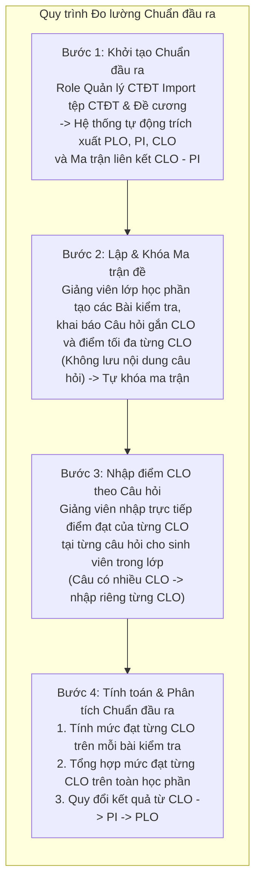

# Đặc tả Nghiệp vụ Hệ thống và Phương pháp Tính toán Mức độ Đạt Chuẩn đầu ra (CLO)

> **Mục đích tài liệu:** Trình bày luồng nghiệp vụ vận hành hệ thống và công thức toán học tính toán mức độ đạt chuẩn đầu ra học phần (CLO) trên từng bài kiểm tra và trên toàn học phần, phục vụ báo cáo và xin ý kiến xem xét của Giảng viên hướng dẫn (GVHD).  
> **Ngày lập:** 10/11/2026

---

## 1. Phạm vi và Nguyên tắc Nghiệp vụ Cốt lõi

Hệ thống được thiết kế chuyên biệt cho bài toán **Quản lý, đo lường và phân tích chuẩn đầu ra chương trình đào tạo (OBE — Outcome-Based Education)** theo 5 nguyên tắc cốt lõi:

1. **Khởi tạo dữ liệu chuẩn đầu ra bằng Import:** Một vai trò quản lý học thuật được cấp quyền (Quản lý Chương trình đào tạo / Giáo vụ Khoa) thực hiện **Import Chương trình đào tạo (CTĐT)** và **Import Đề cương chi tiết học phần** đã ban hành. Từ đó, hệ thống tự động trích xuất và lưu trữ toàn bộ **PLO**, **PI**, **CLO** cùng ma trận liên kết giữa chúng.
2. **Thiết lập Bài kiểm tra và Ma trận đề tại Lớp học phần:** Giảng viên phụ trách lớp học phần tạo các bài kiểm tra trong học kỳ, thiết lập **ma trận đề** (danh sách các câu hỏi gắn với các CLO và điểm tối đa của từng CLO trong mỗi câu hỏi), sau đó **tự khóa ma trận đề** để tiến hành nhập kết quả.
3. **Bảo mật đề thi — Không lưu nội dung câu hỏi:** Hệ thống **tuyệt đối không lưu nội dung câu hỏi, đề bài hay đáp án** dưới mọi hình thức nhằm loại bỏ nguy cơ lộ đề thi. Mỗi câu hỏi trong ma trận đề chỉ lưu nhãn định danh (ví dụ: `Câu 1`, `Câu 2`) và cấu trúc điểm tối đa theo từng CLO.
4. **Điểm CLO của từng câu hỏi do Giảng viên nhập trực tiếp (Không chia theo trọng số):**
   - Giảng viên **nhập trực tiếp điểm đạt của từng CLO tại từng câu hỏi**, không nhập điểm tổng của câu hỏi rồi chia theo tỷ lệ trọng số.
   - **Nếu 1 câu hỏi đánh giá nhiều CLO**, giảng viên quy định điểm tối đa riêng và **nhập điểm đạt riêng cho từng CLO của câu hỏi đó**.
5. **Chỉ đo lường Chuẩn đầu ra — Không đo kết quả bài kiểm tra hay điểm môn học:**
   - Hệ thống **không tính tổng điểm bài kiểm tra**, không xét đậu/rớt bài kiểm tra và không tính điểm tổng kết học vụ của môn học.
   - Hệ thống chỉ thực hiện đo lường chuẩn đầu ra:
     - **Mức độ đạt từng CLO trong phạm vi một bài kiểm tra**;
     - **Mức độ đạt từng CLO trên toàn học phần qua nhiều bài kiểm tra**; và
     - **Từ kết quả CLO toàn học phần suy ra mức độ đạt PI và PLO**.

---

## 2. Tổng quan Luồng Nghiệp vụ Hệ thống

---

## 3. Đặc tả Chi tiết Các Bước Nghiệp vụ

### 3.1. Phân quyền và Nghiệp vụ Import Chương trình Đào tạo & Đề cương Học phần

Vì văn bản Chương trình đào tạo (CTĐT) và Đề cương chi tiết học phần thực tế đã được Hội đồng Khoa và Bộ môn phê duyệt trước khi đưa vào giảng dạy, hệ thống tập trung quyền khởi tạo dữ liệu chuẩn đầu ra cho **một vai trò quản lý học thuật duy nhất (Quản lý CTĐT / Giáo vụ Khoa)** thông qua chức năng Import:

1. **Import Chương trình Đào tạo (CTĐT):**
   - Trích xuất thông tin chung của CTĐT và phiên bản áp dụng theo khóa tuyển sinh.
   - Trích xuất danh sách **Chuẩn đầu ra chương trình (PLO)**: mã PLO (`PLO1..PLOn`), nội dung mô tả, nhóm năng lực, trình độ năng lực yêu cầu.
   - Trích xuất danh sách **Chỉ số thực hiện (PI)** thuộc từng PLO: mã PI (`PI1.1..PIn.m`), nội dung mô tả, liên kết về PLO cha.
   - Trích xuất danh mục học phần trong CTĐT và ma trận mức độ đóng góp của từng học phần vào các PI (`I` — Giới thiệu, `R` — Củng cố, `M` — Thành thạo).

2. **Import Đề cương Chi tiết Học phần:**
   - Trích xuất thông tin phiên bản đề cương áp dụng cho học phần.
   - Trích xuất danh sách **Chuẩn đầu ra học phần (CLO)**: mã CLO (`CLO1..CLOk`), nội dung mô tả, mức nhận thức Bloom.
   - Trích xuất **Ma trận liên kết CLO – PI**: xác định mỗi CLO của học phần đóng góp trực tiếp vào những PI nào của CTĐT.
   - Trích xuất khung kế hoạch các bài kiểm tra/đánh giá dự kiến trong đề cương để làm mẫu gợi ý cho các lớp học phần.

---

### 3.2. Thiết lập Bài kiểm tra và Tự khóa Ma trận đề tại Lớp học phần

Trong mỗi học kỳ, học phần được mở thành các lớp học phần cụ thể. Giảng viên phụ trách lớp học phần thực hiện thiết lập các bài kiểm tra của lớp mình:

1. **Khởi tạo Bài kiểm tra:**
   - Giảng viên tạo các bài kiểm tra trong học kỳ (ví dụ: *Bài kiểm tra 1*, *Bài kiểm tra 2*, *Kiểm tra giữa kỳ*, *Thi cuối kỳ*).
   - Khai báo thông tin định danh bài kiểm tra: mã bài, tên bài, giai đoạn đánh giá (quá trình / giữa kỳ / cuối kỳ).

2. **Thiết lập Ma trận đề (`Câu hỏi × CLO`):**
   - Trong mỗi bài kiểm tra, giảng viên khai báo danh sách các câu hỏi (`Câu 1`, `Câu 2`, ..., `Câu K`).
   - **Không nhập và không lưu nội dung đề bài hay đáp án.**
   - Tại mỗi câu hỏi $k$, giảng viên gắn một hoặc nhiều chuẩn đầu ra $CLO_j$ mà câu hỏi đó đánh giá, đồng thời **nhập trực tiếp điểm tối đa của từng CLO trong câu hỏi đó** ($MaxScore_{p,k,j} > 0$):
     - *Trường hợp câu hỏi đánh giá 1 CLO:* Ví dụ `Câu 1` đánh giá `CLO1` với điểm tối đa là $2.0$ điểm.
     - *Trường hợp câu hỏi đánh giá nhiều CLO:* Ví dụ `Câu 4` đánh giá đồng thời `CLO2` và `CLO3`, giảng viên nhập riêng điểm tối đa cho phần `CLO2` (ví dụ $1.5$ điểm) và điểm tối đa cho phần `CLO3` (ví dụ $0.5$ điểm).

3. **Giảng viên tự khóa Ma trận đề:**
   - Sau khi kiểm tra đầy đủ danh sách câu hỏi và điểm tối đa của các CLO trong bài kiểm tra, **giảng viên chủ động bấm khóa (chốt) ma trận đề**.
   - Ngay sau khi khóa ma trận đề, hệ thống sinh biểu mẫu nhập điểm tương ứng và cho phép giảng viên nhập kết quả đạt CLO của bài kiểm tra đó (không cần chờ bước phê duyệt trung gian).

**Ví dụ minh họa Ma trận đề của một bài kiểm tra do Giảng viên thiết lập:**

| Câu hỏi | Các CLO được đánh giá trong câu hỏi | Điểm tối đa `CLO1` ($MaxScore_{k,CLO1}$) | Điểm tối đa `CLO2` ($MaxScore_{k,CLO2}$) | Điểm tối đa `CLO3` ($MaxScore_{k,CLO3}$) |
|:---:|:---|:---:|:---:|:---:|
| **Câu 1** | Đánh giá `CLO1` | **2.0 đ** | — | — |
| **Câu 2** | Đánh giá `CLO1` | **3.0 đ** | — | — |
| **Câu 3** | Đánh giá `CLO2` | — | **3.0 đ** | — |
| **Câu 4** | Đánh giá `CLO2` và `CLO3` *(thiết lập điểm riêng cho từng CLO)* | — | **1.5 đ** | **0.5 đ** |
| **Tổng điểm tối đa của từng CLO trong bài kiểm tra ($MaxScore_{p,j}$)** | | **$5.0$ đ** | **$4.5$ đ** | **$0.5$ đ** |

---

### 3.3. Nhập điểm đạt của từng CLO trên từng câu hỏi

Sau khi chấm bài, giảng viên nhập kết quả vào hệ thống (trực tiếp trên bảng lưới giao diện hoặc tải lên tệp Excel/CSV theo mẫu của ma trận đề đã khóa).

#### A. Nguyên tắc nhập điểm
- **Nhập trực tiếp theo từng CLO của từng câu hỏi:** Giảng viên nhập điểm đạt được của sinh viên cho từng CLO tại từng câu hỏi, không nhập một điểm chung cho cả câu hỏi rồi chia theo trọng số.
- **Xử lý câu hỏi có nhiều CLO:** Nếu một câu hỏi gắn với nhiều CLO (như `Câu 4` ở bảng trên gắn cả `CLO2` và `CLO3`), biểu mẫu nhập liệu sẽ hiển thị hai cột tách biệt:
  - Cột `Câu 4 — CLO2 (Tối đa 1.5 đ)`
  - Cột `Câu 4 — CLO3 (Tối đa 0.5 đ)`
  Giảng viên nhập riêng điểm mà sinh viên đạt được ở từng CLO của câu hỏi đó.
- **Lý do thực tiễn:** Trong một câu hỏi tự luận hoặc bài tập tổng hợp kiểm tra nhiều chuẩn đầu ra, sinh viên có thể làm đúng hoàn toàn ý thuộc `CLO2` (đạt $1.5 / 1.5$ đ) nhưng bỏ trống hoặc làm sai hoàn toàn ý thuộc `CLO3` (đạt $0.0 / 0.5$ đ). Việc giảng viên nhập riêng điểm từng CLO trong câu hỏi giúp kết quả đo lường phản ánh đúng thực chất năng lực của sinh viên, không bị hiện tượng lấy điểm của CLO này bù sang CLO khác như cách chia theo trọng số cố định.

#### B. Minh họa biểu mẫu nhập điểm của Giảng viên

| Mã sinh viên | Câu 1 — `CLO1` *(Tối đa 2.0 đ)* | Câu 2 — `CLO1` *(Tối đa 3.0 đ)* | Câu 3 — `CLO2` *(Tối đa 3.0 đ)* | Câu 4 — `CLO2` *(Tối đa 1.5 đ)* | Câu 4 — `CLO3` *(Tối đa 0.5 đ)* |
|:---:|:---:|:---:|:---:|:---:|:---:|
| `SV001` | `1.5` | `2.5` | `2.0` | `1.5` | `0.0` |
| `SV002` | `2.0` | `2.0` | `2.5` | `1.0` | `0.5` |

- **Ràng buộc kiểm tra dữ liệu đầu vào:**
  - Điểm nhập vào tại mỗi ô `(Câu hỏi k, CLO j)` phải nằm trong đoạn $[0, MaxScore_{p,k,j}]$.
  - Sinh viên có dự thi nhưng bỏ trống phần nội dung đó được ghi nhận bằng `0` điểm.
  - Sinh viên vắng thi hoặc được miễn thi được đánh dấu trạng thái riêng (`ABSENT` / `EXEMPT`), giá trị điểm để `null` (không tự động gán `0` điểm để tránh làm méo thống kê chuẩn đầu ra của lớp).
  - Biểu mẫu **không tính và không lưu tổng điểm bài kiểm tra**, vì hệ thống chỉ đo lường chuẩn đầu ra.

---

## 4. Phương pháp Tính toán Mức độ Đạt Chuẩn đầu ra (CLO)

### 4.1. Ký hiệu Toán học

Xét một lớp học phần trong học kỳ có $P$ bài kiểm tra $A_1, A_2, \dots, A_P$ và danh sách các chuẩn đầu ra học phần $CLO_1, CLO_2, \dots, CLO_M$:

- Tại bài kiểm tra $A_p$ ($p \in \{1, \dots, P\}$):
  - Gọi $K_p(CLO_j)$ là tập hợp các câu hỏi trong bài kiểm tra $A_p$ có đánh giá chuẩn đầu ra $CLO_j$.
  - Với mỗi câu hỏi $k \in K_p(CLO_j)$:
    - $MaxScore_{p,k,j} > 0$: Điểm tối đa của $CLO_j$ tại câu hỏi $k$ (do giảng viên thiết lập trên ma trận đề).
    - $Score_{s,p,k,j} \in [0, MaxScore_{p,k,j}]$: Điểm đạt $CLO_j$ của sinh viên $s$ tại câu hỏi $k$ (**do giảng viên nhập trực tiếp**).
  - Tổng điểm tối đa của $CLO_j$ trong bài kiểm tra $A_p$:
    $$MaxScore_{p,j} = \sum_{k \in K_p(CLO_j)} MaxScore_{p,k,j}$$
  - Tổng điểm mà sinh viên $s$ đạt được cho $CLO_j$ trong bài kiểm tra $A_p$:
    $$Score_{s,p,j} = \sum_{k \in K_p(CLO_j)} Score_{s,p,k,j}$$
- Gọi $P(CLO_j)$ là tập hợp các bài kiểm tra trong học phần có đánh giá $CLO_j$ (tức các bài kiểm tra $A_p$ có $MaxScore_{p,j} > 0$).
- Gọi $\text{PassThreshold}(CLO_j) \in (0, 1]$ là ngưỡng điểm chuẩn hóa để một sinh viên được công nhận là **Đạt** chuẩn đầu ra $CLO_j$ (ví dụ: $0.60$ tương ứng $60\%$, được cấu hình theo quy định của Khoa/Chương trình đào tạo).

---

### 4.2. Cấp độ 1: Tính mức độ đạt các CLO trên MỘT bài kiểm tra ($A_p$)

Với mỗi chuẩn đầu ra $CLO_j$ xuất hiện trong ma trận đề của bài kiểm tra $A_p$ ($p \in P(CLO_j)$):

#### 1. Mức độ đạt $CLO_j$ của từng sinh viên $s$ trên bài kiểm tra $A_p$
Mức độ đạt $CLO_j$ của sinh viên $s$ trong bài kiểm tra $A_p$ là tỷ số giữa tổng điểm sinh viên đạt được ở các mục thuộc $CLO_j$ và tổng điểm tối đa của $CLO_j$ trong bài kiểm tra đó:

$$CLO_{s,p,j} = \frac{Score_{s,p,j}}{MaxScore_{p,j}} = \frac{\sum_{k \in K_p(CLO_j)} Score_{s,p,k,j}}{\sum_{k \in K_p(CLO_j)} MaxScore_{p,k,j}} \in [0, 1]$$

*(Trường hợp cần xem chi tiết mức độ đạt $CLO_j$ tại từng câu hỏi đơn lẻ $k \in K_p(CLO_j)$, tỷ lệ đạt tại câu $k$ là $r_{s,p,k,j} = \frac{Score_{s,p,k,j}}{MaxScore_{p,k,j}} \in [0, 1]$).*

#### 2. Đánh giá và Thống kê mức độ đạt $CLO_j$ của Lớp học phần trên bài kiểm tra $A_p$
Gọi $N_{\text{evaluable},p,j}$ là số sinh viên trong lớp có dữ liệu điểm hợp lệ đối với $CLO_j$ ở bài kiểm tra $A_p$:

1. **Kết luận đạt / chưa đạt $CLO_j$ cho từng sinh viên $s$ ở bài kiểm tra $A_p$:**
   $$\text{Passed}(CLO_{s,p,j}) = \begin{cases} \text{Đạt (true)} & \text{nếu } CLO_{s,p,j} \ge \text{PassThreshold}(CLO_j) \\ \text{Chưa đạt (false)} & \text{nếu } CLO_{s,p,j} < \text{PassThreshold}(CLO_j) \end{cases}$$

2. **Mức độ đạt $CLO_j$ trung bình của cả lớp trên bài kiểm tra $A_p$:**
   $$\overline{CLO}_{p,j} = \frac{1}{N_{\text{evaluable},p,j}} \sum_{s=1}^{N_{\text{evaluable},p,j}} CLO_{s,p,j}$$

3. **Tỷ lệ phần trăm sinh viên đạt chuẩn $CLO_j$ trên bài kiểm tra $A_p$:**
   $$\text{PassRate}_{p,j} = \frac{\text{Số sinh viên có } CLO_{s,p,j} \ge \text{PassThreshold}(CLO_j)}{N_{\text{evaluable},p,j}} \times 100\%$$

> **Lưu ý:** Nếu bài kiểm tra $A_p$ đánh giá 3 chuẩn đầu ra (`CLO1`, `CLO2`, `CLO3`), hệ thống trả về **3 chỉ số mức độ đạt độc lập cho `CLO1`, `CLO2`, `CLO3`**, không gộp chung thành điểm kết quả của bài kiểm tra $A_p$.

---

### 4.3. Cấp độ 2: Tính mức độ đạt các CLO trên TOÀN HỌC PHẦN qua nhiều bài kiểm tra ($A_1, \dots, A_P$)

Khi kết thúc các bài kiểm tra trong học kỳ, mức độ đạt của mỗi chuẩn đầu ra $CLO_j$ trên **toàn học phần** được tổng hợp từ tất cả các bài kiểm tra $p \in P(CLO_j)$ có đánh giá $CLO_j$ đó:

#### 1. Mức độ đạt $CLO_j$ trên toàn học phần của từng sinh viên $s$
Mức độ đạt $CLO_j$ toàn học phần của sinh viên $s$ bằng **tổng điểm sinh viên đạt được cho $CLO_j$ qua tất cả các bài kiểm tra** chia cho **tổng điểm tối đa của $CLO_j$ qua tất cả các bài kiểm tra** trong học phần:

$$Value(CLO_{s,j}) = \frac{\sum_{p \in P(CLO_j)} Score_{s,p,j}}{\sum_{p \in P(CLO_j)} MaxScore_{p,j}} = \frac{\sum_{p \in P(CLO_j)} \sum_{k \in K_p(CLO_j)} Score_{s,p,k,j}}{\sum_{p \in P(CLO_j)} \sum_{k \in K_p(CLO_j)} MaxScore_{p,k,j}} \in [0, 1]$$

- **Mối liên hệ trực tiếp với kết quả CLO của từng bài kiểm tra ($CLO_{s,p,j}$):**
  Vì tại mỗi bài kiểm tra $A_p$, ta có $Score_{s,p,j} = MaxScore_{p,j} \times CLO_{s,p,j}$, nên công thức trên hoàn toàn tương đương với trung bình có trọng số của các $CLO_{s,p,j}$ theo tổng điểm tối đa $MaxScore_{p,j}$ mà mỗi bài kiểm tra phân bổ cho $CLO_j$:
  $$Value(CLO_{s,j}) = \frac{\sum_{p \in P(CLO_j)} MaxScore_{p,j} \times CLO_{s,p,j}}{\sum_{p \in P(CLO_j)} MaxScore_{p,j}}$$

#### 2. Đánh giá và Thống kê mức độ đạt $CLO_j$ toàn học phần của Lớp học phần
Gọi $N_{\text{evaluable},j}$ là số sinh viên đủ dữ liệu đánh giá $CLO_j$ cấp học phần:

1. **Kết luận đạt / chưa đạt $CLO_j$ toàn học phần cho từng sinh viên $s$:**
   $$\text{Passed}(CLO_{s,j}) = \begin{cases} \text{Đạt (true)} & \text{nếu } Value(CLO_{s,j}) \ge \text{PassThreshold}(CLO_j) \\ \text{Chưa đạt (false)} & \text{nếu } Value(CLO_{s,j}) < \text{PassThreshold}(CLO_j) \end{cases}$$

2. **Mức độ đạt $CLO_j$ trung bình của lớp trên toàn học phần:**
   $$\overline{CLO}_{j} = \frac{1}{N_{\text{evaluable},j}} \sum_{s=1}^{N_{\text{evaluable},j}} Value(CLO_{s,j})$$

3. **Tỷ lệ phần trăm sinh viên đạt chuẩn $CLO_j$ toàn học phần:**
   $$\text{PassRate}_{j} = \frac{\text{Số sinh viên có } Value(CLO_{s,j}) \ge \text{PassThreshold}(CLO_j)}{N_{\text{evaluable},j}} \times 100\%$$

*(Từ kết quả $Value(CLO_{s,j})$ cấp học phần này, hệ thống tiếp tục ánh xạ qua ma trận liên kết `CLO – PI` đã được Import ở Bước 1 để tính mức độ đạt **PI** và **PLO** của chương trình đào tạo).*

---

### 4.4. Quy tắc xử lý các trường hợp biên khi tính toán

| Tình huống thực tế | Quy tắc xử lý |
|---|---|
| **1. Sinh viên dự thi nhưng bỏ trống phần câu hỏi thuộc $CLO_j$** | Điểm đạt của phần đó bằng `0` ($Score_{s,p,k,j} = 0$), điểm tối đa $MaxScore_{p,k,j}$ vẫn giữ nguyên ở mẫu số. |
| **2. Sinh viên vắng thi có phép/không phép hoặc chưa có điểm ở một bài kiểm tra** | Dữ liệu được ghi nhận là thiếu (`null`), không tự động gán bằng `0`. Nếu sinh viên thiếu dữ liệu vượt quá ngưỡng cho phép thì trạng thái $CLO_j$ của sinh viên đó được đánh dấu là *Chưa đủ dữ liệu đánh giá* và không đưa vào mẫu số $N_{\text{evaluable}}$ để tránh làm sai lệch tỷ lệ đạt chung của lớp. |
| **3. Một $CLO_j$ có trong Đề cương nhưng chưa được gắn vào bất kỳ câu hỏi nào** | Mẫu số $\sum MaxScore_{p,j} = 0 \implies$ hệ thống không thực hiện phép chia cho $0$, trả về trạng thái *Chưa được đánh giá* và hiển thị cảnh báo độ phủ ma trận đề cho giảng viên. |

---

## 5. Ví dụ Minh họa Tính toán Chi tiết (Worked Example)

*(Lưu ý: Các con số dưới đây là dữ liệu giả định nhằm minh họa trực quan các bước tính toán của hệ thống).*

### 5.1. Thiết lập Ma trận đề của 3 Bài kiểm tra trong Học phần
Giả sử học phần có 3 chuẩn đầu ra: `CLO1`, `CLO2`, `CLO3` với ngưỡng đạt cấu hình là $\text{PassThreshold} = 0.60$ ($60\%$).  
Trong học kỳ, giảng viên tạo và khóa ma trận đề cho **3 bài kiểm tra** ($A_1, A_2, A_3$) như sau:

1. **Bài kiểm tra 1 ($A_1$):**
   - **Câu 1:** đánh giá `CLO1` — tối đa **4.0 đ**
   - **Câu 2:** đánh giá `CLO1` — tối đa **6.0 đ**
   - $\implies$ Tổng điểm tối đa trong bài $A_1$: $MaxScore_{1,CLO1} = 4.0 + 6.0 = \mathbf{10.0}$ **đ** *(không đánh giá `CLO2`, `CLO3`)*.

2. **Bài kiểm tra 2 ($A_2$):**
   - **Câu 1:** đánh giá `CLO1` — tối đa **5.0 đ**
   - **Câu 2:** đánh giá `CLO2` — tối đa **5.0 đ**
   - $\implies$ Tổng điểm tối đa trong bài $A_2$: $MaxScore_{2,CLO1} = \mathbf{5.0}$ **đ**; $MaxScore_{2,CLO2} = \mathbf{5.0}$ **đ** *(không đánh giá `CLO3`)*.

3. **Bài kiểm tra 3 ($A_3$):**
   - **Câu 1:** đánh giá `CLO1` — tối đa **2.0 đ**
   - **Câu 2:** đánh giá `CLO2` — tối đa **4.0 đ**
   - **Câu 3** *(Câu hỏi đánh giá nhiều CLO — giảng viên quy định điểm tối đa riêng cho từng CLO)*:
     - Phần `CLO2` của Câu 3: tối đa **2.0 đ**
     - Phần `CLO3` của Câu 3: tối đa **2.0 đ**
   - $\implies$ Tổng điểm tối đa trong bài $A_3$:
     - $MaxScore_{3,CLO1} = \mathbf{2.0}$ **đ**
     - $MaxScore_{3,CLO2} = 4.0 + 2.0 = \mathbf{6.0}$ **đ**
     - $MaxScore_{3,CLO3} = \mathbf{2.0}$ **đ**

---

### 5.2. Giảng viên nhập điểm CLO từng câu và Hệ thống tính mức đạt CLO trên TỪNG bài kiểm tra (Cấp độ 1)

Giả sử đối với sinh viên $s$, giảng viên nhập điểm đạt của từng CLO ở từng câu hỏi như bảng dưới đây *(lưu ý tại Bài $A_3$ – Câu 3, giảng viên nhập riêng điểm đạt của `CLO2` là $1.6$ đ và điểm đạt của `CLO3` là $1.2$ đ)*:

| Bài kiểm tra | Câu hỏi & CLO | Điểm tối đa của CLO tại câu hỏi ($MaxScore_{p,k,j}$) | Điểm CLO do Giảng viên nhập ($Score_{s,p,k,j}$) | Tổng điểm CLO đạt / tối đa trong bài ($Score_{s,p,j} / MaxScore_{p,j}$) | **Mức độ đạt từng CLO trên bài kiểm tra ($CLO_{s,p,j}$)** |
|---|---|---:|---:|---|---|
| **Bài $A_1$** | Câu 1 — `CLO1` Câu 2 — `CLO1` | 4.0 6.0 | **3.0** **5.0** | `CLO1`: $(3.0 + 5.0) / (4.0 + 6.0) = 8.0 / 10.0$ | $\bullet\ \mathbf{CLO_{s,1,CLO1}} = \frac{8.0}{10.0} = \mathbf{0.8000}\ (80.00\% \implies \text{Đạt})$ |
| **Bài $A_2$** | Câu 1 — `CLO1` Câu 2 — `CLO2` | 5.0 5.0 | **3.5** **2.5** | `CLO1`: $3.5 / 5.0$ `CLO2`: $2.5 / 5.0$ | $\bullet\ \mathbf{CLO_{s,2,CLO1}} = \frac{3.5}{5.0} = \mathbf{0.7000}\ (70.00\% \implies \text{Đạt})$ $\bullet\ \mathbf{CLO_{s,2,CLO2}} = \frac{2.5}{5.0} = \mathbf{0.5000}\ (50.00\% \implies \text{Chưa đạt})$ |
| **Bài $A_3$** | Câu 1 — `CLO1` Câu 2 — `CLO2` Câu 3 — `CLO2` Câu 3 — `CLO3` | 2.0 4.0 2.0 2.0 | **1.0** **3.2** **1.6** **1.2** | `CLO1`: $1.0 / 2.0$ `CLO2`: $(3.2 + 1.6) / (4.0 + 2.0) = 4.8 / 6.0$ `CLO3`: $1.2 / 2.0$ | $\bullet\ \mathbf{CLO_{s,3,CLO1}} = \frac{1.0}{2.0} = \mathbf{0.5000}\ (50.00\% \implies \text{Chưa đạt})$ $\bullet\ \mathbf{CLO_{s,3,CLO2}} = \frac{4.8}{6.0} = \mathbf{0.8000}\ (80.00\% \implies \text{Đạt})$ $\bullet\ \mathbf{CLO_{s,3,CLO3}} = \frac{1.2}{2.0} = \mathbf{0.6000}\ (60.00\% \implies \text{Đạt})$ |

---

### 5.3. Hệ thống tổng hợp mức đạt từng CLO trên TOÀN HỌC PHẦN qua 3 bài kiểm tra (Cấp độ 2)

Áp dụng công thức Mục 4.3 cho toàn bộ học phần:

1. **Đối với `CLO1`** (được đánh giá ở cả 3 bài kiểm tra $A_1, A_2, A_3$):
   - Tổng điểm `CLO1` sinh viên đạt được: $Score_{s,1,CLO1} + Score_{s,2,CLO1} + Score_{s,3,CLO1} = 8.0 + 3.5 + 1.0 = \mathbf{12.5}$ **đ**
   - Tổng điểm tối đa của `CLO1` toàn học phần: $MaxScore_{1,CLO1} + MaxScore_{2,CLO1} + MaxScore_{3,CLO1} = 10.0 + 5.0 + 2.0 = \mathbf{17.0}$ **đ**
   - **Mức độ đạt `CLO1` toàn học phần:**
     $$Value(CLO_{s,CLO1}) = \frac{12.5}{17.0} \approx \mathbf{0.7353}\ (73.53\% \ge 60\% \implies \mathbf{ĐẠT})$$

2. **Đối với `CLO2`** (được đánh giá ở 2 bài kiểm tra $A_2, A_3$):
   - Tổng điểm `CLO2` sinh viên đạt được: $Score_{s,2,CLO2} + Score_{s,3,CLO2} = 2.5 + 4.8 = \mathbf{7.3}$ **đ**
   - Tổng điểm tối đa của `CLO2` toàn học phần: $MaxScore_{2,CLO2} + MaxScore_{3,CLO2} = 5.0 + 6.0 = \mathbf{11.0}$ **đ**
   - **Mức độ đạt `CLO2` toàn học phần:**
     $$Value(CLO_{s,CLO2}) = \frac{7.3}{11.0} \approx \mathbf{0.6636}\ (66.36\% \ge 60\% \implies \mathbf{ĐẠT})$$

3. **Đối với `CLO3`** (được đánh giá ở bài kiểm tra $A_3$):
   - Tổng điểm `CLO3` sinh viên đạt được: $Score_{s,3,CLO3} = \mathbf{1.2}$ **đ**
   - Tổng điểm tối đa của `CLO3` toàn học phần: $MaxScore_{3,CLO3} = \mathbf{2.0}$ **đ**
   - **Mức độ đạt `CLO3` toàn học phần:**
     $$Value(CLO_{s,CLO3}) = \frac{1.2}{2.0} = \mathbf{0.6000}\ (60.00\% \ge 60\% \implies \mathbf{ĐẠT})$$

---

### 5.4. Bảng tổng hợp kết quả đầu ra của Hệ thống cho Sinh viên $s$

| Chuẩn đầu ra học phần | Kết quả tại Bài 1 ($A_1$) | Kết quả tại Bài 2 ($A_2$) | Kết quả tại Bài 3 ($A_3$) | **Kết quả tổng hợp Toàn học phần** | **Kết luận Chuẩn đầu ra (Ngưỡng 60%)** |
|:---:|:---:|:---:|:---:|:---:|:---:|
| **`CLO1`** | $8.0 / 10.0$ (**80.00%**) | $3.5 / 5.0$ (**70.00%**) | $1.0 / 2.0$ (**50.00%**) | $12.5 / 17.0$ = **73.53%** | **ĐẠT** |
| **`CLO2`** | *Không đánh giá* | $2.5 / 5.0$ (**50.00%**) | $4.8 / 6.0$ (**80.00%**) | $7.3 / 11.0$ = **66.36%** | **ĐẠT** |
| **`CLO3`** | *Không đánh giá* | *Không đánh giá* | $1.2 / 2.0$ (**60.00%**) | $1.2 / 2.0$ = **60.00%** | **ĐẠT** |
