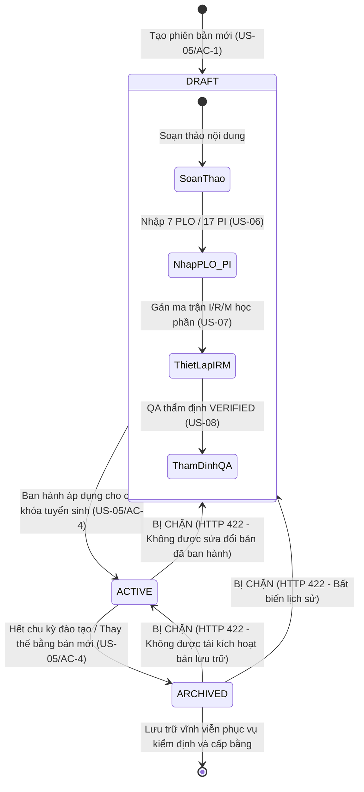

# Hồ Sơ Vấn Đáp Bảo Vệ Đồ Án Tốt Nghiệp — Phân Hệ F02: Chương Trình Đào Tạo, PLO, PI và Ma Trận I/R/M (LMS-API)

**Đề tài:** Hệ thống quản lý, đo lường và phân tích chuẩn đầu ra chương trình đào tạo (Learning Outcomes Management and Analytics System)  
**Phân hệ:** F02 — Quản lý Chương trình đào tạo (CTĐT), Phiên bản CTĐT, 7 PLO, 17 PI, Ma trận đóng góp I/R/M và Quy trình thẩm định chất lượng QA (US-05, US-06, US-07, US-08)  
**Tài liệu liên quan:** `doc/plan/F02-ctdt-plo-pi.md`, `doc/adr/0002-nen-tang-chung-step-00.md`, `doc/adr/0004-qa-xac-nhan-ctdt-plo.md`, `doc/GiaiThich_CoSoDuLieu.md` (§4.2–4.8, §7, §8), `doc/PLO_DB_UPDATE.md`, `LMS-UI/doc/API-CONTRACT.md`  
**Nhóm sinh viên thực hiện:** Sinh viên Công nghệ thông tin (IT) & Sinh viên Kinh doanh số (IBS)

---

## Bối Cảnh và Mục Đích Tài Liệu

Tài liệu này chuẩn bị bộ câu hỏi và câu trả lời học thuật chuyên sâu phục vụ buổi bảo vệ Đồ án tốt nghiệp trước Hội đồng đánh giá khoa học. Nội dung được cấu trúc song song theo hai góc nhìn bổ trợ mật thiết cho nhau:
- **Góc nhìn Sinh viên chuyên ngành Công nghệ thông tin (IT):** Tập trung vào kiến trúc phần mềm 3 tầng (Layered Architecture - ADR 0002), tính bất biến dữ liệu lịch sử (Data Immutability & Historical Integrity), toàn vẹn tham chiếu phi quan hệ (NoSQL Referential Integrity), thiết kế API chuẩn RESTful HTTP semantics, kiểm soát truy cập theo phạm vi chương trình (`canAccessProgram`), và bảo đảm an toàn dữ liệu qua cơ chế Restrict Delete.
- **Góc nhìn Sinh viên chuyên ngành Kinh doanh số (IBS):** Tập trung vào triết lý Giáo dục dựa trên chuẩn đầu ra (Outcome-Based Education - OBE), bộ tiêu chuẩn kiểm định chất lượng giáo dục đại học quốc tế (AUN-QA Tiêu chí 1, ABET Tiêu chí 3/Student Outcomes), quản lý vòng đời chương trình đào tạo (Curriculum Version Lifecycle), ma trận thiết kế sư phạm tích hợp CDIO (I/R/M), và nguyên tắc kiểm định độc lập tách biệt thẩm quyền (Four-Eyes Principle / Separation of Duties).

---

## Câu Hỏi 1: Bạn đã làm gì trong phân hệ F02 (CTĐT, PLO, PI và Ma Trận I/R/M)? (What did you do?)

### Trả lời — Góc nhìn Sinh viên Công nghệ thông tin (IT):

Trong phân hệ F02, nhóm phát triển IT đã thiết kế và hiện thực toàn bộ nền tảng quản lý chuẩn đầu ra cấp chương trình theo chuẩn kiến trúc ADR 0002 (package-by-layer ở cấp gốc `com.hcmute.lms.lmsapi`), hoàn thành 4 User Story cốt lõi (US-05, US-06, US-07, US-08):

1. **Quản lý danh mục Chương trình đào tạo và Phiên bản CTĐT (US-05):**
   - Thiết kế 2 thực thể MongoDB tách biệt: [Program.java](file:///D:/Code/Project/LMS-API/src/main/java/com/hcmute/lms/lmsapi/document/Program.java) (ngành đào tạo) và [ProgramVersion.java](file:///D:/Code/Project/LMS-API/src/main/java/com/hcmute/lms/lmsapi/document/ProgramVersion.java) (phiên bản áp dụng theo khóa).
   - Thiết lập chỉ mục duy nhất: `programs.code` (Unique), và `@CompoundIndex` trên `(programId, version)` của collection `program_versions`.
   - Xây dựng máy trạng thái hữu hạn một chiều bất biến: `DRAFT` $\to$ `ACTIVE` $\to$ `ARCHIVED`. Nghiêm cấm chuyển trạng thái ngược chiều hoặc kích hoạt lại bản đã lưu trữ (HTTP 422 `PROGRAM_VERSION_STATUS_INVALID`).
   - Xây dựng các endpoint RESTful chuẩn: `GET /api/v1/programs`, `POST /api/v1/programs`, `GET /api/v1/program-versions`, `POST /api/v1/program-versions`, `PUT /api/v1/program-versions/{id}/status`.

2. **Quản trị Chuẩn đầu ra chương trình (PLO) và Chỉ số đo lường hiệu năng (PI) (US-06):**
   - Thiết kế thực thể [Plo.java](file:///D:/Code/Project/LMS-API/src/main/java/com/hcmute/lms/lmsapi/document/Plo.java) và [Pi.java](file:///D:/Code/Project/LMS-API/src/main/java/com/hcmute/lms/lmsapi/document/Pi.java) với chỉ mục phức hợp duy nhất theo phiên bản: `(programVersionId, code)`.
   - Xác thực định dạng mã nghiêm ngặt bằng Regular Expression: `^PLO[1-9][0-9]*$` cho PLO (chặn các mã sai như `PLO0`, `plo1`, `PLO01`) và `^PI[1-9][0-9]*\.[1-9][0-9]*$` cho PI (chặn `PI1.0`, `PI01.1`), trả về HTTP 400 chuẩn RFC.
   - Tách rời hoàn toàn khóa định danh nghiệp vụ (`code`) khỏi thứ tự hiển thị giao diện (`displayOrder`): Cho phép sắp xếp danh sách theo `displayOrder ASC` đáp ứng đúng tài liệu CTĐT thực tế.
   - Ràng buộc toàn vẹn quan hệ giữa PI và PLO: Kiểm tra `pi.ploId` phải thuộc về chính `programVersionId` của phiên bản đó trước khi lưu (HTTP 422 `PI_PLO_MISMATCH`).
   - Cơ chế bảo vệ dữ liệu chống xóa nhầm (Restrict Delete): Chặn xóa PLO khi vẫn còn PI tham chiếu (HTTP 422 `PLO_HAS_PIS`).

3. **Thiết lập Ma trận Học phần đóng góp vào PI (Ma trận I/R/M) (US-07):**
   - Thiết kế thực thể [CoursePiContribution.java](file:///D:/Code/Project/LMS-API/src/main/java/com/hcmute/lms/lmsapi/document/CoursePiContribution.java) với chỉ mục phức hợp 3 trường duy nhất: `(programVersionId, courseId, piId)`.
   - Bắt buộc kiểm tra tham chiếu ở tầng nghiệp vụ: `courseId` và `piId` phải cùng thuộc về đúng `programVersionId` trước khi thiết lập quan hệ.
   - Định nghĩa kiểu đóng góp bằng Enum [PiContributionType.java](file:///D:/Code/Project/LMS-API/src/main/java/com/hcmute/lms/lmsapi/enums/PiContributionType.java) gồm 3 giá trị định tính: `I` (Introduce), `R` (Reinforce), `M` (Master). Tuyệt đối không sinh trường trọng số số học trong DTO hay CSDL.

4. **Quy trình Thẩm định chất lượng độc lập của Chuyên viên QA (US-08 - ADR 0004):**
   - Mở rộng [ScopeAuthorizationService.java](file:///D:/Code/Project/LMS-API/src/main/java/com/hcmute/lms/lmsapi/service/ScopeAuthorizationService.java) với phương thức `canAccessProgram(principal, programId)` theo cơ chế fail-closed: Chuyên viên QA chỉ được thẩm định các CTĐT nằm trong danh sách `scope.programIds` được phân công.
   - Phân quyền chặt chẽ các endpoint thẩm định (`PUT /api/v1/program-versions/{id}/verification`, `PUT .../plos/{id}/verification`, `PUT .../pis/{id}/verification`): Chỉ tài khoản có vai trò `QA_OFFICER` đúng scope mới được thực hiện; `PROGRAM_MANAGER` và `ADMIN` đều bị từ chối bằng HTTP 403 `FORBIDDEN`.
   - Tự động ghi nhận định danh người duyệt (`verifiedBy = principal.id`) và mốc thời gian thẩm định (`verifiedAt = Instant.now()`).

5. **Bộ kiểm thử tự động toàn diện (Integration & Unit Testing):**
   - Xây dựng bộ kiểm thử tích hợp thực tế [ProgramIntegrationTest.java](file:///D:/Code/Project/LMS-API/src/test/java/com/hcmute/lms/lmsapi/controller/ProgramIntegrationTest.java) chạy trực tiếp trên MongoDB Replica Set (`rs0`), kiểm chứng trọn vẹn toàn bộ các luồng: RBAC, Scope authorization, vòng đời chuyển trạng thái, mã trùng lặp, schema validation, và dọn dẹp dữ liệu cách ly (`tearDown()`).
   - Đạt 100% ngưỡng kiểm định chất lượng mã nguồn (JaCoCo Line Coverage $\ge 70\%$, 496/496 tests passed).

---

### Trả lời — Góc nhìn Sinh viên Kinh doanh số (IBS):

Trong phân hệ F02, nhóm IBS tập trung vào việc thiết kế cấu trúc dữ liệu học thuật chuẩn mực, đáp ứng đầy đủ các tiêu chuẩn kiểm định chất lượng đào tạo đại học và chuẩn hóa quy trình vận hành CTĐT:

1. **Chuẩn hóa Khung chuẩn đầu ra cấp Chương trình theo mô hình OBE (Outcome-Based Education):**
   - Triết lý OBE yêu cầu mọi hoạt động dạy và học phải bắt đầu từ kết quả đầu ra mong đợi (Constructive Alignment).
   - Nhóm đã số hóa bộ khung 7 PLO (Program Learning Outcomes) và 17 PI (Performance Indicators) của ngành Công nghệ thông tin theo cấu trúc chuẩn: từ các chuẩn năng lực chung (kiến thức nền tảng, tư duy phản biện, kỹ năng mềm) đến các chuẩn năng lực chuyên sâu (phân tích yêu cầu, thiết kế hệ thống, kiểm thử và chuyển giao phần mềm).
   - Mỗi PI được lượng hóa rõ ràng với mức độ năng lực mục tiêu (`capabilityLevelRaw` 1–6) và tỷ lệ sinh viên đạt yêu cầu tối thiểu (`targetPassRate`).

2. **Quản lý Vòng đời CTĐT và Bảo đảm Tính Pháp lý của Văn bằng (Curriculum Lifecycle):**
   - Phân định rõ ràng giữa **Ngành đào tạo** (`Program` — danh mục quản lý hành chính dài hạn theo giấy phép mở ngành của Bộ GD&ĐT) và **Phiên bản CTĐT** (`ProgramVersion` — bản thiết kế chi tiết áp dụng cho từng khóa sinh viên cụ thể qua trường `applicableCohorts`).
   - Thiết lập quy trình bất biến: CTĐT khi đang soạn thảo ở trạng thái `DRAFT`. Khi được ban hành áp dụng cho các khóa nhập học thì chuyển sang `ACTIVE`. Khi chương trình hết chu kỳ và được thay thế bằng phiên bản mới thì chuyển sang `ARCHIVED`. Bản `ARCHIVED` được bảo tồn vĩnh viễn để phục vụ việc cấp bảng điểm, đối chiếu chuẩn đầu ra và giải trình với đoàn kiểm định khi cựu sinh viên ra trường.

3. **Thiết kế Tiến trình Sư phạm theo Khung chuẩn Kỹ thuật CDIO (Ma trận I/R/M):**
   - Ma trận I/R/M là công cụ sư phạm cốt lõi chứng minh tính gắn kết của chương trình đào tạo với chuẩn đầu ra:
     - **I (Introduce):** Học phần giới thiệu khái niệm, kiến thức nền tảng ban đầu của PI.
     - **R (Reinforce):** Học phần củng cố, rèn luyện kỹ năng thực hành và nâng cao năng lực cho PI.
     - **M (Master):** Học phần chuyên sâu/đồ án tốt nghiệp nơi sinh viên thể hiện sự làm chủ hoàn toàn chuẩn đầu ra.
   - Ma trận này giúp Ban chủ nhiệm khoa phát hiện ngay các "lỗ hổng chuẩn đầu ra" (ví dụ: một PI không có môn nào đảm nhận vai trò M, hoặc sinh viên học môn M trước khi có môn I).

4. **Thiết lập Quy trình Kiểm soát Chất lượng Nội bộ Độc lập (ADR 0004 — Nguyên tắc Bốn Mắt):**
   - Trong quản trị chất lượng đại học (IQA), người xây dựng CTĐT không được phép tự thẩm định và phê duyệt sản phẩm của chính mình.
   - Phân hệ F02 thiết lập cơ chế phân quyền độc lập: Trưởng chương trình (`PROGRAM_MANAGER`) chịu trách nhiệm xây dựng nội dung chuyên môn, trong khi Chuyên viên Đảm bảo chất lượng (`QA_OFFICER`) độc lập rà soát tính tương thích với tiêu chuẩn kiểm định AUN-QA/ABET, sau đó mới xác nhận (`VERIFIED`). Quản trị viên kỹ thuật (`ADMIN`) tuyệt đối không được can thiệp vào nghiệp vụ thẩm định học thuật này.

---

## Câu Hỏi 2: Vì sao phần này có mặt và đóng vai trò gì trong đề tài đo lường chuẩn đầu ra? (Why in thesis?)

### Trả lời — Góc nhìn Sinh viên Công nghệ thông tin (IT):

1. **Đóng vai trò là "Khung tọa độ tham chiếu gốc" (Immutable Reference Anchor) cho toàn bộ hệ thống:**
   - Một hệ thống đo lường chuẩn đầu ra không thể tính toán nếu không có các mốc chuẩn tham chiếu. Toàn bộ các phân hệ tiếp theo:
     - F03 (Đề cương môn học & CLO) cần liên kết `clo_pi_links` trỏ vào `piId` và `programVersionId`.
     - F04 (Ngân hàng câu hỏi & Bài đánh giá) cần ánh xạ từng câu hỏi thi `outcomeMappings` về đúng cặp `(cloId, piId)`.
     - F05 & F06 (Nhập điểm & Công cụ tính toán đo lường) cần tập hợp toàn bộ điểm số của sinh viên để tổng hợp lên mức độ đạt của từng PI và PLO theo đúng phiên bản CTĐT mà sinh viên đó theo học.
   - Nếu không có F02 làm nền móng vững chắc, mọi dữ liệu đo lường ở F03–F06 đều trở thành dữ liệu "vô thừa nhận" (unanchored data), không thể xác định được sinh viên đang được đo lường theo tiêu chuẩn nào.

2. **Bảo toàn Tính toàn vẹn Dữ liệu Lịch sử (Historical Data Integrity & Prevention of Data Drift):**
   - Trong quá trình vận hành đại học, CTĐT liên tục được cải tiến sau mỗi chu kỳ 2–4 năm (bổ sung PI mới, thay đổi môn học đóng góp I/R/M).
   - Nhờ thiết kế tách riêng `ProgramVersion`, các kết quả đo lường và báo cáo kiểm định của các khóa sinh viên cũ (ví dụ: Khóa 2022) vẫn được giữ nguyên vẹn 100%, không bị ảnh hưởng hay làm biến dạng khi Khoa ban hành phiên bản CTĐT mới cho Khóa 2026.

3. **Thiết lập Đường ống Truy vết Độc lập (Traceability & Auditability):**
   - Mỗi bản ghi kết quả đo lường đều gắn chặt với `programVersionId`. Khi cần phúc khảo hoặc giải trình kiểm định, hệ thống có thể truy vết ngược từ kết quả đo lường của sinh viên $\to$ PI/PLO được đo $\to$ trạng thái thẩm định `verification` $\to$ người thẩm định (`verifiedBy`) và thời điểm thẩm định (`verifiedAt`).

---

### Trả lời — Góc nhìn Sinh viên Kinh doanh số (IBS):

1. **Đáp ứng trực tiếp các Tiêu chuẩn Kiểm định Quốc tế (AUN-QA & ABET):**
   - **AUN-QA (Bộ tiêu chuẩn phiên bản 4.0 — Tiêu chí 1: Expected Learning Outcomes):** Yêu cầu CTĐT phải có chuẩn đầu ra rõ ràng, được phân rã thành các chỉ số đo lường cụ thể (PI), được phổ biến công khai và có sự tham gia của các bên liên quan.
   - **ABET (Tiêu chí 3: Student Outcomes):** Yêu cầu chương trình đào tạo phải có hệ thống chuẩn đầu ra phản ánh đầy đủ kiến thức, kỹ năng và thái độ của sinh viên khi tốt nghiệp, đồng thời phải chứng minh được các chuẩn đầu ra này được giảng dạy và rèn luyện thông qua các môn học (thể hiện qua ma trận I/R/M).
   - Phân hệ F02 là cấu phần trực tiếp cung cấp minh chứng số hóa (Digital Evidence) để nhà trường xuất trình cho đoàn chuyên gia đánh giá ngoài.

2. **Bảo đảm Tính Pháp lý và Giá trị Văn bằng của Người học:**
   - Mỗi sinh viên khi trúng tuyển vào trường đại học đều ký kết một "hợp đồng giáo dục" ngầm định dựa trên CTĐT của khóa nhập học đó.
   - Sinh viên khóa 2023 có quyền được đánh giá và tốt nghiệp dựa trên đúng chuẩn đầu ra được công bố cho khóa 2023, không thể tùy tiện áp đặt chuẩn đầu ra mới của khóa 2025 lên sinh viên khóa trước. Phân hệ F02 bảo vệ tính pháp lý này bằng cơ chế phân chia `applicableCohorts` và vòng đời phiên bản bất biến.

3. **Chuyển dịch từ Quản lý Điểm số Truyền thống sang Quản trị Chất lượng Hiện đại:**
   - Hệ thống LMS truyền thống chỉ quản lý điểm số theo môn học (GPA, tín chỉ). Mô hình này không cho biết sinh viên sau khi tốt nghiệp có thực sự "làm chủ" kỹ năng phân tích thiết kế hay kỹ năng làm việc nhóm hay không.
   - F02 chuyển đổi toàn bộ tư duy quản lý: Môn học không chỉ để lấy điểm số, mà là phương tiện sư phạm đóng góp (I/R/M) vào các chỉ số năng lực thực tế (PI/PLO) của sinh viên.

---

## Câu Hỏi 3: Các tham số, cấu hình, quy ước từ đâu mà có? (Where do params/specs come from?)

### Trả lời — Góc nhìn Sinh viên Công nghệ thông tin (IT):

Toàn bộ các tham số và quy tắc kỹ thuật trong F02 đều xuất phát từ tài liệu phân tích hệ thống `doc/GiaiThich_CoSoDuLieu.md`, `doc/PLO_DB_UPDATE.md` và mã khởi tạo `doc/database_import.js`:

1. **Quy tắc định dạng Regex của PLO và PI:**
   - Mã PLO: Biểu thức chính quy `^PLO[1-9][0-9]*$` bắt buộc mã phải bắt đầu bằng chữ hoa `PLO` và theo sau là số nguyên dương $\ge 1$. Chặn hoàn toàn các mã không hợp lệ như `PLO0`, `plo1`, `PLO01`.
   - Mã PI: Biểu thức chính quy `^PI[1-9][0-9]*\.[1-9][0-9]*$` bắt buộc định dạng 2 cấp số cách nhau bởi dấu chấm (ví dụ `PI1.1`, `PI6.2`). Chặn các mã sai như `PI1.0`, `PI01.1`.
   - Cả hai biểu thức đều được cài đặt ở tầng `$jsonSchema` của MongoDB và xác thực tiền điều kiện bằng bean validation/service layer để đảm bảo phòng thủ theo chiều sâu (Defense-in-Depth).

2. **Chỉ mục Phức hợp Duy nhất (Unique Compound Indexes):**
   - `program_versions`: `{ "programId": 1, "version": 1 }` — Đảm bảo trong một ngành đào tạo, không bao giờ có hai phiên bản trùng tên (ví dụ: không thể có 2 bản cùng ghi `2024-2028`).
   - `plos`: `{ "programVersionId": 1, "code": 1 }` — Trong một phiên bản CTĐT, mã PLO là duy nhất.
   - `pis`: `{ "programVersionId": 1, "code": 1 }` — Trong một phiên bản CTĐT, mã PI là duy nhất.
   - `course_pi_contributions`: `{ "programVersionId": 1, "courseId": 1, "piId": 1 }` — Mỗi môn học chỉ có duy nhất một vai trò đóng góp (I, R hoặc M) cho một PI trong một phiên bản CTĐT.

3. **Cơ chế Chuyển Trạng thái Một chiều (Finite State Machine):**
   - Trạng thái phiên bản: `DRAFT` $\to$ `ACTIVE` $\to$ `ARCHIVED`.
   - Thuật toán kiểm tra hợp lệ được cài đặt trong `ProgramVersionServiceImpl.validateStatusTransition`: Chặn chuyển ngược từ `ACTIVE` về `DRAFT`, chặn chuyển từ `ARCHIVED` về bất kỳ trạng thái nào (ném ra lỗi 422 `PROGRAM_VERSION_STATUS_INVALID`).

4. **Trạng thái Thẩm định Mặc định và Giá trị Khởi tạo (@Builder.Default):**
   - Trạng thái mặc định: `VerificationStatus.NEEDS_CLARIFICATION`.
   - Trong MongoDB schema, trường `verification` là thuộc tính bắt buộc (`required`). Vì vậy trong thực thể `Plo.java` và `Pi.java`, trường `verification` được chú thích `@Builder.Default` để luôn khởi tạo đối tượng `Verification` mặc định, triệt tiêu lỗi `Document failed validation (WriteError 121)` khi lưu dữ liệu.

---

### Trả lời — Góc nhìn Sinh viên Kinh doanh số (IBS):

1. **Bộ Khung 7 PLO và 17 PI của Ngành Công nghệ Thông tin:**
   - Được trích xuất trực tiếp từ Bản chuẩn đầu ra CTĐT ngành Công nghệ thông tin của Trường Đại học Sư phạm Kỹ thuật TP.HCM (HCMUTE):
     - **PLO1 (3 PI: 1.1, 1.2, 1.3):** Kiến thức toán học, khoa học tự nhiên và nền tảng CNTT.
     - **PLO2 (2 PI: 2.1, 2.2):** Phân tích bài toán, xác định yêu cầu và mô hình hóa giải pháp phần mềm.
     - **PLO3 (2 PI: 3.1, 3.2):** Thiết kế, hiện thực và đánh giá giải pháp dựa trên máy tính.
     - **PLO4 (2 PI: 4.1, 4.2):** Giao tiếp hiệu quả, thuyết trình và soạn thảo tài liệu kỹ thuật.
     - **PLO5 (2 PI: 5.1, 5.2):** Trách nhiệm nghề nghiệp, đạo đức, pháp lý và an toàn thông tin.
     - **PLO6 (4 PI: 6.1, 6.2, 6.3, 6.4):** Làm việc nhóm hiệu quả và quản lý dự án công nghệ.
     - **PLO7 (2 PI: 7.1, 7.2):** Khả năng tự học, nghiên cứu và học tập suốt đời.
   - Tổng cộng 7 PLO và 17 PI tạo thành hệ thống chuẩn đầu ra hoàn chỉnh, bao phủ toàn diện 3 miền năng lực: Kiến thức (Cognitive), Kỹ năng (Psychomotor) và Thái độ (Affective).

2. **Thang đo Trình độ Năng lực Nguồn `capabilityLevelRaw` (1–6):**
   - Bắt nguồn từ cột "Trình độ năng lực" trong văn bản CTĐT chính thức của nhà trường, tương ứng với 6 bậc nhận thức trong Thang đo Bloom sửa đổi (Remember, Understand, Apply, Analyze, Evaluate, Create) và Khung trình độ quốc gia Việt Nam (VQF).
   - Hệ thống lưu trữ đúng giá trị số nguyên nguyên bản (1 đến 6), tuyệt đối không tự ý suy diễn hay quy đổi làm sai lệch văn bản gốc của trường.

3. **Quy chuẩn Ma trận Sư phạm I/R/M (Introduce, Reinforce, Master):**
   - Dựa trên Khung thiết kế chương trình tích hợp CDIO (Conceive - Design - Implement - Operate) áp dụng rộng rãi tại các trường đại học kỹ thuật hàng đầu.
   - Quy định sư phạm:
     - Các môn cơ sở ngành thường đảm nhận vai trò **I** (Introduce).
     - Các môn chuyên ngành rèn luyện kỹ năng đảm nhận vai trò **R** (Reinforce).
     - Các môn Đồ án chuyên ngành, Đồ án tốt nghiệp và Thực tập doanh nghiệp đảm nhận vai trò **M** (Master).

4. **Tỷ lệ Sinh viên Đạt Mục tiêu `targetPassRate` (0.0 đến 1.0):**
   - Tham số phản ánh cam kết chất lượng của Khoa với cơ quan kiểm định. Ví dụ: Ngưỡng `0.7` nghĩa là Khoa kỳ vọng ít nhất 70% sinh viên trong khóa đạt mức năng lực quy định ở PI đó. Nếu kết quả đo lường thực tế dưới 70%, Khoa phải kích hoạt hành động cải tiến liên tục (CQI - Continuous Quality Improvement).

---

## Câu Hỏi 4: Nếu bỏ thành phần này đi thì hệ thống hoặc đề tài sẽ bị ảnh hưởng/phá vỡ ra sao? (What breaks if removed?)

### Trả lời — Góc nhìn Sinh viên Công nghệ thông tin (IT):

1. **Nếu không tách riêng `ProgramVersion` mà gộp chung vào `Program`:**
   - **Phá vỡ hoàn toàn tính toàn vẹn dữ liệu đo lường:** Khi Khoa cập nhật CTĐT cho khóa mới (ví dụ thay đổi nội dung PLO3 từ "Thiết kế phần mềm" thành "Phát triển ứng dụng đám mây"), thao tác ghi đè này sẽ làm biến dạng và phá hủy toàn bộ kết quả đo lường chuẩn đầu ra của tất cả các thế hệ sinh viên khóa trước đã lưu trong CSDL.
   - Hệ thống mất khả năng tái hiện báo cáo quá khứ (Inability to reproduce historical audits), vi phạm nguyên tắc bất biến của hệ thống thông tin quản lý đào tạo.

2. **Nếu cho phép Cascade Delete (Xóa PLO thì tự động xóa sạch các PI bên trong):**
   - Gây thảm họa mất dữ liệu nghiêm trọng (Catastrophic Data Loss): Trong CSDL MongoDB không có khóa ngoại vật lý, nếu một người dùng vô tình bấm xóa một PLO bản nháp, toàn bộ các PI con, các dòng ma trận học phần `course_pi_contributions`, và các liên kết đề cương `clo_pi_links` đã nhập liệu công phu trước đó sẽ bị xóa sạch hoặc rơi vào trạng thái "mồ côi" (orphaned records).
   - Cơ chế chặn xóa `RESTRICT` (HTTP 422 `PLO_HAS_PIS`) bảo đảm nguyên tắc phòng thủ: Người dùng phải chủ động kiểm tra và dọn dẹp các PI trực thuộc trước khi có thể xóa PLO cha.

3. **Nếu bỏ qua Scope Authorization `canAccessProgram` và chỉ dùng RBAC thông thường:**
   - Hệ thống sẽ mắc lỗ hổng nghiêm trọng **BOLA (Broken Object Level Authorization)** cấp chương trình: Một Chuyên viên QA thuộc Khoa Cơ khí hoàn toàn có thể gọi API thẩm định để duyệt hoặc bác bỏ CTĐT của Khoa Công nghệ thông tin chỉ bằng cách đổi giá trị `programVersionId` trên URL.
   - Việc bổ sung `canAccessProgram` với cơ chế fail-closed đảm bảo QA chỉ được thao tác trong đúng danh sách `scope.programIds` của mình.

4. **Nếu gán giá trị số học cho I/R/M (ví dụ tự ý gán I=1, R=2, M=3 để cộng dồn):**
   - Gây lỗi logic toán học và thuật toán đo lường: I, R, M là thuộc tính phân loại sư phạm. Nếu coi I=1, R=2, M=3 rồi lấy trung bình cộng thì một môn học dạy nhập môn sơ sài kết hợp với một môn chuyên sâu sẽ ra một con số vô nghĩa, làm sai lệch hoàn toàn công thức đo lường chuẩn đầu ra ở phân hệ F06.

---

### Trả lời — Góc nhìn Sinh viên Kinh doanh số (IBS):

1. **Đề tài Đồ án tốt nghiệp sẽ bị đánh trượt (Fail) ngay lập tức:**
   - Mục tiêu tối thượng của đề tài là xây dựng hệ thống đo lường chuẩn đầu ra theo triết lý OBE. Nếu không có các cấu phần của F02 (khung 7 PLO, 17 PI, ma trận I/R/M và phiên bản hóa CTĐT), hệ thống sẽ lập tức thoái hóa trở lại thành một phần mềm quản lý điểm số truyền thống (như các phần mềm quản lý đào tạo sinh viên hiện có).
   - Hội đồng đánh giá sẽ kết luận: *"Hệ thống không có đối tượng đo lường, không có căn cứ sư phạm để đo lường, và không đáp ứng được yêu cầu tối thiểu của một đề tài về kiểm định chất lượng đào tạo"*.

2. **Mất hoàn toàn Tính Công nhận của Báo cáo Kiểm định Chất lượng Quốc tế:**
   - Trong quá trình kiểm định AUN-QA hoặc ABET, các chuyên gia kiểm định luôn đặt câu hỏi thẩm tra hồ sơ minh chứng: *"Minh chứng đo lường này lấy từ CTĐT phiên bản năm nào? Có được thẩm định độc lập bởi Phòng Đảm bảo chất lượng trước khi ban hành không? Môn học này đóng góp gì vào chỉ số năng lực của sinh viên?"*.
   - Nếu hệ thống không có F02, nhà trường hoàn toàn bất lực trong việc trả lời các câu hỏi kiểm định này, dẫn đến việc CTĐT bị đánh giá "Không đạt" (Not Met).

3. **Vi phạm Nguyên tắc Kiểm soát Nội bộ (Internal Governance Breakdown):**
   - Nếu cho phép người soạn (`PROGRAM_MANAGER`) tự xác nhận nội dung của mình (`VERIFIED`) mà không có sự kiểm tra độc lập của `QA_OFFICER` (như đã phân tích trong ADR 0004), hệ thống sẽ vi phạm nguyên tắc "Bốn mắt" (Four-Eyes Principle) trong quản trị giáo dục đại học, biến khâu thẩm định chất lượng thành một thủ tục hình thức vô giá trị.

---

## Câu Hỏi 5: Đi Sâu Vào Các Quyết Định Thiết Kế Gây Tranh Cãi & Câu Hỏi Hóc Búa từ Hội Đồng (Challenging Viva Questions)

### 5.1. Tại sao việc tạo phiên bản chương trình đào tạo (`ProgramVersion`) lại tách riêng với tạo chương trình đào tạo (`Program`)?

**Trả lời:**
- **Về mặt nghiệp vụ giáo dục (IBS):**
  - `Program` (Chương trình/Ngành đào tạo) là một thực thể pháp lý có tính dài hạn, được mở theo quyết định của Bộ Giáo dục & Đào tạo và Hội đồng trường (ví dụ: Ngành Công nghệ Thông tin, Mã ngành 7480201). Một ngành đào tạo tồn tại hàng chục năm.
  - `ProgramVersion` (Phiên bản CTĐT) là bản cụ thể hóa áp dụng cho từng chu kỳ tuyển sinh (ví dụ: CTĐT khóa 2022, CTĐT khóa 2024). Sau mỗi chu kỳ 2–4 năm, nhà trường phải cập nhật, bổ sung môn học công nghệ mới để đáp ứng nhu cầu thị trường lao động. Tách riêng giúp quản lý linh hoạt từng phiên bản mà không làm thay đổi định danh pháp lý của ngành.
- **Về mặt kỹ thuật phần mềm (IT):**
  - Áp dụng nguyên lý Single Responsibility Principle (SRP) và tách biệt chu kỳ thay đổi (Separation of Lifecycle): `Program` chỉ chứa thông tin danh mục chung (`code`, `name`, `level`, `degree`), trong khi `ProgramVersion` quản lý thông tin động (`status`, `totalCredits`, `durationYears`, `applicableCohorts`, `verification`).
  - Mối quan hệ là $1 : N$ (Một Program có nhiều ProgramVersion). Tách riêng giúp loại bỏ sự dư thừa dữ liệu (Data Redundancy) và cho phép các khóa sinh viên khác nhau cùng trỏ về đúng ngành đào tạo nhưng áp dụng phiên bản chuẩn đầu ra riêng biệt.

---

### 5.2. Tại sao xóa PLO lại bị chặn khi có PI (`RESTRICT`), nếu là bản nháp (`DRAFT`) sao không cho xóa cả PLO lẫn các PI bên trong (Cascade Delete)?

**Trả lời:**
- **Về mặt an toàn dữ liệu NoSQL (IT):**
  - MongoDB không có cơ chế ràng buộc khóa ngoại cứng (Foreign Key Constraints) hay tự động kích hoạt trigger cascade delete như cơ sở dữ liệu quan hệ (RDBMS). Mọi cơ chế cascade phải chạy bằng logic ứng dụng.
  - Một PI không chỉ liên kết với PLO, mà còn là đối tượng tham chiếu của:
    1. Ma trận đóng góp môn học `course_pi_contributions`.
    2. Liên kết chuẩn đầu ra môn học `clo_pi_links` (phân hệ F03).
    3. Ánh xạ câu hỏi thi `outcomeMappings` (phân hệ F04).
  - Nếu cho phép Cascade Delete ở mức PLO, hệ thống sẽ phải thực hiện hàng loạt thao tác xóa dây chuyền trên nhiều collection khác nhau. Nếu xảy ra lỗi giữa chừng, CSDL sẽ bị rơi vào trạng thái bất nhất nghiêm trọng (Inconsistent State). Quy tắc `RESTRICT` chặn đứng rủi ro này từ gốc.
- **Về mặt nghiệp vụ quản lý đào tạo (IBS):**
  - Xây dựng một PLO và hệ thống 2–4 PI con bên trong đòi hỏi công sức làm việc của cả một Hội đồng chuyên môn trong nhiều tuần.
  - Thao tác bấm nhầm nút xóa trên giao diện là rủi ro có xác suất xảy ra cao. Nếu hệ thống tự động xóa dây chuyền toàn bộ các PI con, công sức nhập liệu và rà soát của giảng viên sẽ bị mất sạch mà không thể cứu vãn. Quy tắc yêu cầu người dùng phải chủ động kiểm tra và xóa từng PI trước khi xóa PLO đóng vai trò là "chốt an toàn" (Safety Interlock) trong vận hành thực tế.

---

### 5.3. Tại sao không có API xóa Chương trình đào tạo (`Program`) và Phiên bản CTĐT (`ProgramVersion`) kể cả khi còn là bản nháp?

**Trả lời:**
- **Về mặt lưu vết kiểm toán và pháp lý học thuật (IT & IBS):**
  - Trong quản lý đại học, mọi đề án mở ngành đào tạo hoặc ban hành phiên bản CTĐT đều gắn liền với các văn bản, tờ trình hành chính và quyết định của Hiệu trưởng. Dữ liệu một khi đã được đưa vào hệ thống quản lý học thuật chính thống thì không được phép biến mất không để lại dấu vết.
  - Thay vì cung cấp API `DELETE` vật lý gây nguy cơ mất mát dữ liệu không thể phục hồi, hệ thống quản lý theo vòng đời trạng thái: Bản nháp nếu không sử dụng có thể được chỉnh sửa nội dung hoặc chuyển sang trạng thái lưu trữ (`ARCHIVED`).
  - Thiết kế này bảo đảm 100% khả năng truy vết kiểm toán (Audit Trail) và bảo vệ hệ thống khỏi các lỗ hổng xóa dữ liệu phá hoại từ bên ngoài.

---

### 5.4. Ma trận I/R/M có phải là trọng số đo lường không? Vì sao tuyệt đối không được gán I=1, R=2, M=3?

**Trả lời:**
- **Bản chất sư phạm của I/R/M (IBS):**
  - I/R/M xuất phát từ mô hình thiết kế chương trình CDIO:
    - **I (Introduce - Giới thiệu):** Sinh viên lần đầu tiên được tiếp cận khái niệm lý thuyết.
    - **R (Reinforce - Củng cố):** Sinh viên được làm bài tập, thực hành để củng cố kỹ năng.
    - **M (Master - Làm chủ):** Sinh viên đạt đến mức độ tự chủ, sáng tạo giải quyết vấn đề thực tế.
  - Đây là **vai trò sư phạm định tính** nhằm định hướng cho giảng viên khi biên soạn đề cương môn học và thiết kế phương pháp giảng dạy, **hoàn toàn không phải là mức đóng góp số học**.
- **Sai lầm toán học nếu tự ý gán điểm số (IT & IBS):**
  - Nếu tùy tiện gán $I=1, R=2, M=3$ để tính trọng số: Một môn học nhập môn (I) sẽ bị coi là đóng góp $1/6$, môn củng cố (R) đóng góp $2/6$, môn làm chủ (M) đóng góp $3/6$. Cách tính này hoàn toàn sai lệch về mặt khoa học đo lường giáo dục: Điểm số của sinh viên trong một môn học chỉ phản ánh mức độ đạt các chuẩn đầu ra môn học (CLO) của môn học đó; mức độ đóng góp thực tế từ điểm thi lên PI được phân bổ qua ma trận câu hỏi và đề thi ở phân hệ F04/F05, không thể lấy nhãn I/R/M để chia điểm.
  - Vì vậy, trong mã nguồn `CoursePiContribution.java`, `contribution` chỉ là Enum định tính và hệ thống không cung cấp bất kỳ trường "trọng số" nào suy ra từ I/R/M.

---

### 5.5. Hiện tại trong CSDL và hệ thống đã có công thức tổng hợp từ PI lên PLO chưa?

**Trả lời:**
- **Thực trạng kỹ thuật và thiết kế CSDL hiện tại:**
  - Trong tài liệu thiết kế CSDL `doc/PLO_DB_UPDATE.md` §4 và `doc/database_import.js`: Hệ thống đã có công thức tính từ Điểm câu hỏi $\to$ CLO (§4.1) và từ CLO $\to$ PI (§4.2).
  - Đối với cấp độ từ **PI lên PLO**, trong collection `measurement_rules.plo.method`, hệ thống đã chuẩn bị sẵn các giá trị cấu hình tương lai: `ALL_PIS_PASSED` (Tất cả PI đạt thì PLO mới đạt), `WEIGHTED_PIS` (Tính theo trọng số từng PI), `AVERAGE_PIS` (Tính trung bình cộng các PI), và giá trị mặc định hiện tại là `null`.
- **Lý do học thuật tại sao chưa hardcode công thức này:**
  - Nhóm phát triển tuân thủ nghiêm ngặt nguyên tắc **Tính chính trực học thuật (Academic Integrity)**: Công thức tổng hợp từ PI lên PLO là vấn đề học thuật cốt lõi (được ghi nhận là câu hỏi Q21 / CT-04 trong tài liệu dự án) thuộc thẩm quyền phê duyệt của Hội đồng Khoa học và Đào tạo nhà trường.
  - Cho đến khi Khoa có văn bản hướng dẫn chính thức, nhóm phát triển **tuyệt đối không tự ý bịa đặt công thức** hay tự gán trọng số giả định vào hệ thống. Việc thiết kế trường cấu hình linh hoạt trong CSDL bảo đảm khi nhà trường chốt phương án, hệ thống có thể kích hoạt công thức ngay lập tức mà không cần phải đập đi xây lại cấu trúc dữ liệu.

---

### 5.6. Tại sao trường `displayOrder` lại tách riêng khỏi `code` (ví dụ `PLO1`, `PLO6`, `PLO7`...)?

**Trả lời:**
- **Hiện tượng thực tế trong tài liệu CTĐT của trường (IBS):**
  - Trong văn bản CTĐT chính thức của Trường Đại học Sư phạm Kỹ thuật TP.HCM, thứ tự trình bày các chuẩn đầu ra không đi tuần tự từ 1 đến 7 mà được sắp xếp theo nhóm logic năng lực: Nhóm năng lực chung (PLO1, PLO6, PLO7) được trình bày trước, sau đó mới đến các nhóm năng lực kỹ thuật và chuyên ngành (PLO4, PLO5, PLO2, PLO3).
- **Giải pháp kiến trúc phần mềm (IT):**
  - `code` mang tính chất là định danh nghiệp vụ cố định (`PLO1`, `PLO2`...), dùng để làm khóa duy nhất và làm căn cứ đối chiếu liên kết với các văn bản quy chuẩn.
  - `displayOrder` là số nguyên quản lý thứ tự hiển thị linh hoạt trên màn hình người dùng. Nhờ tách riêng hai trường này, API `GET /plos` luôn sắp xếp theo `displayOrder ASC`, giúp giao diện hiển thị đúng 100% thứ tự bố cục của văn bản giấy mà không làm thay đổi hay xáo trộn mã định danh chuẩn đầu ra.

---

### 5.7. Tại sao lại phân quyền cho `QA_OFFICER` thẩm định CTĐT thay vì `ADMIN` hay `PROGRAM_MANAGER` tự duyệt? (ADR 0004)

**Trả lời:**
- **Nguyên tắc "Bốn mắt" và Kiểm soát chất lượng độc lập (IBS):**
  - Trong quản trị doanh nghiệp và giáo dục đại học, nguyên tắc Bốn mắt (Four-Eyes Principle / Separation of Duties) quy định: Người trực tiếp lập kế hoạch hoặc xây dựng nội dung (`PROGRAM_MANAGER`) không được phép là người phê duyệt chính thức nội dung đó. Nếu người soạn tự phê duyệt, nguy cơ bỏ lọt sai sót chủ quan hoặc thiếu khách quan là rất lớn.
  - Chuyên viên Đảm bảo chất lượng (`QA_OFFICER`) đóng vai trò là cơ quan giám sát độc lập, kiểm tra xem việc phân rã PLO/PI có tuân thủ đúng hướng dẫn AUN-QA và quy chế đào tạo của trường hay không.
- **Phân định rõ ranh giới Quản trị kỹ thuật và Thẩm quyền Học thuật (IT):**
  - Vai trò `ADMIN` trong hệ thống là Quản trị viên kỹ thuật (Technical Administrator), phụ trách việc khởi tạo tài khoản, cấu hình tham số hạ tầng và phân quyền hệ thống. `ADMIN` không có chuyên môn về chương trình đào tạo và không có thẩm quyền ký duyệt nội dung học thuật.
  - Do đó, việc thiết lập quyền thẩm định chỉ dành riêng cho `QA_OFFICER` (với đúng phạm vi `scope.programIds`) là một quyết định kiến trúc chuẩn xác cả về mặt bảo mật (Principle of Least Privilege) lẫn nghiệp vụ quản trị đại học.

---

## Bảng Tóm Tắt Ma Trận Phân Quyền Phân Hệ F02

| Tài nguyên & Hành vi | Đường dẫn API | `PROGRAM_MANAGER` | `QA_OFFICER` | `ADMIN` | `LECTURER` / `VIEWER` / `STUDENT` |
|---|---|---|---|---|---|
| **Xem danh mục CTĐT & Phiên bản** | `GET /api/v1/programs/**`, `GET /api/v1/program-versions/**` | **CHO PHÉP** | **CHO PHÉP** | **CHO PHÉP** | **CHO PHÉP** (Chỉ đọc) |
| **Khởi tạo/Sửa Ngành đào tạo (Master Data)** | `POST/PUT /api/v1/programs/**` | **TỪ CHỐI (403)** | **TỪ CHỐI (403)** | **CHO PHÉP** (ADR 0005) | **TỪ CHỐI (403)** |
| **Tạo/Sửa Phiên bản CTĐT** | `POST/PUT /api/v1/program-versions/**` | **CHO PHÉP** (Nếu thuộc `scope.programIds`) | **TỪ CHỐI (403)** | **TỪ CHỐI (403)** | **TỪ CHỐI (403)** |
| **Đổi trạng thái Phiên bản (DRAFT $\to$ ACTIVE $\to$ ARCHIVED)** | `PUT /api/v1/program-versions/{id}/status` | **CHO PHÉP** (Nếu thuộc `scope.programIds`) | **TỪ CHỐI (403)** | **TỪ CHỐI (403)** | **TỪ CHỐI (403)** |
| **Tạo/Sửa/Xóa PLO & PI** | `POST/PUT/DELETE .../plos/**`, `POST/PUT/DELETE .../pis/**` | **CHO PHÉP** (DRAFT & đúng `scope.programIds`) | **TỪ CHỐI (403)** | **TỪ CHỐI (403)** | **TỪ CHỐI (403)** |
| **Thiết lập Ma trận I/R/M** | `POST/DELETE .../pi-contributions/**` | **CHO PHÉP** (DRAFT & đúng `scope.programIds`) | **TỪ CHỐI (403)** | **TỪ CHỐI (403)** | **TỪ CHỐI (403)** |
| **Thẩm định Chất lượng (US-08)** | `PUT .../verification` (trên version, plo, pi) | **TỪ CHỐI (403)** | **CHO PHÉP** (Nếu thuộc `scope.programIds`) | **TỪ CHỐI (403)** | **TỪ CHỐI (403)** |

---

## Bảng Vòng Đời Trạng Thái Phiên Bản CTĐT (`ProgramVersionStatus`)

