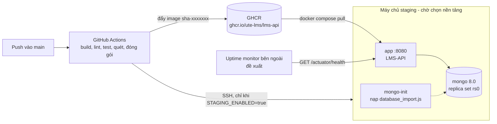

# Triển khai staging LMS-API

> **Trạng thái: khung chờ nền tảng.** Chưa có nền tảng staging (câu hỏi **Q06**, **Q07** chờ Trung tâm CNPM/GVHD).
> Mọi thứ dưới đây là phần đã chuẩn bị sẵn và đã chạy thử **cục bộ bằng Docker**. Chưa có lần triển khai nào lên máy chủ thật,
> chưa có URL staging, chưa có số lần deploy. Giả định tạm để viết khung: *một máy chủ Linux có Docker + Docker Compose v2,
> truy cập bằng SSH*. Nếu nền tảng được chọn khác, chỉ thay job `deploy-staging` và thư mục `deploy/staging/`.
> Quyết định và lý do: `doc/adr/0006-ci-cd-va-staging.md`.

## 1. Sơ đồ triển khai (khung)



Cổng MongoDB **không** publish ra máy chủ; chỉ ứng dụng trong mạng compose truy cập được (MongoDB chưa bật xác thực).

## 2. Điều kiện để bật triển khai tự động

1. Chọn nền tảng và chuẩn bị máy chủ (Linux, Docker Engine + plugin Compose v2, người dùng SSH có quyền chạy `docker`).
2. Trên máy chủ, tạo thư mục triển khai (mặc định `~/lms-api`), rồi tạo `deploy/staging/.env` từ `.env.example`
   (xem mục 8), `chmod 600`. Workflow **không bao giờ ghi đè `.env`**.
3. Tạo **GitHub Environment** `staging` (Settings → Environments) và, nếu muốn, bắt buộc người duyệt trước khi deploy.
4. Tạo các secret/variable dưới đây. **Không** commit giá trị thật; nhóm tự tạo, tài liệu này chỉ liệt kê tên.

| Loại | Tên | Phạm vi | Ý nghĩa |
|---|---|---|---|
| Variable | `STAGING_ENABLED` | repository | `true` để bật job deploy; thiếu hoặc khác `true` thì job bị bỏ qua |
| Variable | `STAGING_HOST` | repository | địa chỉ máy chủ SSH |
| Variable | `STAGING_USER` | repository | tài khoản SSH |
| Variable | `STAGING_SSH_PORT` | repository, tùy chọn | cổng SSH (mặc định 22) |
| Variable | `STAGING_DEPLOY_DIR` | repository, tùy chọn | thư mục triển khai trên máy chủ (mặc định `lms-api`, tương đối với thư mục home) |
| Variable | `STAGING_URL` | repository | địa chỉ công khai của staging (dùng cho smoke test và nút "View deployment"), ví dụ `https://<địa-chỉ>` |
| Secret | `STAGING_SSH_PRIVATE_KEY` | environment `staging` | khóa riêng SSH dành cho CI (nên tạo khóa riêng, chỉ có quyền triển khai) |
| Secret | `STAGING_SSH_KNOWN_HOSTS` | environment `staging` | dòng known_hosts của máy chủ (`ssh-keyscan -p <cổng> <host>`, kiểm tra vân tay độc lập) |
| Secret | `SONAR_TOKEN` | repository, tùy chọn | bật bước Sonar (kèm variable `SONAR_ORGANIZATION`, `SONAR_PROJECT_KEY`, `SONAR_HOST_URL` tùy chọn). **Chưa có token nên Sonar đang bị bỏ qua và chưa quét.** |

`GITHUB_TOKEN` (tự có) được dùng để máy chủ đăng nhập GHCR kéo image trong lúc deploy; token hết hạn khi job kết thúc,
và workflow chạy `docker logout` ở cuối.

## 3. Quy trình triển khai

Tự động (khi đã bật): push/merge vào `main` → chặng 1-5 xanh → image `ghcr.io/ute-lms/lms-api:sha-<7 ký tự commit>` được đẩy →
job `deploy-staging` chép `deploy/staging/` và `doc/database_import.js` sang máy chủ, đăng nhập GHCR, chạy `deploy.sh sha-<…>` →
job `smoke-staging` kiểm tra từ bên ngoài → nếu smoke đỏ, `rollback-staging` chạy `rollback.sh`.

Thủ công (trên máy chủ, thư mục `deploy/staging`):

```bash
./deploy.sh sha-1a2b3c4          # tag lấy từ chặng "package-image" hoặc tab Packages của repo
```

`deploy.sh` làm: kéo image theo tag → `docker compose up -d` (MongoDB giữ nguyên nếu không đổi) → đợi
`GET /actuator/health` có `"status":"UP"` tối đa `HEALTH_TIMEOUT_SECONDS` (mặc định 120 giây) → ghi tag vào `.deploy/current_tag`
(bản chạy tốt trước đó sang `.deploy/previous_tag`). Mã thoát: `0` thành công; `1` thất bại nhưng đã tự rollback và bản cũ UP lại;
`2` thất bại và không khôi phục được (chưa có bản trước hoặc rollback cũng không UP).

Dịch vụ `mongo-init` nạp `doc/database_import.js` khi khởi tạo. Script chạy lại an toàn nếu compose chạy lại nó (cập nhật validator, chèn dữ liệu khởi tạo
còn thiếu, không xóa dữ liệu).

## 4. Health check (US-39 / AC-1)

`GET /actuator/health` công khai (SecurityConfig), chỉ mở `health` và `info` (`management.endpoints.web.exposure.include=health,info`).

- Staging đặt `MANAGEMENT_ENDPOINT_HEALTH_SHOWDETAILS=never`: phản hồi chỉ có `{"status":"UP"}` (hoặc `DOWN` kèm HTTP 503), không lộ
  tên cơ sở dữ liệu hay dung lượng đĩa. Mẫu `application.properties.example` đang để `always`; khi chạy thử đã thấy health công khai trả danh sách
  cơ sở dữ liệu và dung lượng đĩa, nên staging ghi đè.
- `HEALTHCHECK` của image và `deploy.sh` dựa vào mã HTTP (503 khi DOWN → `wget` thoát mã khác 0, đã kiểm chứng) và chuỗi `"status":"UP"`.
- `smoke.sh <base-url> <chuỗi-phiên-bản>` kiểm tra: health UP, `/actuator/info` chứa `app.version` đúng commit vừa deploy,
  `/actuator/env` không trả 200, `/api/v1/auth/me` không token trả 401. Chạy từ bất kỳ đâu:
  `bash deploy/staging/smoke.sh https://<địa-chỉ-staging> 1a2b3c4`.
- Điều kiện AC-1 thật sự ("trả UP/DOWN đúng" trên staging công khai) **chỉ đóng được khi có staging**.

## 5. Rollback

Image cũ giữ lại trên máy chủ (Docker không xóa image đang có) và trong GHCR (tag `sha-…` bất biến).

```bash
./rollback.sh            # về .deploy/previous_tag, đợi health UP, rồi hoán đổi current/previous
./rollback.sh sha-9f8e7d6  # về một tag chỉ định
```

Tự động: `deploy.sh` rollback khi health không UP; workflow rollback khi smoke đỏ. Sau mỗi rollback **phải** sửa nguyên nhân rồi deploy lại;
không để staging chạy bản cũ mà không biết.

## 6. Xem log

- Trên máy chủ: `docker compose logs -f app` (thư mục `deploy/staging`); log Docker `json-file` xoay vòng 5 × 10 MB mỗi dịch vụ.
- Định dạng: `LOGGING_STRUCTURED_FORMAT_CONSOLE=ecs` (Spring Boot structured logging) cho JSON một dòng một sự kiện, có trường `correlationId`
  (từ `CorrelationIdFilter`) để truy vết một yêu cầu qua `X-Correlation-Id`. **Đã chạy xác nhận** khi thử image cục bộ. Đặt biến này rỗng để quay về
  log văn bản của `application.properties`.
- **Log tập trung:** chưa có hạ tầng nên chưa dựng ELK/Loki. Đề xuất: dùng tính năng gom log của nền tảng được chọn, hoặc agent gom log
  đọc log container; vì log đã là JSON nên không cần parser riêng.

## 7. Cảnh báo (đề xuất, chưa triển khai)

- Uptime monitor bên ngoài gọi `GET <STAGING_URL>/actuator/health` mỗi 1-5 phút, báo email/Slack khi không trả `UP` quá 2 lần liên tiếp
  (dịch vụ miễn phí hoặc do nền tảng cung cấp; chưa chọn).
- Workflow đỏ ở `main` đã gửi thông báo của GitHub tới người đẩy commit; nên bật thông báo Actions cho cả hai sinh viên.
- Khi có log tập trung: cảnh báo theo tỉ lệ `log.level=ERROR`.

## 8. Biến môi trường

Đối chiếu với `src/main/resources/application.properties.example`. Image không chứa giá trị bí mật; mọi thứ truyền lúc chạy.

| Biến | Bắt buộc | Mặc định trong image/compose | Ghi chú |
|---|---|---|---|
| `JWT_SECRET` | có (compose báo lỗi nếu thiếu) | không | ≥ 32 byte. Nếu không đặt, ứng dụng dùng khóa công khai trong `application.properties.example`: **không được để vậy ở staging** |
| `MONGODB_URI` | không | `mongodb://mongo:27017/learning_outcomes?replicaSet=rs0` (compose) | phải có `replicaSet=rs0` cho transaction |
| `INITIAL_ADMIN_USERNAME`, `INITIAL_ADMIN_EMAIL`, `INITIAL_ADMIN_PASSWORD` | không | rỗng | chỉ dùng khi collection `users` rỗng. Phải *tồn tại* (có thể rỗng): nếu không có biến nào, Spring báo `Circular placeholder reference` và ứng dụng không khởi động. Image đặt sẵn rỗng |
| `APP_CORS_ALLOWED_ORIGINS` | không | rỗng (không origin nào) | origin của frontend, phân tách bằng dấu phẩy; khóa `app.cors.allowed-origins` có trong mã (`SecurityConfig`) nhưng chưa có trong file mẫu. Đã kiểm chứng đặt/không đặt |
| `MANAGEMENT_ENDPOINT_HEALTH_SHOWDETAILS` | không | `never` (compose) | mẫu cấu hình là `always` |
| `LOGGING_STRUCTURED_FORMAT_CONSOLE` | không | `ecs` (compose) | `ecs`, `logstash`, `gelf` hoặc rỗng |
| `JAVA_TOOL_OPTIONS` | không | `-XX:MaxRAMPercentage=75.0` (image) | tham số JVM |
| `INFO_APP_VERSION`, `MANAGEMENT_INFO_ENV_ENABLED` | không | do build đặt trong image | phiên bản hiển thị ở `/actuator/info` |
| `IMAGE_REPO`, `IMAGE_TAG`, `APP_PORT`, `HEALTH_TIMEOUT_SECONDS` | `IMAGE_REPO` có | `APP_PORT=8080`, timeout 120 | chỉ dùng bởi compose/script, không vào ứng dụng |

## 9. Chờ quyết định (Q06, Q07) và việc còn thiếu

- Chọn nền tảng staging và nơi đặt MongoDB (máy chủ riêng, dịch vụ quản lý, hay container như khung này).
- Địa chỉ công khai của staging, tên miền, TLS (khung này chưa có reverse proxy/TLS; cần thêm trước khi mở công khai).
- Bật xác thực cho MongoDB staging (cần keyFile cho replica set) nếu dữ liệu thật vào staging.
- Tạo các secret/variable ở mục 2, bật `STAGING_ENABLED`, chạy lần đầu và ghi lại thời gian thật; sau đó mới có số lần deploy và thời gian commit → staging.
- Chọn công cụ cảnh báo/log tập trung (mục 6, 7).
- Chưa đo: thời gian commit → image ≤ 15 phút (workflow có bước ghi thời gian vào job summary khi chạy trên `main`).

## 10. Đã kiểm chứng và chưa

Đã chạy cục bộ (Docker Desktop, 2026-11-02): `docker compose` với `mongo` + `mongo-init` + `app`; `deploy.sh` triển khai hai tag; triển khai tag hỏng
→ thoát mã 1 và quay về bản trước UP; `rollback.sh` hai chiều; `smoke.sh` đạt; health ECS log; CORS qua biến môi trường.
**Chưa**: chạy trên máy chủ thật, qua SSH, kéo từ GHCR, workflow trên GitHub.
