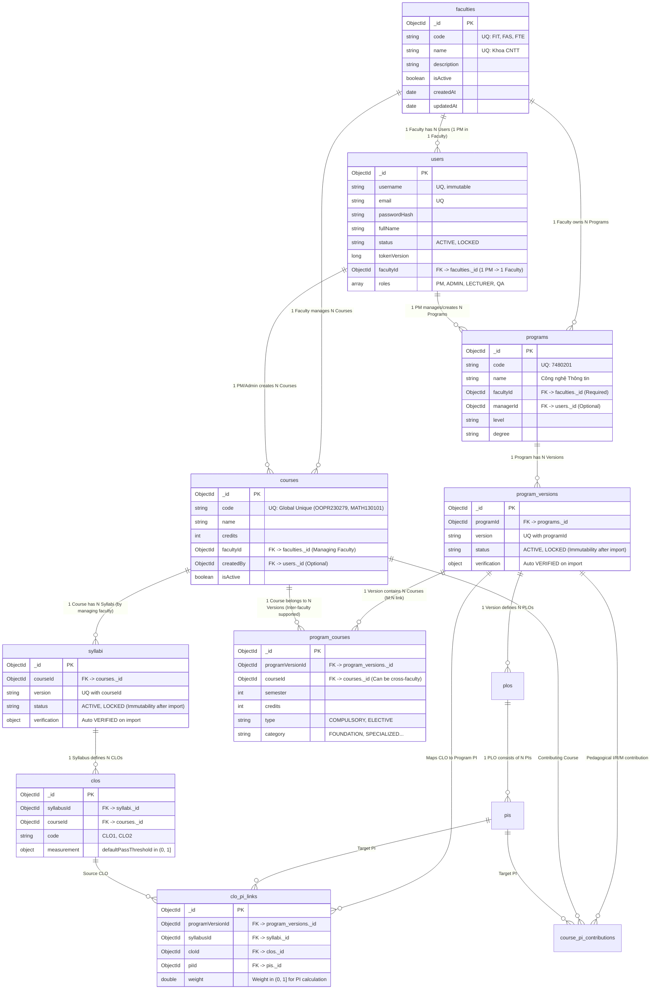
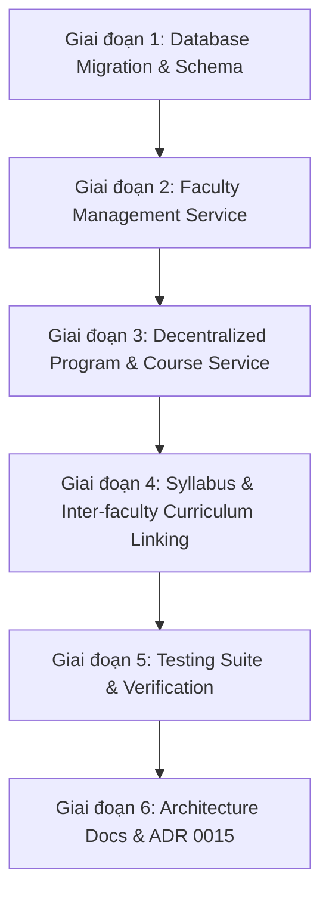

# KẾ HOẠCH VÀ ĐẶC TẢ KIẾN TRÚC: TÁI CẤU TRÚC PHÂN QUYỀN VÀ QUẢN LÝ CHƯƠNG TRÌNH ĐÀO TẠO THEO KHOA

**Hệ thống Quản lý, Đo lường và Phân tích Chuẩn đầu ra Chương trình Đào tạo (LMS-API)**  
*(Learning Outcomes Management and Analytics System)*

---

| Thông tin tài liệu | Chi tiết |
|---|---|
| **Mã tài liệu** | `PLAN-ARCH-FACULTY-DELEGATION-2026` |
| **Trạng thái** | Kế hoạch và Đặc tả Kiến trúc Chính thức (Authoritative Architectural Specification) |
| **Phiên bản kế thừa** | Nâng cấp từ v0.7 (25 collections) lên **v0.8 (26 collections)** |
| **Ngày lập** | 2026-11-15 |
| **Văn bản căn cứ** | `CLAUDE.md`, `doc/GiaiThich_CoSoDuLieu.md` (v0.7), `doc/dac-ta-thay-doi-nghiep-vu-va-phuong-an-tinh-clo.md`, ADR 0003, ADR 0005, ADR 0009, ADR 0010, ADR 0014 |
| **Phạm vi tác động** | Collection `faculties` (mới), `users`, `programs`, `courses`, `program_courses`, `syllabi`, `clos`, `clo_pi_links`, `ScopeAuthorizationService`, API Controllers, RBAC/ABAC Security Layer |

---

## MỤC LỤC TỔNG QUAN

- [PHẦN I: PHÂN TÍCH ĐỐI CHIẾU HIỆN TRẠNG KIẾN TRÚC VÀ NGHIỆP VỤ](#phần-i-phân-tích-đối-chiếu-hiện-trạng-kiến-trúc-và-nghiệp-vụ)
  - [1.1. Bối cảnh CSDL và Cơ cấu Tổ chức hiện tại (v0.7 - 25 Collections)](#11-bối-cảnh-csdl-và-cơ-cấu-tổ-chức-hiện-tại-v07---25-collections)
  - [1.2. Phân tích Các Quyết định Kiến trúc Hiện hành (ADRs) và Mã nguồn Spring Boot](#12-phân-tích-các-quyết-định-kiến-trúc-hiện-hành-adrs-và-mã-nguồn-spring-boot)
  - [1.3. Các Điểm Hạn chế, Nghịch lý và Lỗ hổng Kỹ thuật Tồn đọng](#13-các-điểm-hạn-chế-nghịch-lý-và-lỗ-hổng-kỹ-thuật-tồn-đọng)
- [PHẦN II: THIẾT KẾ MÔ HÌNH CƠ SỞ DỮ LIỆU VÀ ERD CHI TIẾT](#phần-ii-thiết-kế-mô-hình-cơ-sở-dữ-liệu-và-erd-chi-tiết)
  - [2.1. Collection mới `faculties` (Khoa Quản lý Đào tạo)](#21-collection-mới-faculties-khoa-quản-lý-đào-tạo)
  - [2.2. Cập nhật Collection `users` và Bất biến 1 PM - 1 Khoa](#22-cập-nhật-collection-users-và-bất-biến-1-pm---1-khoa)
  - [2.3. Cập nhật Collection `programs` (Chương trình Đào tạo)](#23-cập-nhật-collection-programs-chương-trình-đào-tạo)
  - [2.4. Cập nhật Collection `courses` (Danh mục Học phần Master)](#24-cập-nhật-collection-courses-danh-mục-học-phần-master)
  - [2.5. Phân tích Quan hệ `program_courses` và Tính Trung lập Môn học Liên khoa](#25-phân-tích-quan-hệ-program_courses-và-tính-trung-lập-môn-học-liên-khoa)
  - [2.6. Mối quan hệ và Ràng buộc với `syllabi`, `clos` và `clo_pi_links`](#26-mối-quan-hệ-và-ràng-buộc-với-syllabi-clos-và-clo_pi_links)
  - [2.7. Biểu đồ Quan hệ Thực thể Tổng thể (Mermaid ERD)](#27-biểu-đồ-quan-hệ-thực-thể-tổng-thể-mermaid-erd)
  - [2.8. Kịch bản Di chuyển Dữ liệu Hoàn chỉnh (Zero-Downtime Mongosh Migration Script)](#28-kịch-bản-di-chuyển-dữ-liệu-hoàn-chỉnh-zero-downtime-mongosh-migration-script)
  - [2.9. Kịch bản Hoàn nguyên Dữ liệu Chi tiết (Rollback Script: Revert v0.8 -> v0.7)](#29-kịch-bản-hoàn-nguyên-dữ-liệu-chi-tiết-rollback-script-revert-v08--v07)
- [PHẦN III: ĐẶC TẢ CHI TIẾT DANH SÁCH API ENDPOINTS](#phần-iii-đặc-tả-chi-tiết-danh-sách-api-endpoints)
  - [3.1. Luồng 1: Quản lý Khoa (Faculty Management - Admin Only)](#31-luồng-1-quản-lý-khoa-faculty-management---admin-only)
  - [3.2. Luồng 2: Phân công Program Manager vào Khoa (PM Assignment - Admin Only)](#32-luồng-2-phân-công-program-manager-vào-khoa-pm-assignment---admin-only)
  - [3.3. Luồng 3: Quản lý CTĐT & Phiên bản theo Khoa (Curriculum Management - PM & Admin)](#33-luồng-3-quản-lý-ctđt--phiên-bản-theo-khoa-curriculum-management---pm--admin)
  - [3.4. Luồng 4: Quản lý Môn học & Đề cương theo Khoa (Course & Syllabus Management)](#34-luồng-4-quản-lý-môn-học--đề-cương-theo-khoa-course--syllabus-management)
  - [3.5. Luồng 5: Gán Môn học Liên khoa vào CTĐT (Inter-faculty Curriculum Linking)](#35-luồng-5-gán-môn-học-liên-khoa-vào-ctđt-inter-faculty-curriculum-linking)
- [PHẦN IV: MA TRẬN PHÂN QUYỀN RBAC / ABAC CHI TIẾT](#phần-iv-ma-trận-phân-quyền-rbac--abac-chi-tiết)
  - [4.1. Bảng Ma trận Phân quyền trên 13 Tài nguyên Cốt lõi](#41-bảng-ma-trận-phân-quyền-trên-13-tài-nguyên-cốt-lõi)
  - [4.2. Ranh giới Quyền hạn và Trách nhiệm giữa các Vai trò](#42-ranh-giới-quyền-hạn-và-trách-nhiệm-giữa-các-vai-trò)
- [PHẦN V: CÁC QUY TẮC NGHIỆP VỤ BẮT BUỘC (BUSINESS INVARIANTS)](#phần-v-các-quy-tắc-nghiệp-vụ-bắt-buộc-business-invariants)
  - [5.1. Bất biến 1 PM thuộc Tối đa 1 Khoa và Xử lý Luân chuyển Công tác](#51-bất-biến-1-pm-thuộc-tối-đa-1-khoa-và-xử-lý-luân-chuyển-công-tác)
  - [5.2. Chủ quyền Đề cương Môn học: Triệt tiêu Hoàn toàn Lỗ hổng TD-29](#52-chủ-quyền-đề-cương-môn-học-triệt-tiêu-hoàn-toàn-lỗ-hổng-td-29)
  - [5.3. Cơ chế Độc lập Học thuật khi Gán Môn học Liên khoa](#53-cơ-chế-độc-lập-học-thuật-khi-gán-môn-học-liên-khoa)
  - [5.4. Tính Tương thích Tuyệt đối với Động cơ Đo lường OBE 4 Cấp độ (ADR 0014)](#54-tính-tương-thích-tuyệt-đối-với-động-cơ-đo-lường-obe-4-cấp-độ-adr-0014)
- [PHẦN VI: LỘ TRÌNH TRIỂN KHAI KỸ THUẬT (ROADMAP & MIGRATION)](#phần-vi-lộ-trình-triển-khai-kỹ-thuật-roadmap--migration)
  - [6.1. Giai đoạn 1: Database Migration & Entity Schema](#61-giai-đoạn-1-database-migration--entity-schema)
  - [6.2. Giai đoạn 2: Faculty Management & Assignment Service](#62-giai-đoạn-2-faculty-management--assignment-service)
  - [6.3. Giai đoạn 3: Decentralized Program & Course Management Service](#63-giai-đoạn-3-decentralized-program--course-management-service)
  - [6.4. Giai đoạn 4: Syllabus & Inter-faculty Curriculum Linking](#64-giai-đoạn-4-syllabus--inter-faculty-curriculum-linking)
  - [6.5. Giai đoạn 5: Comprehensive Testing Suite](#65-giai-đoạn-5-comprehensive-testing-suite)
  - [6.6. Giai đoạn 6: Ban hành ADR 0015 và Cập nhật Tài liệu Kiến trúc v0.8](#66-giai-đoạn-6-ban-hành-adr-0015-và-cập-nhật-tài-liệu-kiến-trúc-v08)

---

# PHẦN I: PHÂN TÍCH ĐỐI CHIẾU HIỆN TRẠNG KIẾN TRÚC VÀ NGHIỆP VỤ

## 1.1. Bối cảnh CSDL và Cơ cấu Tổ chức hiện tại (v0.7 - 25 Collections)

Theo tài liệu kiến trúc cơ sở dữ liệu `doc/GiaiThich_CoSoDuLieu.md` (phiên bản v0.7), hệ thống LMS-API được cấu trúc gồm **25 collection**, phân thành 8 nhóm chức năng:
- **Nhóm A (Người dùng):** `users`
- **Nhóm B (Chương trình đào tạo):** `programs`, `program_versions`, `plos`, `pis`, `courses`, `program_courses`, `course_pi_contributions`
- **Nhóm C (Học phần & CLO):** `syllabi`, `clos`, `clo_pi_links`
- **Nhóm D (Bài đánh giá & Ma trận CLO):** `assessments`
- **Nhóm E (Học kỳ, lớp, sinh viên):** `terms`, `course_sections`, `students`, `enrollments`
- **Nhóm F (Nhập điểm CLO):** `import_batches`, `import_row_errors`, `scores`
- **Nhóm G (Đo lường chuẩn đầu ra 4 cấp):** `calculation_runs`, `student_results`, `aggregate_results`
- **Nhóm H (Báo cáo, cải tiến, hỗ trợ):** `reports`, `improvement_actions`, `audit_logs`

### Điểm thiếu khuyết về cơ cấu tổ chức:
1. **Hoàn toàn vắng bóng thực thể Khoa (`faculties`):** Trong toàn bộ 25 collection của v0.7 cũng như file cấu hình schema `doc/database_import.js`, không hề có collection nào biểu diễn đơn vị Khoa hoặc Đơn vị học thuật cấp trường.
2. **Không có trường `facultyId`:** Không có bất kỳ trường tham chiếu `facultyId` nào tồn tại trong các collection cốt lõi: `users`, `programs`, `courses`, `syllabi`.
3. **Mô hình tổ chức phẳng (Flat Hierarchy):** Hệ thống đang đối xử với danh mục Chương trình Đào tạo (`programs`) và Môn học (`courses`) như một kho dữ liệu phẳng dùng chung toàn trường, phụ thuộc hoàn toàn vào Quản trị viên hệ thống (`ADMIN`) để tạo mồi và phân bổ ID thủ công.

---

## 1.2. Phân tích Các Quyết định Kiến trúc Hiện hành (ADRs) và Mã nguồn Spring Boot

### 1. ADR 0003 — Xác thực và Phân quyền theo Phạm vi (F01)
- Hệ thống áp dụng mô hình phân quyền dựa trên vai trò kết hợp phạm vi truy cập: `RoleAssignment = { role, scope }`, trong đó `UserScope = { programIds[], courseIds[], sectionIds[] }`.
- Kiến trúc Stateless: JWT token chỉ lưu định danh `userId` và `tokenVersion`. Mỗi request đến đều được nạp lại trạng thái mới nhất từ MongoDB qua `UserPrincipal` (Dynamic Reload).
- **Hạn chế:** Khi bổ nhiệm một `PROGRAM_MANAGER` (PM), Quản trị viên phải gán thủ công từng ID của CTĐT vào mảng `scope.programIds` của người dùng. Nếu trường có 50 CTĐT, việc quản trị danh sách ID này gây quá tải và rất dễ sai sót.

### 2. ADR 0005 — ADMIN khởi tạo danh mục CTĐT; PROGRAM_MANAGER quản lý phiên bản theo scope
- **Nghịch lý "Con gà và quả trứng" (Chicken-and-Egg Paradox):** Tại `ScopeValidationServiceImpl.java:31-43`, khi Admin tạo tài khoản PM và gán `scope.programIds`, hệ thống yêu cầu các `programId` đó phải tồn tại sẵn trong CSDL (nếu không sẽ ném HTTP 422 `SCOPE_NOT_FOUND`). Nhưng nếu PM là người tạo ra CTĐT thì CTĐT chưa có ID để đưa vào scope của PM.
- **Giải pháp tình thế của ADR 0005:** Để vượt qua nghịch lý này, ADR 0005 đã tước bỏ hoàn toàn quyền tạo CTĐT của PM, chuyển quyền tạo và cập nhật `Program` sang **chỉ dành riêng cho `ADMIN`** (`@PreAuthorize("hasRole('ADMIN')")` tại `ProgramController.java:63, 70`).
- **Hệ quả thực tế:** PM không thể tự chủ tạo mới ngành học của mình. Mọi việc mở ngành mới đều phải gửi yêu cầu Admin tạo hộ rồi Admin phải vào sửa tài khoản PM để thêm ID vào scope.

### 3. ADR 0009 & Mã nguồn `ScopeAuthorizationServiceImpl` — Lỗ hổng kỹ thuật TD-29
- Tại `ScopeAuthorizationServiceImpl.java:415-445`, khi kiểm tra quyền ghi trên Môn học và Đề cương của PM, hệ thống sử dụng phương thức:
  ```java
  // ScopeAuthorizationServiceImpl.java
  private boolean isCourseInProgramScope(UserScope scope, String courseId) {
      if (scope == null || scope.getProgramIds() == null || scope.getProgramIds().isEmpty()) {
          return false;
      }
      return programCourseRepository.findByCourseId(courseId.trim()).stream()
          .anyMatch(pc -> programVersionRepository.findById(pc.getProgramVersionId())
              .map(pv -> scope.getProgramIds().contains(pv.getProgramId()))
              .orElse(false));
  }
  ```
- **Lỗ hổng chiếm quyền đề cương (TD-29):** Vì hệ thống suy quyền ghi môn học (`canAccessCourse(..., WRITE)`) thông qua việc kiểm tra môn học có nằm trong `program_courses` của bất kỳ CTĐT nào trong scope của PM hay không, dẫn đến một kịch bản nguy hiểm:
  * PM Khoa CNTT khi đưa môn *Toán cao cấp 1* (do Khoa Khoa học Cơ bản biên soạn) vào CTĐT ngành CNTT sẽ **ngẫu nhiên được cấp quyền sửa đề cương của môn Toán cao cấp 1**!
  * PM Khoa CNTT có thể import đè đề cương mới, xóa sửa CLO của môn Toán, làm phá vỡ toàn bộ cấu trúc chuẩn đầu ra của các khoa khác đang cùng sử dụng môn Toán này.

### 4. ADR 0010 & ADR 0014 — Lịch sử vai trò và Động cơ Đo lường 4 cấp
- **ADR 0010** từng đề xuất mô hình Bộ môn (`DEPARTMENT_HEAD`) để duyệt đề cương, nhưng gây cồng kềnh bộ máy hành chính và phát sinh xung đột quyền với PM.
- **ADR 0014 (v0.7)** đã bãi bỏ hoàn toàn vai trò `DEPARTMENT_HEAD`, hợp nhất quyền quản lý học thuật về `PROGRAM_MANAGER`, đồng thời chuẩn hóa hệ thống thành **4 vai trò cốt lõi**: `ADMIN`, `PROGRAM_MANAGER`, `LECTURER`, `QA`.
- **Khóa cứng môn học tại CourseController:** Do bãi bỏ bộ môn nhưng chưa có Khoa, `CourseController.java:72, 79, 89` đã khóa cứng quyền tạo môn học, sửa môn học và import môn học chỉ dành cho `@PreAuthorize("hasRole('ADMIN')")`. PM hoàn toàn không thể chủ động thêm môn học thuộc ngành mình.

---

## 1.3. Các Điểm Hạn chế, Nghịch lý và Lỗ hổng Kỹ thuật Tồn đọng

| Vấn đề | Vị trí hiện trạng trong Codebase / ADR | Bản chất kỹ thuật & Rủi ro | Giải pháp mục tiêu của Kế hoạch Tái cấu trúc |
|---|---|---|---|
| **Nghịch lý "Con gà và quả trứng"** | ADR 0005, `ProgramController.java:63, 70`, `ScopeValidationServiceImpl.java` | PM muốn tạo CTĐT phải có ID trong scope, nhưng CTĐT chưa tạo thì chưa có ID. Dẫn đến Admin bị biến thành người "gõ hộ dữ liệu" CTĐT. | Đưa vào thực thể Khoa (`faculties`). PM gắn với Khoa từ trước (`user.facultyId`). PM tự tạo CTĐT gắn theo `facultyId` của mình. |
| **Kho môn học bị phong tỏa** | `CourseController.java:72, 79, 89`, ADR 0010 | Chỉ Admin mới được tạo và import môn học. PM không thể bổ sung môn chuyên ngành mới cho CTĐT của mình. | Bổ sung `courses.facultyId`. Mở quyền cho PM tạo và import môn học thuộc Khoa mình phụ trách. |
| **Lỗ hổng chiếm quyền đề cương (TD-29)** | `ScopeAuthorizationServiceImpl.java:415-445`, ADR 0009 | Logic `isCourseInProgramScope` suy quyền môn học từ bảng nối `program_courses`. Khi gán môn khoa khác vào CTĐT mình, PM tự động có quyền sửa đè đề cương khoa khác. | Xóa bỏ hoàn toàn nhánh suy quyền qua `program_courses`. Quyền tạo/sửa đề cương môn học bắt buộc phải so khớp trực tiếp: `course.facultyId == pm.facultyId`. |
| **Thiếu API gán môn vào CTĐT** | `ProgramCourseController.java:20-52` | `ProgramCourseService` có logic thêm/xóa môn học nhưng Controller chỉ mở các API đọc (`GET`), chưa có API ghi (`POST`, `PUT`, `DELETE`). | Mở đầy đủ bộ REST API ghi cho `ProgramCourseController`, cho phép gán môn học liên khoa. |
| **Không có cơ cấu tổ chức học thuật** | CSDL 25 collections v0.7 | Không thể phân nhóm CTĐT, môn học và giảng viên theo đơn vị Khoa trong toàn trường. | Bổ sung collection `faculties` (v0.8 - 26 collections), chuẩn hóa quan hệ $1\text{ PM} \in 1\text{ Khoa}$. |

---

# PHẦN II: THIẾT KẾ MÔ HÌNH CƠ SỞ DỮ LIỆU VÀ ERD CHI TIẾT

## 2.1. Collection mới `faculties` (Khoa Quản lý Đào tạo)

Collection `faculties` đóng vai trò là thực thể tổ chức học thuật cấp cơ sở trong Nhà trường. Mỗi Khoa chịu trách nhiệm quản lý một tập hợp các Chương trình Đào tạo (`programs`), các Môn học chuyên môn (`courses`), và các Program Manager trực thuộc.

### Cấu trúc Document `faculties`:
```json
{
  "_id": {"$oid": "67370a1b2c4e8f1234567890"},
  "code": "FIT",
  "name": "Khoa Công nghệ Thông tin",
  "description": "Quản lý các chương trình đào tạo thuộc lĩnh vực Máy tính và CNTT",
  "isActive": true,
  "createdAt": {"$date": "2026-11-15T08:00:00.000Z"},
  "updatedAt": {"$date": "2026-11-15T08:00:00.000Z"},
  "extra": {}
}
```

### Chỉ mục (Indexes & Constraints):
1. `faculty_code_unique_idx`: `{"code": 1}`, `unique: true` — Đảm bảo mã khoa viết tắt không trùng lặp toàn trường (ví dụ: `FIT`, `FAS`, `FTE`, `FBE`).
2. `faculty_name_unique_idx`: `{"name": 1}`, `unique: true` — Đảm bảo tên khoa duy nhất.
3. `faculty_active_idx`: `{"isActive": 1}` — Tối ưu hóa truy vấn các khoa đang hoạt động.

### MongoDB `$jsonSchema` Validator chính thức:
```javascript
faculties: {
  validator: {
    $jsonSchema: {
      bsonType: 'object',
      required: ['code', 'name', 'isActive'],
      properties: {
        code: {
          bsonType: 'string',
          pattern: '^[A-Z0-9_-]{2,20}$',
          description: 'Mã định danh khoa viết tắt, 2-20 ký tự in hoa, duy nhất toàn trường'
        },
        name: {
          bsonType: 'string',
          minLength: 3,
          maxLength: 255,
          description: 'Tên đầy đủ của Khoa, bắt buộc, không được để trống'
        },
        description: {
          bsonType: ['string', 'null'],
          description: 'Mô tả tóm tắt chức năng, nhiệm vụ của Khoa'
        },
        isActive: {
          bsonType: 'bool',
          description: 'Trạng thái hoạt động của Khoa (true = đang hoạt động, false = tạm khóa)'
        },
        createdAt: { bsonType: ['date', 'null'] },
        updatedAt: { bsonType: ['date', 'null'] },
        extra: { bsonType: ['object', 'null'] }
      }
    }
  },
  validationLevel: 'strict',
  validationAction: 'error'
}
```

### Document Model Spring Data MongoDB (`Faculty.java`):
```java
package com.hcmute.lms.lmsapi.document;

import java.time.Instant;
import java.util.Map;
import lombok.*;
import org.springframework.data.annotation.Id;
import org.springframework.data.mongodb.core.index.CompoundIndex;
import org.springframework.data.mongodb.core.index.CompoundIndexes;
import org.springframework.data.mongodb.core.mapping.Document;
import org.springframework.data.mongodb.core.mapping.Field;

@Data
@Builder
@NoArgsConstructor
@AllArgsConstructor
@Document(collection = "faculties")
@CompoundIndexes({
    @CompoundIndex(name = "faculty_code_unique_idx", def = "{'code': 1}", unique = true),
    @CompoundIndex(name = "faculty_name_unique_idx", def = "{'name': 1}", unique = true),
    @CompoundIndex(name = "faculty_active_idx", def = "{'isActive': 1}")
})
public class Faculty {
    @Id
    private String id;

    @Field("code")
    private String code;

    @Field("name")
    private String name;

    @Field("description")
    private String description;

    @Builder.Default
    @Field("isActive")
    private Boolean isActive = true;

    @Field("createdAt")
    private Instant createdAt;

    @Field("updatedAt")
    private Instant updatedAt;

    @Field("extra")
    private Map<String, Object> extra;
}
```

---

## 2.2. Cập nhật Collection `users` và Bất biến 1 PM - 1 Khoa

### Phân tích Kiến trúc: Vì sao đặt `facultyId` ở cấp gốc của `User`?
Có 2 phương án đặt `facultyId` khi thiết kế:
- *Phương án A: Đặt trong `RoleAssignment.scope` (`UserScope.facultyId`)*: Nhược điểm lớn là một user có thể được cấp nhiều role assignments mang vai trò `PROGRAM_MANAGER` trỏ tới các `facultyId` khác nhau, hoặc phải phụ thuộc hoàn toàn vào mã kiểm tra tầng ứng dụng để chống vi phạm.
- *Phương án B: Đặt trực tiếp ở cấp gốc Document `User` (`User.facultyId`)*:
  * **Đảm bảo tính bất biến ngay từ mô hình dữ liệu (Schema-level Invariant):** Do mỗi document `User` chỉ có duy nhất 1 trường `facultyId`, một Program Manager về mặt cấu trúc thực thể không thể thuộc về 2 khoa cùng một lúc!
  * **Phù hợp với cơ chế nhân sự đại học:** Mỗi cán bộ, giảng viên trong trường đại học biên chế hoặc bổ nhiệm chính thức tại đúng một Khoa chủ quản duy nhất.
  * **Truy vấn hiệu năng cao ($O(1)$ Index Lookup):** Dễ dàng tìm kiếm danh sách PM của Khoa hoặc lọc danh sách giảng viên của Khoa thông qua chỉ mục `{"facultyId": 1, "roles": 1}`.

### Cập nhật Schema `users`:
```json
{
  "_id": {"$oid": "67370b3c2c4e8f1234567891"},
  "username": "pm_fit_01",
  "email": "pm_fit@hcmute.edu.vn",
  "passwordHash": "$2a$10$...",
  "fullName": "TS. Nguyễn Văn A",
  "status": "ACTIVE",
  "tokenVersion": 1,
  "facultyId": {"$oid": "67370a1b2c4e8f1234567890"},
  "roles": ["PROGRAM_MANAGER"]
}
```

### Chỉ mục bổ sung trên `users`:
1. `user_faculty_idx`: `{"facultyId": 1}`
2. `user_faculty_role_status_idx`: `{"facultyId": 1, "roles": 1, "status": 1}`

### Cập nhật Java Entity (`User.java`):
```java
@Field(name = "facultyId", targetType = FieldType.OBJECT_ID)
private String facultyId;
```

### Cập nhật DTO và Runtime Security Principal (`UserPrincipal.java`, `UserResponse.java`):

Để phục vụ kiểm tra phân quyền thời gian chạy (Runtime Authorization) thông qua Spring Security SpEL và đồng bộ thông tin Khoa hiển thị trên giao diện người dùng, các lớp DTO cốt lõi bắt buộc phải được bổ sung thông tin Khoa ngay từ Giai đoạn 1:

1. **Cập nhật `UserPrincipal.java` (`src/main/java/com/hcmute/lms/lmsapi/dto/UserPrincipal.java`):**
   - Bổ sung trường:
     ```java
     private String facultyId;
     ```
   - Bổ sung getter `getFacultyId()` (hoặc thông qua `@Getter` của Lombok).
   - Cập nhật mapper chuyển đổi `UserPrincipal.from(User user)`:
     ```java
     public static UserPrincipal from(User user) {
         if (user == null) {
             return null;
         }
         return UserPrincipal.builder()
             .id(user.getId())
             .username(user.getUsername())
             .email(user.getEmail())
             .fullName(user.getFullName())
             .status(user.getStatus())
             .tokenVersion(user.getTokenVersion())
             .facultyId(user.getFacultyId()) // Sao chép facultyId từ User entity
             .roles(user.getRoles() != null ? user.getRoles() : Collections.emptyList())
             .build();
     }
     ```
   - **Tầm quan trọng sống còn:** Toàn bộ các biểu thức SpEL (như `authentication.principal.facultyId == #request.facultyId` hoặc `@scopeAuthorizationService.canManageProgram(authentication.principal, #id)`) thực thi Reflection trên đối tượng `UserPrincipal`. Nếu thiếu trường này, Spring Security sẽ ném ngoại lệ thời gian chạy `SpelEvaluationException: EL1008E: Property or field 'facultyId' cannot be found on object of type 'UserPrincipal'` dẫn đến lỗi sập toàn bộ hệ thống HTTP 500 Internal Server Error trên tất cả các API được bảo vệ.

2. **Cập nhật DTO phản hồi người dùng:**
   - `UserResponse.java`: Bổ sung `facultyId`, `facultyCode`, `facultyName`.
   - `UserProfileResponse.java`: Bổ sung `facultyId`, `facultyCode`, `facultyName` để ứng dụng Frontend hiển thị thông tin Khoa công tác của Program Manager ngay sau khi xác thực danh tính.

---

## 2.3. Cập nhật Collection `programs` (Chương trình Đào tạo)

Chương trình đào tạo (`Program`) được chuyển đổi từ một thực thể dùng chung toàn trường sang thực thể có **Khoa sở hữu trực tiếp**.

### Cập nhật Schema `programs`:
- **Trường bắt buộc bổ sung:** `facultyId: ObjectId` (tham chiếu `faculties._id`).
- *(Đã loại bỏ `managerId` dư thừa: mọi Program Manager thuộc cùng Khoa đều có quyền quản lý toàn bộ CTĐT của Khoa đó qua `facultyId`.)*

```json
{
  "_id": {"$oid": "67370c4e2c4e8f1234567892"},
  "code": "7480201",
  "name": "Công nghệ Thông tin",
  "facultyId": {"$oid": "67370a1b2c4e8f1234567890"},
  "level": "Đại học",
  "degree": "Kỹ sư",
  "extra": {}
}
```

### Chỉ mục trên `programs`:
1. `code_unique_idx`: `{"code": 1}`, `unique: true` — Duy trì tính duy nhất toàn cục của mã ngành.
2. `program_faculty_idx`: `{"facultyId": 1}` — Lấy danh sách CTĐT thuộc Khoa.
3. `program_faculty_code_idx`: `{"facultyId": 1, "code": 1}`.

### Cập nhật MongoDB Validator cho `programs`:
`required: ['code', 'name', 'facultyId']`

---

## 2.4. Cập nhật Collection `courses` (Danh mục Học phần Master)

Môn học trong trường đại học luôn có đơn vị chuyên môn chịu trách nhiệm nội dung (ví dụ: *Toán cao cấp* thuộc Khoa Khoa học Ứng dụng/Cơ bản; *Lập trình Hướng đối tượng* thuộc Khoa CNTT).

### Cập nhật Schema `courses`:
- **Trường bắt buộc bổ sung:** `facultyId: ObjectId` (tham chiếu `faculties._id` - Khoa chủ quản môn học).
- **Trường tùy chọn bổ sung:** `createdBy: ObjectId` (tham chiếu `users._id`), `description: String`, `isActive: Boolean`.

```json
{
  "_id": {"$oid": "67370d1e2c4e8f1234567893"},
  "code": "OOPR230279",
  "name": "Lập trình hướng đối tượng",
  "credits": 3,
  "facultyId": {"$oid": "67370a1b2c4e8f1234567890"},
  "createdBy": {"$oid": "67370b3c2c4e8f1234567891"},
  "isActive": true,
  "extra": {}
}
```

### Chỉ mục trên `courses`:
1. `code_unique_idx`: `{"code": 1}`, `unique: true` — **Bắt buộc duy nhất toàn cục**. Mã môn học là chuẩn chung của trường, không cho phép hai khoa tạo trùng mã môn.
2. `course_faculty_idx`: `{"facultyId": 1}` — Lọc các môn do Khoa chủ quản biên soạn.
3. `course_faculty_code_idx`: `{"facultyId": 1, "code": 1}`.

### Cập nhật MongoDB Validator cho `courses`:
- `required: ['code', 'name', 'facultyId']`
- `isActive: { bsonType: ['bool', 'null'] }` (cho phép giá trị boolean hoặc null nhằm bảo toàn trạng thái của các môn học cũ đã lưu trữ và ngăn ngừa lỗi vi phạm schema MongoDB Document Validation 121 khi khởi tạo dữ liệu).

---

## 2.5. Phân tích Quan hệ `program_courses` và Tính Trung lập Môn học Liên khoa

Collection `program_courses` giữ vai trò liên kết Nhiều - Nhiều (M:N) giữa Phiên bản CTĐT (`program_versions`) và Học phần (`courses`).

### Cấu trúc Document `program_courses`:
```json
{
  "_id": {"$oid": "67370f2b2c4e8f1234567895"},
  "programVersionId": {"$oid": "67370e012c4e8f1234567894"},
  "courseId": {"$oid": "67370d1e2c4e8f1234567893"},
  "semester": 1,
  "credits": 3,
  "type": "COMPULSORY",
  "category": "FOUNDATION",
  "prerequisiteCourseIds": [],
  "previousCourseIds": []
}
```

### Tính Trung lập Về Cấu trúc (Structural Neutrality):
- Collection `program_courses` hoàn toàn trung lập: nó chỉ lưu cặp khóa ngoại `{ programVersionId, courseId }` cùng thông tin cấu hình vị trí trong CTĐT.
- **Không có ràng buộc cứng về Khoa:** Một `programVersionId` thuộc Khoa A có thể liên kết với bất kỳ `courseId` nào thuộc Khoa B.
- **Nhận diện Môn liên khoa tại Thời gian chạy (Runtime Inter-faculty Resolution):**
  $$\text{isInterFaculty} = (\text{course.facultyId} \ne \text{program.facultyId})$$
  Không cần thêm cờ cứng `isInterFaculty` vào database để tránh rủi ro bất đồng bộ nếu môn học hoặc CTĐT được điều chỉnh đơn vị quản lý.
- Khi trả response về client, DTO `ProgramCourseResponse` sẽ tự động bổ sung:
  * `managingFacultyId`: ID của Khoa sở hữu môn học.
  * `managingFacultyCode`: Mã Khoa sở hữu (ví dụ: `FAS`).
  * `managingFacultyName`: Tên Khoa sở hữu (ví dụ: `Khoa Khoa học Cơ bản`).
  * `isInterFaculty`: `true` nếu môn học khác khoa với CTĐT.

---

## 2.6. Mối quan hệ và Ràng buộc với `syllabi`, `clos` và `clo_pi_links`

### 1. Phân định quyền trên Đề cương (`syllabi`)
- `Syllabus` gắn trực tiếp vào `Course` qua `courseId`. Khóa duy nhất: `{ courseId: 1, version: 1 }`.
- **Nguyên tắc phân quyền triệt để:** Quyền import hoặc khóa đề cương của PM được kiểm tra qua Khoa sở hữu môn học:
  $$\text{CanManageSyllabus}(pm, syllabus) \iff \text{courseRepository.findById}(syllabus.courseId).facultyId == pm.facultyId$$
- PM Khoa sử dụng môn học liên khoa **tuyệt đối không được cấp quyền** import hoặc khóa đề cương môn học của Khoa khác.
- **Bất biến sau Import & Mặc định đã duyệt (`VERIFIED`):** Đề cương khi được PM bấm xác nhận import sẽ được lưu thẳng vào hệ thống ở trạng thái đã duyệt (`status = ACTIVE/CONFIRMED`, `verification.status = VERIFIED`), **không cần QA duyệt** và **không cho phép sửa hoặc xóa** nội dung đề cương. Chỉ hỗ trợ thao tác **Khóa (`LOCKED`)** để ngừng sử dụng và chặn giảng viên import điểm.

### 2. Chuẩn đầu ra Học phần (`clos`)
- `CLO` phụ thuộc vào `syllabusId` và `courseId`.
- Toàn bộ CLO được tạo đồng bộ cùng lúc khi PM import đề cương.
- **Không có chức năng thêm, sửa, xóa CLO** sau khi đề cương đã được import vào hệ thống (bảo đảm tính bất biến tuyệt đối).

### 3. Ánh xạ Chuẩn đầu ra Liên khoa (`clo_pi_links`)
- Document `clo_pi_links` lưu: `{ programVersionId, syllabusId, cloId, piId, weight }`.
- **Thẩm quyền của PM Khoa sử dụng môn học liên khoa:**
  * PM được chọn các CLO của môn học liên khoa (từ đề cương đang hiệu lực, chưa bị khóa) để thiết lập ánh xạ vào các PI trong CTĐT của mình khi import/xây dựng phiên bản CTĐT.
  * Khai báo trọng số đóng góp $W_{CLO \to PI} \in (0, 1]$.
  * Khai báo mức độ đóng góp sư phạm $I/R/M$ tại collection `course_pi_contributions`.

---

## 2.7. Biểu đồ Quan hệ Thực thể Tổng thể (Mermaid ERD)



---

## 2.8. Kịch bản Di chuyển Dữ liệu Hoàn chỉnh (Zero-Downtime Mongosh Migration Script)

Để chuyển đổi an toàn hệ thống hiện hành (v0.7 với 25 collections) sang hệ thống tái cấu trúc phân quyền theo Khoa (v0.8 với 26 collections) mà không gây gián đoạn dịch vụ (Zero-Downtime), quy trình di chuyển dữ liệu được thực thi theo 7 bước tuần tự:

```javascript
/*
 * ============================================================================
 * SCRIPT MIGRATION V0.8: TÁI CẤU TRÚC PHÂN QUYỀN VÀ QUẢN LÝ CTĐT THEO KHOA
 * File: migration_v0.8_faculties_and_delegation.js
 * Cú pháp: mongosh (MongoDB Shell)
 * ============================================================================
 */

const DB_NAME = (typeof process !== 'undefined' && process.env.LMS_DB) || 'learning_outcomes';
const d = db.getSiblingDB(DB_NAME);
const NOW = new Date();

print('====================================================================');
print('>>> BẮT ĐẦU MIGRATION V0.8: PHÂN QUYỀN VÀ QUẢN LÝ CTĐT THEO KHOA');
print('>>> Database mục tiêu: ' + DB_NAME);
print('>>> Thời gian chạy: ' + NOW.toISOString());
print('====================================================================');

// ----------------------------------------------------------------------------
// BƯỚC 1: KHỞI TẠO COLLECTION faculties KÈM JSON SCHEMA VALIDATOR
// ----------------------------------------------------------------------------
if (!d.getCollectionNames().includes('faculties')) {
  d.createCollection('faculties', {
    validator: {
      $jsonSchema: {
        bsonType: 'object',
        required: ['code', 'name', 'isActive'],
        properties: {
          code: {
            bsonType: 'string',
            pattern: '^[A-Z0-9_-]{2,20}$',
            description: 'Mã định danh khoa viết tắt, 2-20 ký tự in hoa, duy nhất toàn trường'
          },
          name: {
            bsonType: 'string',
            minLength: 3,
            maxLength: 255,
            description: 'Tên đầy đủ của Khoa, bắt buộc, không được để trống'
          },
          description: {
            bsonType: ['string', 'null'],
            description: 'Mô tả tóm tắt chức năng, nhiệm vụ của Khoa'
          },
          isActive: {
            bsonType: 'bool',
            description: 'Trạng thái hoạt động của Khoa (true = đang hoạt động, false = tạm khóa)'
          },
          createdAt: { bsonType: ['date', 'null'] },
          updatedAt: { bsonType: ['date', 'null'] },
          extra: { bsonType: ['object', 'null'] }
        }
      }
    },
    validationLevel: 'strict',
    validationAction: 'error'
  });
  print('[Bước 1] Đã tạo mới collection faculties kèm $jsonSchema validator.');
} else {
  print('[Bước 1] Collection faculties đã tồn tại, cập nhật validator qua collMod.');
  d.runCommand({
    collMod: 'faculties',
    validator: {
      $jsonSchema: {
        bsonType: 'object',
        required: ['code', 'name', 'isActive'],
        properties: {
          code: { bsonType: 'string', pattern: '^[A-Z0-9_-]{2,20}$' },
          name: { bsonType: 'string', minLength: 3, maxLength: 255 },
          description: { bsonType: ['string', 'null'] },
          isActive: { bsonType: 'bool' },
          createdAt: { bsonType: ['date', 'null'] },
          updatedAt: { bsonType: ['date', 'null'] },
          extra: { bsonType: ['object', 'null'] }
        }
      }
    },
    validationLevel: 'strict',
    validationAction: 'error'
  });
}

// ----------------------------------------------------------------------------
// BƯỚC 2: KHỞI TẠO DANH MỤC KHOA GỐC (SEED FACULTIES)
// ----------------------------------------------------------------------------
function ensureFaculty(code, name, description) {
  const existing = d.faculties.findOne({ code: code });
  if (existing) {
    print('  - Khoa đã tồn tại: ' + code + ' (ID: ' + existing._id + ')');
    return existing._id;
  }
  const result = d.faculties.insertOne({
    code: code,
    name: name,
    description: description,
    isActive: true,
    createdAt: NOW,
    updatedAt: NOW
  });
  print('  + Đã tạo mới Khoa: ' + code + ' - ' + name + ' (ID: ' + result.insertedId + ')');
  return result.insertedId;
}

print('[Bước 2] Thiết lập các Khoa cơ sở:');
const fitId = ensureFaculty('FIT', 'Khoa Công nghệ Thông tin', 'Quản lý các ngành Công nghệ thông tin, Kỹ thuật phần mềm, ATTT');
const fasId = ensureFaculty('FAS', 'Khoa Khoa học Ứng dụng', 'Quản lý các môn Toán cao cấp, Vật lý, Hóa học đại cương toàn trường');
const fbeId = ensureFaculty('FBE', 'Khoa Kinh tế', 'Quản lý các ngành Công nghệ Tài chính (Fintech), QTKD, Thương mại điện tử');
const fteId = ensureFaculty('FTE', 'Khoa Cơ khí Chế tạo máy', 'Quản lý các ngành Cơ kỹ thuật, Cơ điện tử, Chế tạo máy');

// ----------------------------------------------------------------------------
// BƯỚC 3: BACKFILL facultyId CHO COLLECTION programs
// ----------------------------------------------------------------------------
print('[Bước 3] Backfill facultyId cho programs:');
// 3.1. Các ngành CNTT gán về FIT
const progFitRes = d.programs.updateMany(
  {
    code: { $in: ['7480201', 'CNTT', 'SE', 'CS'] },
    $or: [{ facultyId: { $exists: false } }, { facultyId: null }]
  },
  { $set: { facultyId: fitId, updatedAt: NOW } }
);
// 3.2. Ngành Fintech gán về FBE
const progFbeRes = d.programs.updateMany(
  {
    code: { $in: ['FINTECH', '7340205', 'BA'] },
    $or: [{ facultyId: { $exists: false } }, { facultyId: null }]
  },
  { $set: { facultyId: fbeId, updatedAt: NOW } }
);
// 3.3. Các ngành còn lại chưa có facultyId gán về FIT làm mặc định an toàn
const progOtherRes = d.programs.updateMany(
  { $or: [{ facultyId: { $exists: false } }, { facultyId: null }] },
  { $set: { facultyId: fitId, updatedAt: NOW } }
);
print('  - Đã cập nhật facultyId cho programs: FIT (' + progFitRes.modifiedCount + '), FBE (' + progFbeRes.modifiedCount + '), Mặc định (' + progOtherRes.modifiedCount + ')');

// ----------------------------------------------------------------------------
// BƯỚC 4: BACKFILL facultyId CHO COLLECTION courses (BẢO TOÀN TRẠNG THÁI isActive)
// ----------------------------------------------------------------------------
print('[Bước 4] Backfill facultyId cho courses (bảo toàn nguyên vẹn trạng thái isActive cũ):');
// 4.1. Các môn Toán, Lý, Hóa (bắt đầu bằng MATH, PHYS, CHEM, GENC, LLCT) gán về FAS
const courseFasRes = d.courses.updateMany(
  {
    code: { $regex: '^(MATH|PHYS|CHEM|GENC|LLCT)', $options: 'i' },
    $or: [{ facultyId: { $exists: false } }, { facultyId: null }]
  },
  { $set: { facultyId: fasId, updatedAt: NOW } }
);
// 4.2. Các môn Kinh tế, Tài chính (bắt đầu bằng ECON, FINT, ACCT, MKTG, ABDA) gán về FBE
const courseFbeRes = d.courses.updateMany(
  {
    code: { $regex: '^(ECON|FINT|ACCT|MKTG|ABDA)', $options: 'i' },
    $or: [{ facultyId: { $exists: false } }, { facultyId: null }]
  },
  { $set: { facultyId: fbeId, updatedAt: NOW } }
);
// 4.3. Các môn CNTT còn lại (OOPR, CPRG, CS, IT, SE, NETW) gán về FIT
const courseFitRes = d.courses.updateMany(
  { $or: [{ facultyId: { $exists: false } }, { facultyId: null }] },
  { $set: { facultyId: fitId, updatedAt: NOW } }
);
// 4.4. Chỉ khởi tạo isActive = true cho các môn nào HOÀN TOÀN CHƯA CÓ trường isActive
// Tuyệt đối không ghi đè lên các môn học cũ đã lưu trữ hoặc ngừng hoạt động (isActive == false)
const courseActiveInitRes = d.courses.updateMany(
  { isActive: { $exists: false } },
  { $set: { isActive: true, updatedAt: NOW } }
);
print('  - Đã cập nhật facultyId cho courses: FAS (' + courseFasRes.modifiedCount + '), FBE (' + courseFbeRes.modifiedCount + '), FIT (' + courseFitRes.modifiedCount + '). Khởi tạo isActive môn mới: (' + courseActiveInitRes.modifiedCount + ').');

// ----------------------------------------------------------------------------
// BƯỚC 5: BACKFILL facultyId CHO users (CHUẨN HÓA BSON ObjectId TRUY VẤN programs)
// ----------------------------------------------------------------------------
print('[Bước 5] Backfill facultyId cho tài khoản người dùng:');
const pmUsers = d.users.find({ 'roleAssignments.role': 'PROGRAM_MANAGER' }).toArray();
let pmUpdatedCount = 0;

pmUsers.forEach(function(u) {
  if (!u.facultyId) {
    let targetFaculty = fitId;
    if (u.roleAssignments && u.roleAssignments.length > 0) {
      const pmRole = u.roleAssignments.find(r => r.role === 'PROGRAM_MANAGER');
      if (pmRole && pmRole.scope && pmRole.scope.programIds && pmRole.scope.programIds.length > 0) {
        const rawPId = pmRole.scope.programIds[0];
        // Chuyển đổi an toàn từ chuỗi String 24 hex sang BSON ObjectId để khớp chính xác kiểu _id trong MongoDB
        let programQueryId = rawPId;
        try {
          if (typeof rawPId === 'string' && rawPId.length === 24) {
            programQueryId = (typeof ObjectId !== 'undefined') ? new ObjectId(rawPId) : rawPId;
          }
        } catch (err) {
          programQueryId = rawPId;
        }
        const prog = d.programs.findOne({ $or: [{ _id: programQueryId }, { _id: rawPId }] });
        if (prog && prog.facultyId) {
          targetFaculty = prog.facultyId;
        }
      }
    }
    d.users.updateOne(
      { _id: u._id },
      { $set: { facultyId: targetFaculty, updatedAt: NOW } }
    );
    pmUpdatedCount++;
  }
});
print('  - Đã cập nhật facultyId cho ' + pmUpdatedCount + ' tài khoản Program Manager (khớp chính xác ObjectId CTĐT).');

// ----------------------------------------------------------------------------
// BƯỚC 6: KHỞI TẠO CÁC CHỈ MỤC INDEXES BẢO ĐẢM HIỆU NĂNG VÀ TOÀN VẸN
// ----------------------------------------------------------------------------
print('[Bước 6] Cấu hình và khởi tạo các Indexes:');
// 6.1. faculties
d.faculties.createIndex({ code: 1 }, { unique: true, name: 'faculty_code_unique_idx' });
d.faculties.createIndex({ name: 1 }, { unique: true, name: 'faculty_name_unique_idx' });
d.faculties.createIndex({ isActive: 1 }, { name: 'faculty_active_idx' });

// 6.2. programs
d.programs.createIndex({ facultyId: 1 }, { name: 'program_faculty_idx' });
d.programs.createIndex({ facultyId: 1, code: 1 }, { name: 'program_faculty_code_idx' });

// 6.3. courses
d.courses.createIndex({ facultyId: 1 }, { name: 'course_faculty_idx' });
d.courses.createIndex({ facultyId: 1, code: 1 }, { name: 'course_faculty_code_idx' });

// 6.4. users
d.users.createIndex({ facultyId: 1 }, { name: 'user_faculty_idx' });
d.users.createIndex({ facultyId: 1, 'roleAssignments.role': 1, status: 1 }, { name: 'user_faculty_role_status_idx' });
print('  - Toàn bộ Indexes cần thiết đã được tạo thành công.');

// ----------------------------------------------------------------------------
// BƯỚC 7: CẬP NHẬT JSON SCHEMA VALIDATOR (CHIẾN LƯỢC ZERO-DOWNTIME TWO-PHASE)
// ----------------------------------------------------------------------------
// Lưu ý kiến trúc Zero-Downtime (Expand / Contract Pattern):
// - Trong Phase 1 (khi backend v0.7 đang chạy song song, chưa deploy code Phase 3):
//   Thiết lập validationLevel: 'moderate' và validationAction: 'warn' trên programs và courses
//   để các thao tác ghi hiện hành từ ứng dụng v0.7 chưa có facultyId không bị từ chối với lỗi schema validation 121.
// - Sau khi Phase 3 backend code được triển khai thành công lên production (toàn bộ code Java
//   mới đã luôn cung cấp facultyId), quản trị viên chạy lệnh chuyển validationLevel sang 'strict'
//   và validationAction sang 'error' để thắt chặt bảo đảm toàn vẹn dữ liệu.
print('[Bước 7] Cấu hình JSON Schema Validator (Mức Moderate/Warn cho Phase 1 Zero-Downtime):');
d.runCommand({
  collMod: 'programs',
  validator: {
    $jsonSchema: {
      bsonType: 'object',
      required: ['code', 'name', 'facultyId'],
      properties: {
        code: { bsonType: 'string' },
        name: { bsonType: 'string' },
        facultyId: { bsonType: 'objectId', description: 'Khoa chủ quản bắt buộc' },
        managerId: { bsonType: ['objectId', 'null'] },
        level: { bsonType: ['string', 'null'] },
        degree: { bsonType: ['string', 'null'] },
        extra: { bsonType: ['object', 'null'] }
      }
    }
  },
  validationLevel: 'moderate',
  validationAction: 'warn'
});

d.runCommand({
  collMod: 'courses',
  validator: {
    $jsonSchema: {
      bsonType: 'object',
      required: ['code', 'name', 'facultyId'],
      properties: {
        code: { bsonType: 'string' },
        name: { bsonType: 'string' },
        facultyId: { bsonType: 'objectId', description: 'Khoa quản lý chuyên môn bắt buộc' },
        credits: { bsonType: ['int', 'long', 'double', 'null'] },
        description: { bsonType: ['string', 'null'] },
        isActive: { bsonType: ['bool', 'null'] }, // Cho phép boolean hoặc null, tránh lỗi schema trên dữ liệu cũ
        createdBy: { bsonType: ['objectId', 'null'] },
        extra: { bsonType: ['object', 'null'] }
      }
    }
  },
  validationLevel: 'moderate',
  validationAction: 'warn'
});
print('  - collMod đã cấu hình validator thành công ở mức moderate/warn (Zero-downtime ready).');

print('====================================================================');
print('>>> MIGRATION V0.8 HOÀN TẤT THÀNH CÔNG VÀ AN TOÀN TUYỆT ĐỐI!');
print('====================================================================');
```

---

## 2.9. Kịch bản Hoàn nguyên Dữ liệu Chi tiết (Rollback Script: Revert v0.8 $\to$ v0.7)

Để đảm bảo an toàn tuyệt đối cho môi trường Production theo chuẩn Enterprise Architecture, khi quy trình di chuyển gặp sự cố nghiêm trọng không thể khắc phục tại chỗ, đội ngũ vận hành thực thi kịch bản hoàn nguyên `rollback_v0.8_to_v0.7.js` sau đây để đưa cơ sở dữ liệu trở về trạng thái chuẩn v0.7 ban đầu:

```javascript
/*
 * ============================================================================
 * SCRIPT ROLLBACK: HOÀN NGUYÊN HỆ THỐNG TỪ V0.8 VỀ V0.7
 * File: rollback_v0.8_to_v0.7.js
 * Cú pháp: mongosh (MongoDB Shell)
 * ============================================================================
 */

const DB_NAME = (typeof process !== 'undefined' && process.env.LMS_DB) || 'learning_outcomes';
const d = db.getSiblingDB(DB_NAME);
const NOW = new Date();

print('====================================================================');
print('>>> BẮT ĐẦU HOÀN NGUYÊN (ROLLBACK) V0.8 -> V0.7');
print('>>> Database mục tiêu: ' + DB_NAME);
print('>>> Thời gian chạy: ' + NOW.toISOString());
print('====================================================================');

// ----------------------------------------------------------------------------
// BƯỚC R1: HẠ CẤP / GỠ BỎ VALIDATOR KHỎI programs VÀ courses VỀ CHUẨN V0.7
// ----------------------------------------------------------------------------
print('[Rollback Bước 1] Khôi phục JSON Schema Validator về v0.7 (gỡ bỏ required facultyId):');
d.runCommand({
  collMod: 'programs',
  validator: {
    $jsonSchema: {
      bsonType: 'object',
      required: ['code', 'name'],
      properties: {
        code: { bsonType: 'string' },
        name: { bsonType: 'string' },
        level: { bsonType: ['string', 'null'] },
        degree: { bsonType: ['string', 'null'] },
        extra: { bsonType: ['object', 'null'] }
      }
    }
  },
  validationLevel: 'moderate',
  validationAction: 'warn'
});

d.runCommand({
  collMod: 'courses',
  validator: {
    $jsonSchema: {
      bsonType: 'object',
      required: ['code', 'name'],
      properties: {
        code: { bsonType: 'string' },
        name: { bsonType: 'string' },
        credits: { bsonType: ['int', 'long', 'double', 'null'] },
        description: { bsonType: ['string', 'null'] },
        extra: { bsonType: ['object', 'null'] }
      }
    }
  },
  validationLevel: 'moderate',
  validationAction: 'warn'
});
print('  - Validator trên programs và courses đã hoàn nguyên về cấu trúc v0.7.');

// ----------------------------------------------------------------------------
// BƯỚC R2: XÓA CÁC CHỈ MỤC (INDEXES) ĐÃ TẠO Ở V0.8
// ----------------------------------------------------------------------------
print('[Rollback Bước 2] Xóa bỏ các chỉ mục liên quan đến facultyId:');
function safeDropIndex(coll, indexName) {
  try {
    coll.dropIndex(indexName);
    print('  - Đã xóa index: ' + indexName + ' trên ' + coll.getName());
  } catch (err) {
    print('  - Bỏ qua index: ' + indexName + ' (' + err.message + ')');
  }
}

safeDropIndex(d.programs, 'program_faculty_idx');
safeDropIndex(d.programs, 'program_faculty_code_idx');
safeDropIndex(d.courses, 'course_faculty_idx');
safeDropIndex(d.courses, 'course_faculty_code_idx');
safeDropIndex(d.users, 'user_faculty_idx');
safeDropIndex(d.users, 'user_faculty_role_status_idx');

// ----------------------------------------------------------------------------
// BƯỚC R3: GỠ BỎ TRƯỜNG facultyId KHỎI programs, courses, users ($unset)
// ----------------------------------------------------------------------------
print('[Rollback Bước 3] Gỡ bỏ trường facultyId và managerId khỏi dữ liệu:');
const progUnsetRes = d.programs.updateMany(
  { facultyId: { $exists: true } },
  { $unset: { facultyId: "", managerId: "" } }
);
const courseUnsetRes = d.courses.updateMany(
  { facultyId: { $exists: true } },
  { $unset: { facultyId: "" } }
);
const userUnsetRes = d.users.updateMany(
  { facultyId: { $exists: true } },
  { $unset: { facultyId: "" } }
);
print('  - Đã unset facultyId: programs (' + progUnsetRes.modifiedCount + '), courses (' + courseUnsetRes.modifiedCount + '), users (' + userUnsetRes.modifiedCount + ').');

// ----------------------------------------------------------------------------
// BƯỚC R4: SAO LƯU VÀ XÓA / ĐỔI TÊN COLLECTION faculties
// ----------------------------------------------------------------------------
print('[Rollback Bước 4] Xử lý collection faculties:');
if (d.getCollectionNames().includes('faculties')) {
  const backupCollName = 'faculties_backup_rollback_' + Date.now();
  d.faculties.renameCollection(backupCollName);
  print('  - Đã đổi tên faculties thành ' + backupCollName + ' để lưu trữ dữ liệu an toàn.');
}

// ----------------------------------------------------------------------------
// BƯỚC R5: KIỂM CHỨNG TRẠNG THÁI HỆ THỐNG SAU ROLLBACK
// ----------------------------------------------------------------------------
print('[Rollback Bước 5] Kiểm chứng tính toàn vẹn hệ thống:');
const remainingProgFaculty = d.programs.countDocuments({ facultyId: { $exists: true } });
const remainingCourseFaculty = d.courses.countDocuments({ facultyId: { $exists: true } });
const remainingUserFaculty = d.users.countDocuments({ facultyId: { $exists: true } });

if (remainingProgFaculty === 0 && remainingCourseFaculty === 0 && remainingUserFaculty === 0) {
  print('>>> KIỂM TRA ĐẠT: Không còn bản ghi nào chứa facultyId.');
  print('>>> HOÀN NGUYÊN V0.8 -> V0.7 THÀNH CÔNG VÀ TOÀN VẸN!');
} else {
  print('>>> CẢNH BÁO: Còn sót bản ghi chưa được gỡ facultyId. Vui lòng kiểm tra lại!');
}
print('====================================================================');
```
```

---

# PHẦN III: ĐẶC TẢ CHI TIẾT DANH SÁCH API ENDPOINTS

Hệ thống cung cấp đầy đủ các API RESTful cho 5 luồng nghiệp vụ. Toàn bộ các endpoints đều được đặc tả chi tiết: Phương thức HTTP, Đường dẫn, Biểu thức SpEL bảo vệ quyền, Request Body Schema, Response Body Schema và Danh mục các mã trạng thái HTTP chuẩn.

---

## 3.1. Luồng 1: Quản lý Khoa (Faculty Management - Admin Only)

### API 1.1: Tạo mới Khoa
- **Phương thức & Đường dẫn:** `POST /api/v1/faculties`
- **Bảo vệ quyền (SpEL):** `@PreAuthorize("hasRole('ADMIN')")`
- **Request Body JSON Schema:**
  ```json
  {
    "$schema": "http://json-schema.org/draft-07/schema#",
    "type": "object",
    "required": ["code", "name"],
    "properties": {
      "code": {
        "type": "string",
        "pattern": "^[A-Z0-9_-]{2,20}$",
        "description": "Mã khoa viết tắt in hoa duy nhất (ví dụ: FIT, FAS)"
      },
      "name": {
        "type": "string",
        "minLength": 3,
        "maxLength": 255,
        "description": "Tên đầy đủ của Khoa"
      },
      "description": {
        "type": "string",
        "maxLength": 1000
      }
    }
  }
  ```
- **Response JSON Schema (HTTP 201 Created):**
  ```json
  {
    "type": "object",
    "properties": {
      "id": { "type": "string" },
      "code": { "type": "string" },
      "name": { "type": "string" },
      "description": { "type": "string" },
      "isActive": { "type": "boolean" },
      "programManagerCount": { "type": "integer" },
      "createdAt": { "type": "string", "format": "date-time" },
      "updatedAt": { "type": "string", "format": "date-time" }
    }
  }
  ```
- **Danh mục HTTP Status Codes:**
  * `201 Created`: Tạo Khoa thành công.
  * `400 Bad Request`: Dữ liệu đầu vào sai định dạng hoặc để trống trường bắt buộc (`VALIDATION_ERROR`).
  * `401 Unauthorized`: Token không hợp lệ hoặc đã hết hạn.
  * `403 Forbidden`: Người gọi không có vai trò `ADMIN`.
  * `409 Conflict`: Mã khoa `code` hoặc tên khoa `name` đã tồn tại trong CSDL.
  * `422 Unprocessable Entity`: Vi phạm quy tắc nghiệp vụ.

### API 1.2: Lấy danh sách Khoa (Phân trang và Tìm kiếm)
- **Phương thức & Đường dẫn:** `GET /api/v1/faculties`
- **Bảo vệ quyền (SpEL):** `@PreAuthorize("isAuthenticated()")` (Mọi người dùng đã xác thực đều có quyền tra cứu danh mục Khoa).
- **Query Parameters:** `page` (int, default 0), `size` (int, default 20), `search` (string, optional), `isActive` (boolean, optional).
- **Response JSON Schema (HTTP 200 OK):** Đối tượng `PageResponse<FacultyResponse>`.
- **Status Codes:** `200 OK`, `401 Unauthorized`.

### API 1.3: Xem chi tiết Khoa
- **Phương thức & Đường dẫn:** `GET /api/v1/faculties/{id}`
- **Bảo vệ quyền (SpEL):** `@PreAuthorize("isAuthenticated()")`
- **Response JSON Schema (HTTP 200 OK):** Đối tượng `FacultyResponse`.
- **Status Codes:** `200 OK`, `401 Unauthorized`, `404 Not Found` (Khoa không tồn tại).

### API 1.4: Cập nhật thông tin Khoa
- **Phương thức & Đường dẫn:** `PUT /api/v1/faculties/{id}`
- **Bảo vệ quyền (SpEL):** `@PreAuthorize("hasRole('ADMIN')")`
- **Request Body:** `{ "name": "Khoa CNTT Đổi mới", "description": "...", "isActive": true }`
- **Status Codes:** `200 OK`, `400 Bad Request`, `401 Unauthorized`, `403 Forbidden`, `404 Not Found`, `409 Conflict` (Tên khoa trùng với khoa khác).

### API 1.5: Khóa hoặc Đổi trạng thái Khoa
- **Phương thức & Đường dẫn:** `PUT /api/v1/faculties/{id}/status`
- **Bảo vệ quyền (SpEL):** `@PreAuthorize("hasRole('ADMIN')")`
- **Request Body:** `{ "isActive": false, "reason": "Tạm dừng hoạt động sáp nhập" }`
- **Ràng buộc nghiệp vụ:** Không được khóa Khoa nếu Khoa đang có CTĐT ở trạng thái `ACTIVE` đang đào tạo sinh viên.
- **Status Codes:** `200 OK`, `401 Unauthorized`, `403 Forbidden`, `404 Not Found`, `422 Unprocessable Entity` (`FACULTY_HAS_ACTIVE_PROGRAMS`).

---

## 3.2. Luồng 2: Phân công Program Manager vào Khoa (PM Assignment - Admin Only)

### API 2.1: Lấy danh sách Program Manager thuộc Khoa
- **Phương thức & Đường dẫn:** `GET /api/v1/faculties/{facultyId}/program-managers`
- **Bảo vệ quyền (SpEL):**
  ```java
  @PreAuthorize("hasRole('ADMIN') or (hasRole('PROGRAM_MANAGER') and authentication.principal.facultyId == #facultyId)")
  ```
- **Response JSON Schema (HTTP 200 OK):**
  ```json
  [
    {
      "id": "67370b3c2c4e8f1234567891",
      "username": "pm_fit_01",
      "fullName": "TS. Nguyễn Văn A",
      "email": "pm_fit@hcmute.edu.vn",
      "status": "ACTIVE",
      "facultyId": "67370a1b2c4e8f1234567890",
      "facultyCode": "FIT",
      "facultyName": "Khoa Công nghệ Thông tin"
    }
  ]
  ```
- **Status Codes:** `200 OK`, `401 Unauthorized`, `403 Forbidden`, `404 Not Found`.

### API 2.2: Gán Program Manager vào Khoa (Validate 1 PM $\to$ 1 Khoa)
- **Phương thức & Đường dẫn:** `POST /api/v1/faculties/{facultyId}/program-managers`
- **Bảo vệ quyền (SpEL):** `@PreAuthorize("hasRole('ADMIN')")`
- **Request Body JSON Schema:**
  ```json
  {
    "type": "object",
    "required": ["userId"],
    "properties": {
      "userId": { "type": "string", "pattern": "^[a-fA-F0-9]{24}$" }
    }
  }
  ```
- **Xử lý nghiệp vụ tại Service Layer:**
  1. Kiểm tra `facultyId` tồn tại và đang `isActive == true`. Nếu không $\to$ 404/422.
  2. Kiểm tra `userId` tồn tại, trạng thái `ACTIVE`.
  3. Kiểm tra user có chứa role `PROGRAM_MANAGER` trong danh sách `roles` không. Nếu chưa có $\to$ ném `422 Unprocessable Entity` (`USER_NOT_PROGRAM_MANAGER`).
  4. **Kiểm tra Ràng buộc Bất biến 1 PM - 1 Khoa:**
     * Nếu `user.facultyId != null && !user.facultyId.equals(facultyId)`: Người dùng này đang thuộc Khoa khác.
     * Ném lỗi `409 Conflict` (hoặc `422 BusinessRuleViolation`): `"Người dùng [username] hiện đang thuộc Khoa [Mã Khoa Cũ]. Mỗi Program Manager chỉ được phép thuộc đúng 1 Khoa. Vui lòng chuyển công tác hoặc hủy gán trước."`
  5. Cập nhật `user.facultyId = facultyId` và ghi nhận `audit_logs`.
- **Status Codes:** `200 OK`, `400 Bad Request`, `401 Unauthorized`, `403 Forbidden`, `404 Not Found`, `409 Conflict`, `422 Unprocessable Entity`.

### API 2.3: Hủy gán Program Manager khỏi Khoa
- **Phương thức & Đường dẫn:** `DELETE /api/v1/faculties/{facultyId}/program-managers/{userId}`
- **Bảo vệ quyền (SpEL):** `@PreAuthorize("hasRole('ADMIN')")`
- **Xử lý nghiệp vụ & Thu hồi Phiên (Session Invalidation):**
  1. Kiểm tra user có đúng đang thuộc `facultyId` này không.
  2. Cập nhật `user.facultyId = null`.
  3. **Thu hồi phiên đăng nhập tức thì (Token Invalidation):** Gọi `user.incrementTokenVersion()` (hoặc `userRepository.incrementTokenVersion(userId)` tương đương lệnh MongoDB `$inc: { tokenVersion: 1 }`). Cơ chế này vô hiệu hóa ngay lập tức toàn bộ các JWT access tokens hiện hành của PM này, buộc người dùng phải đăng nhập lại và ngăn chặn triệt để hành vi lợi dụng token cũ còn hạn (TTL) để thực hiện các thao tác mang thẩm quyền của Khoa vừa bị hủy gán.
  4. Ghi `audit_logs` về hành động hủy gán của Quản trị viên.
- **Status Codes:** `204 No Content`, `401 Unauthorized`, `403 Forbidden`, `404 Not Found`, `422 Unprocessable Entity`.

### API 2.4: Điều chuyển Program Manager sang Khoa khác (Transfer Faculty)
- **Phương thức & Đường dẫn:** `POST /api/v1/faculties/transfer-program-manager`
- **Bảo vệ quyền (SpEL):** `@PreAuthorize("hasRole('ADMIN')")`
- **Request Body:** `{ "userId": "...", "targetFacultyId": "...", "transferReason": "..." }`
- **Xử lý nghiệp vụ:** Rút `facultyId` cũ, gán `facultyId` mới, tăng `tokenVersion` (`$inc: { tokenVersion: 1 }`) để vô hiệu hóa token cũ, ghi `audit_logs` chuyển giao quyền hạn.
- **Status Codes:** `200 OK`, `401 Unauthorized`, `403 Forbidden`, `404 Not Found`, `422 Unprocessable Entity`.

---

## 3.3. Luồng 3: Quản lý CTĐT & Phiên bản theo Khoa (Curriculum Management - PM & Admin)

### API 3.1: Tạo mới Chương trình Đào tạo (Program)
- **Phương thức & Đường dẫn:** `POST /api/v1/programs`
- **Bảo vệ quyền (SpEL):**
  ```java
  @PreAuthorize("hasRole('ADMIN') or (hasRole('PROGRAM_MANAGER') and (#request.facultyId == null or authentication.principal.facultyId == #request.facultyId))")
  ```
- **Xử lý tiện ích & Bảo vệ SpEL an toàn:**
  * **Hỗ trợ bỏ trống `facultyId`:** Khi PM gửi request tạo CTĐT mà bỏ trống `facultyId` (`request.facultyId == null`), SpEL guard hợp lệ cho phép luồng điều khiển đi vào phương thức Controller. Tại đây, hệ thống tự động gán `request.setFacultyId(principal.getFacultyId())` mà không bao giờ bị chặn đứng bởi HTTP 403 Forbidden.
  * **Chặn đứng leo thang đặc quyền (Privilege Escalation):** Nếu PM chủ động truyền `facultyId` trong body, giá trị này bắt buộc phải trùng khớp với `principal.getFacultyId()` của PM. Nếu PM cố tình truyền `facultyId` của Khoa khác, điều kiện `#request.facultyId == authentication.principal.facultyId` trả về `false`, Spring Security ném `AccessDeniedException` (HTTP 403 Forbidden) ngay tại bộ lọc bảo mật.
  * **Quyền hạn Quản trị viên (ADMIN):** Quản trị viên có toàn quyền truyền bất kỳ `facultyId` nào để tạo CTĐT cho bất kỳ Khoa nào trong toàn trường.
- **Request Body JSON Schema:**
  ```json
  {
    "type": "object",
    "required": ["code", "name"],
    "properties": {
      "facultyId": { "type": "string" },
      "code": { "type": "string", "pattern": "^[A-Z0-9_-]{3,20}$" },
      "name": { "type": "string", "minLength": 3, "maxLength": 255 },
      "level": { "type": "string" },
      "degree": { "type": "string" },
      "extra": { "type": "object" }
    }
  }
  ```
- **Status Codes:**
  * `201 Created`: Tạo thành công.
  * `400 Bad Request`: Mã ngành hoặc tên ngành không hợp lệ.
  * `401 Unauthorized`: Chưa đăng nhập.
  * `403 Forbidden`: PM cố tình tạo CTĐT cho một Khoa khác mà mình không quản lý (`principal.facultyId != request.facultyId`) hoặc PM chưa được gán Khoa.
  * `409 Conflict`: Trùng mã ngành `code` trong hệ thống.
  * `422 Unprocessable Entity`: Khoa chủ quản không tồn tại hoặc bị khóa.

### API 3.2: Cập nhật thông tin Chương trình Đào tạo
- **Phương thức & Đường dẫn:** `PUT /api/v1/programs/{id}`
- **Bảo vệ quyền (SpEL):**
  ```java
  @PreAuthorize("hasRole('ADMIN') or (hasRole('PROGRAM_MANAGER') and @scopeAuthorizationService.canManageProgram(authentication.principal, #id))")
  ```
- **Logic `canManageProgram`:** Trả về `true` khi `Objects.equals(program.getFacultyId(), principal.getFacultyId())`.
- **Ràng buộc Bất biến Tuyệt đối (Immutability Rule):**
  * Đối với vai trò `PROGRAM_MANAGER`, trường `facultyId` của CTĐT là **BẤT BIẾN (STRICTLY IMMUTABLE)**.
  * PM không có quyền chuyển quyền sở hữu CTĐT sang Khoa khác. Nếu Request Body của PM chứa `facultyId` khác với `facultyId` hiện tại của CTĐT, hệ thống kiên quyết từ chối cập nhật và trả về lỗi HTTP `400 Bad Request` hoặc `403 Forbidden` (`CANNOT_TRANSFER_PROGRAM_FACULTY`).
  * Chỉ duy nhất tài khoản Quản trị viên (`ADMIN`) mới có thẩm quyền điều chuyển CTĐT sang một Khoa chủ quản mới.
- **Status Codes:** `200 OK`, `400 Bad Request`, `401 Unauthorized`, `403 Forbidden`, `404 Not Found`, `422 Unprocessable Entity`.

### API 3.3: Xem trước Import CSV Phiên bản CTĐT (Preview)
- **Phương thức & Đường dẫn:** `POST /api/v1/program-versions/import/preview` (Multipart Form)
- **Bảo vệ quyền (SpEL):**
  ```java
  @PreAuthorize("hasRole('ADMIN') or (hasRole('PROGRAM_MANAGER') and @scopeAuthorizationService.canAccessProgram(authentication.principal, #programId, T(com.hcmute.lms.lmsapi.enums.AccessType).WRITE))")
  ```
- **Quy tắc xử lý:**
  - PM upload file CSV để hệ thống phân tích cú pháp, kiểm tra mã môn (cho phép cả môn nội bộ và môn liên khoa trong `courses`), kiểm tra PLO/PI và trả về bản **Preview** để người dùng xem trước.
  - **Chưa lưu dữ liệu chính thức** vào CSDL ở bước này.
- **Status Codes:** `200 OK` (Trả về dữ liệu Preview + danh sách cảnh báo/lỗi nếu có), `400 Bad Request` (Sai cấu trúc file CSV), `401 Unauthorized`, `403 Forbidden`, `422 Unprocessable Entity` (Môn học trong file không tồn tại trên hệ thống).

### API 3.4: Xác nhận Import Phiên bản CTĐT (Lưu thẳng ở trạng thái đã duyệt & ACTIVE)
- **Phương thức & Đường dẫn:** `POST /api/v1/program-versions/import` (hoặc `POST /api/v1/program-versions/import/confirm`)
- **Bảo vệ quyền (SpEL):**
  ```java
  @PreAuthorize("hasRole('ADMIN') or (hasRole('PROGRAM_MANAGER') and @scopeAuthorizationService.canAccessProgram(authentication.principal, #programId, T(com.hcmute.lms.lmsapi.enums.AccessType).WRITE))")
  ```
- **Quy tắc xử lý:**
  - Khi người dùng đã xem Preview và bấm nút **Import / Xác nhận**, hệ thống lưu toàn bộ Phiên bản CTĐT, Khung học phần (`program_courses`), PLO và PI thẳng vào hệ thống.
  - **Mặc định đã duyệt (Auto-Verified):** Trạng thái phiên bản được thiết lập ngay là `ACTIVE` và `verification.status = VERIFIED` (**không cần QA duyệt**, không qua bước `DRAFT`).
  - **Bất biến sau Import:** Sau khi đã bấm Import lưu vào hệ thống, **không có chức năng sửa hoặc xóa** phiên bản CTĐT đã import.
- **Status Codes:** `201 Created`, `400 Bad Request`, `401 Unauthorized`, `403 Forbidden`, `409 Conflict` (Trùng phiên bản trên cùng CTĐT), `422 Unprocessable Entity`.

### API 3.5: Khóa Phiên bản CTĐT (Lock Program Version: ACTIVE $\to$ LOCKED)
- **Phương thức & Đường dẫn:** `PUT /api/v1/program-versions/{id}/lock`
- **Bảo vệ quyền (SpEL):** `@PreAuthorize("hasRole('ADMIN') or (hasRole('PROGRAM_MANAGER') and @scopeAuthorizationService.canAccessProgramVersion(..., WRITE))")`
- **Quy tắc nghiệp vụ:**
  - Chỉ hỗ trợ thao tác **Khóa** một chiều `ACTIVE -> LOCKED` (ngưng hoạt động phiên bản CTĐT). Không có thao tác sửa nội dung hay xóa phiên bản CTĐT.
  - **Tác dụng chặn Giảng viên:** Khi Phiên bản CTĐT ở trạng thái `LOCKED`, hệ thống lập tức **chặn Giảng viên import điểm** (và chặn thao tác ma trận đề) vào các lớp học phần thuộc phiên bản CTĐT đã ngưng hoạt động đó (`422 Unprocessable Entity`: `PROGRAM_VERSION_LOCKED`).
- **Status Codes:** `200 OK`, `401 Unauthorized`, `403 Forbidden`, `404 Not Found`, `422 Unprocessable Entity` (`ALREADY_LOCKED`).

---

## 3.4. Luồng 4: Quản lý Môn học & Đề cương theo Khoa (Course & Syllabus Management)

### API 4.1: Tạo mới Môn học Master (Course)
- **Phương thức & Đường dẫn:** `POST /api/v1/courses`
- **Bảo vệ quyền (SpEL):**
  ```java
  @PreAuthorize("hasRole('ADMIN') or (hasRole('PROGRAM_MANAGER') and (#request.facultyId == null or authentication.principal.facultyId == #request.facultyId))")
  ```
- **Xử lý tiện ích & Bảo vệ SpEL an toàn:**
  * **Hỗ trợ bỏ trống `facultyId`:** Khi PM tạo môn học mà không truyền `facultyId` (`request.facultyId == null`), SpEL guard cho phép request đi tiếp qua proxy bảo mật. Tại Controller, hệ thống tự động gán `request.setFacultyId(principal.getFacultyId())` mà không bao giờ bị từ chối bởi HTTP 403.
  * **Chặn đứng xâm phạm chéo:** Nếu PM chủ động truyền `facultyId`, giá trị đó bắt buộc phải trùng khớp với `principal.getFacultyId()` của PM. Nếu PM cố tình truyền `facultyId` của Khoa khác, điều kiện `#request.facultyId == authentication.principal.facultyId` trả về `false`, Spring Security ném `AccessDeniedException` (HTTP 403 Forbidden).
  * **Quản trị viên (ADMIN):** Có toàn quyền truyền bất kỳ `facultyId` nào để tạo môn học cho bất kỳ Khoa nào trong toàn trường.
- **Request Body JSON Schema:**
  ```json
  {
    "type": "object",
    "required": ["code", "name"],
    "properties": {
      "facultyId": { "type": "string" },
      "code": { "type": "string", "pattern": "^[A-Z0-9_-]{4,20}$" },
      "name": { "type": "string", "minLength": 3, "maxLength": 255 },
      "credits": { "type": "integer", "minimum": 1, "maximum": 20 },
      "description": { "type": "string" }
    }
  }
  ```
- **Status Codes:**
  * `201 Created`: Tạo môn học thành công.
  * `400 Bad Request`: Thiếu trường bắt buộc hoặc sai định dạng mã môn.
  * `401 Unauthorized`: Chưa đăng nhập.
  * `403 Forbidden`: PM cố tình tạo môn học cho Khoa khác hoặc PM chưa được gán Khoa.
  * `409 Conflict`: Trùng mã môn học `code` trên toàn trường.
  * `422 Unprocessable Entity`: Khoa không tồn tại hoặc bị khóa.

### API 4.2: Import Danh mục Môn học CSV cho Khoa
- **Phương thức & Đường dẫn:** `POST /api/v1/courses/import` (Multipart Form)
- **Bảo vệ quyền (SpEL):**
  ```java
  @PreAuthorize("hasRole('ADMIN') or (hasRole('PROGRAM_MANAGER') and #facultyId != null and authentication.principal.facultyId == #facultyId)")
  ```
- **Form Parts:** `facultyId`, `file` (CSV).
- **Status Codes:** `200 OK`, `400 Bad Request`, `401 Unauthorized`, `403 Forbidden`, `422 Unprocessable Entity`.

### API 4.3: Cập nhật thông tin Môn học Master
- **Phương thức & Đường dẫn:** `PUT /api/v1/courses/{id}`
- **Bảo vệ quyền (SpEL):**
  ```java
  @PreAuthorize("hasRole('ADMIN') or (hasRole('PROGRAM_MANAGER') and @scopeAuthorizationService.canManageCourse(authentication.principal, #id))")
  ```
- **Logic `canManageCourse`:** Chỉ trả về `true` khi `Objects.equals(course.getFacultyId(), principal.getFacultyId())`. PM của Khoa khác (dù có dùng môn này trong CTĐT) cũng bị từ chối `403 Forbidden`.
- **Ràng buộc Bất biến (Immutability Rule):** Đối với vai trò `PROGRAM_MANAGER`, trường `facultyId` của môn học là **BẤT BIẾN (STRICTLY IMMUTABLE)**. PM không được phép đổi Khoa quản lý của môn học sang Khoa khác nhằm ngăn chặn nguy cơ đánh tráo hoặc tẩu tán tài sản học thuật. Chỉ ADMIN mới có quyền điều chuyển Khoa cho môn học.
- **Ràng buộc Toàn vẹn Tham chiếu khi Vô hiệu hóa / Lưu trữ Môn học (`isActive = false`):**
  Khi người dùng cập nhật môn học sang trạng thái ngừng hoạt động (`isActive = false`), hệ thống bắt buộc kiểm tra xem môn học này có đang nằm trong bất kỳ bản ghi `program_courses` nào của một Phiên bản CTĐT đang ở trạng thái `ACTIVE` (bất kể CTĐT thuộc Khoa chủ quản hay thuộc bất kỳ Khoa nào khác trong trường).
  * Nếu môn học đang nằm trong CTĐT `ACTIVE`, hệ thống từ chối cập nhật và ném mã lỗi HTTP `422 Unprocessable Entity` (`COURSE_IN_USE_IN_ACTIVE_PROGRAM_VERSION`).
  * Môn học chỉ được phép chuyển sang `isActive = false` khi tất cả các CTĐT liên quan đã gỡ bỏ môn học này khỏi khung chương trình hoặc các CTĐT đó đã chuyển sang trạng thái lưu trữ `ARCHIVED`.
- **Status Codes:** `200 OK`, `400 Bad Request`, `401 Unauthorized`, `403 Forbidden`, `404 Not Found`, `422 Unprocessable Entity`.

### API 4.4: Tra cứu & Tìm kiếm Môn học Toàn trường (Cross-Faculty Course Retrieval - R5)
- **Phương thức & Đường dẫn:** `GET /api/v1/courses`
- **Bảo vệ quyền (SpEL):** `@PreAuthorize("isAuthenticated()")`
- **Query Parameters:**
  * `page`: default 0.
  * `size`: default 20.
  * `search`: string (tìm theo mã hoặc tên học phần).
  * `facultyId`: string (lọc theo Khoa quản lý chuyên môn, nếu bỏ trống thì tra cứu toàn trường).
- **Mục đích hỗ trợ R5:** Cho phép PM Khoa CNTT tra cứu các môn Toán, Lý của Khoa KHCB để lấy `courseId` đưa vào CTĐT mình.
- **Status Codes:** `200 OK`, `401 Unauthorized`.

### API 4.5: Xem trước Import CSV Đề cương Học phần (Preview - Chặn PM Khoa khác - R4)
- **Phương thức & Đường dẫn:** `POST /api/v1/courses/{courseId}/syllabi/import/preview` (Multipart Form)
- **Bảo vệ quyền (SpEL):**
  ```java
  @PreAuthorize("hasRole('ADMIN') or (hasRole('PROGRAM_MANAGER') and @scopeAuthorizationService.canManageCourseSyllabus(authentication.principal, #courseId))")
  ```
- **Logic bảo vệ cốt lõi:**
  ```java
  Course course = courseRepository.findById(courseId).orElseThrow(...);
  if (!course.getFacultyId().equals(principal.getFacultyId())) {
      throw new AccessDeniedException("Chỉ Program Manager của Khoa chủ quản môn học mới có quyền quản lý đề cương.");
  }
  ```
- **Quy tắc xử lý:** Trả về bản **Preview** đề cương và danh sách CLO để người dùng kiểm tra trước, **chưa lưu vào hệ thống**.
- **Status Codes:** `200 OK`, `400 Bad Request` (Lỗi cú pháp file đề cương), `401 Unauthorized`, `403 Forbidden` (PM Khoa khác - chặn TD-29), `404 Not Found`.

### API 4.6: Xác nhận Import Đề cương Học phần (Lưu thẳng ở trạng thái đã duyệt & ACTIVE)
- **Phương thức & Đường dẫn:** `POST /api/v1/courses/{courseId}/syllabi/import` (Multipart Form / Confirm)
- **Bảo vệ quyền (SpEL):**
  ```java
  @PreAuthorize("hasRole('ADMIN') or (hasRole('PROGRAM_MANAGER') and @scopeAuthorizationService.canManageCourseSyllabus(authentication.principal, #courseId))")
  ```
- **Quy tắc xử lý:**
  - Khi người dùng xem Preview xong và bấm **Import**, hệ thống lưu toàn bộ Đề cương và các CLO vào hệ thống.
  - **Mặc định đã duyệt (`VERIFIED`):** Đề cương được lưu với `status = ACTIVE` (tương đương `CONFIRMED`) và `verification.status = VERIFIED` ngay lập tức, **không cần QA duyệt** và không qua trạng thái `DRAFT`.
  - **Bất biến sau Import:** Bỏ hoàn toàn chức năng sửa hoặc xóa Đề cương và CLO sau khi đã import.
- **Status Codes:**
  * `201 Created`: Import và lưu đề cương thành công.
  * `400 Bad Request`: Lỗi cú pháp file đề cương.
  * `401 Unauthorized`: Chưa đăng nhập.
  * `403 Forbidden`: PM cố tình import đề cương cho môn học không thuộc Khoa mình (khắc phục lỗ hổng TD-29).
  * `404 Not Found`: Môn học không tồn tại.
  * `409 Conflict` / `422 Unprocessable Entity`: Đề cương đã tồn tại phiên bản hoặc dữ liệu CLO không hợp lệ.

### API 4.7: Khóa Đề cương Học phần (Lock Syllabus: ACTIVE $\to$ LOCKED)
- **Phương thức & Đường dẫn:** `PUT /api/v1/syllabi/{id}/lock`
- **Bảo vệ quyền (SpEL):**
  ```java
  @PreAuthorize("hasRole('ADMIN') or (hasRole('PROGRAM_MANAGER') and @scopeAuthorizationService.canManageSyllabus(authentication.principal, #id))")
  ```
- **Quy tắc nghiệp vụ:**
  - Chỉ cho phép **Khóa** đề cương (`ACTIVE -> LOCKED`), không cho sửa hoặc xóa đề cương.
  - **Tác dụng chặn Giảng viên:** Khi đề cương bị `LOCKED`, hệ thống **chặn Giảng viên import điểm** (và chặn thao tác ma trận đề) vào các lớp học phần đang sử dụng đề cương đã ngưng hoạt động đó (`422 Unprocessable Entity`: `SYLLABUS_LOCKED`).
- **Status Codes:** `200 OK`, `401 Unauthorized`, `403 Forbidden`, `404 Not Found`, `422 Unprocessable Entity` (`ALREADY_LOCKED`).

### API 4.8: Xóa Môn học Master (Course Deletion)
- **Phương thức & Đường dẫn:** `DELETE /api/v1/courses/{id}`
- **Bảo vệ quyền (SpEL):**
  ```java
  @PreAuthorize("hasRole('ADMIN') or (hasRole('PROGRAM_MANAGER') and @scopeAuthorizationService.canManageCourse(authentication.principal, #id))")
  ```
- **Xử lý nghiệp vụ & Ràng buộc Toàn vẹn Tham chiếu Chặt chẽ:**
  1. Kiểm tra môn học tồn tại. Nếu không tồn tại $\to$ ném HTTP 404 Not Found.
  2. Đối với `PROGRAM_MANAGER`: `course.facultyId` bắt buộc phải trùng khớp với `principal.facultyId` (chỉ được xóa môn của Khoa mình).
  3. **Kiểm tra Ràng buộc Khung CTĐT Liên khoa:** Hệ thống truy vấn collection `program_courses` kết hợp trạng thái phiên bản CTĐT (`program_versions`). Nếu môn học này đang nằm trong bất kỳ Phiên bản CTĐT nào đang ở trạng thái `ACTIVE` (của Khoa mình hoặc của bất kỳ Khoa liên kết nào trong toàn trường) $\to$ Kiên quyết từ chối xóa và ném lỗi HTTP `422 Unprocessable Entity` (`COURSE_IN_USE_IN_ACTIVE_PROGRAM_VERSION`).
  4. **Kiểm tra Ràng buộc Lịch sử Đào tạo & Điểm số:** Nếu môn học đã có đề cương ở trạng thái `CONFIRMED` hoặc đã có lớp học phần (`course_sections`) phát sinh điểm sinh viên $\to$ Không cho phép xóa cứng (Hard Delete), chỉ cho phép chuyển sang trạng thái lưu trữ (`isActive = false`) khi đã thỏa mãn điều kiện gỡ khỏi toàn bộ các CTĐT ACTIVE.
  5. Nếu thỏa mãn toàn bộ điều kiện an toàn, thực hiện xóa môn học Master và các liên kết phụ thuộc chưa active khỏi hệ thống.
- **Status Codes:** `204 No Content`, `401 Unauthorized`, `403 Forbidden`, `404 Not Found`, `422 Unprocessable Entity` (`COURSE_IN_USE_IN_ACTIVE_PROGRAM_VERSION`).

---

## 3.5. Luồng 5: Gán Môn học Liên khoa vào CTĐT (Inter-faculty Curriculum Linking)

### API 5.1: Gán Môn học (Nội bộ hoặc Liên khoa) vào Phiên bản CTĐT
- **Phương thức & Đường dẫn:** `POST /api/v1/program-versions/{programVersionId}/courses`
- **Bảo vệ quyền (SpEL):**
  ```java
  @PreAuthorize("hasRole('ADMIN') or (hasRole('PROGRAM_MANAGER') and @scopeAuthorizationService.canAccessProgramVersion(authentication.principal, #programVersionId, T(com.hcmute.lms.lmsapi.enums.AccessType).WRITE))")
  ```
- **Request Body JSON Schema:**
  ```json
  {
    "type": "object",
    "required": ["courseId", "semester", "credits", "type"],
    "properties": {
      "courseId": { "type": "string", "pattern": "^[a-fA-F0-9]{24}$" },
      "semester": { "type": "integer", "minimum": 1, "maximum": 12 },
      "credits": { "type": "integer", "minimum": 1, "maximum": 20 },
      "type": { "type": "string", "enum": ["COMPULSORY", "ELECTIVE"] },
      "category": { "type": "string" },
      "prerequisiteCourseIds": { "type": "array", "items": { "type": "string" } },
      "previousCourseIds": { "type": "array", "items": { "type": "string" } }
    }
  }
  ```
- **Xử lý nghiệp vụ:**
  1. Kiểm tra PM có quyền WRITE trên `programVersionId` (tức `program.facultyId == principal.facultyId`).
  2. Kiểm tra `courseId` tồn tại trong hệ thống (cho phép môn thuộc **BẤT KỲ KHOA NÀO**).
  3. Kiểm tra cặp `(programVersionId, courseId)` chưa từng được thêm vào `program_courses`.
  4. Lưu bản ghi liên kết vào `program_courses`.
- **Response JSON Schema (HTTP 201 Created):**
  ```json
  {
    "id": "67370f2b2c4e8f1234567895",
    "programVersionId": "67370e012c4e8f1234567894",
    "courseId": "67370d1e2c4e8f1234567893",
    "courseCode": "MATH130101",
    "courseName": "Toán cao cấp 1",
    "semester": 1,
    "credits": 3,
    "type": "COMPULSORY",
    "category": "FOUNDATION",
    "managingFacultyId": "67370a992c4e8f1234567899",
    "managingFacultyCode": "FAS",
    "managingFacultyName": "Khoa Khoa học Cơ bản",
    "isInterFaculty": true
  }
  ```
- **Status Codes:**
  * `201 Created`: Gán môn vào CTĐT thành công.
  * `400 Bad Request`: Dữ liệu đầu vào không hợp lệ.
  * `401 Unauthorized`: Chưa đăng nhập.
  * `403 Forbidden`: PM không có quyền trên `programVersionId` đích.
  * `404 Not Found`: Không tìm thấy CTĐT hoặc môn học.
  * `409 Conflict`: Môn học này đã tồn tại trong phiên bản CTĐT.
  * `422 Unprocessable Entity`: Môn tiên quyết không hợp lệ hoặc tự tham chiếu chính nó.

> **Lưu ý về tính bất biến (Immutability):** Sau khi Phiên bản CTĐT đã được xác nhận Import, khung môn học trong phiên bản đó (`program_courses`) là cố định; **bỏ hoàn toàn chức năng sửa/xóa** cấu hình môn học hay gỡ môn khỏi Phiên bản CTĐT đã import. Nếu có thay đổi chương trình, PM phải khóa phiên bản cũ (`LOCKED`) và import phiên bản mới.

### API 5.2: Thiết lập Ánh xạ Chuẩn đầu ra $CLO \to PI$ cho Môn học Liên khoa
- **Phương thức & Đường dẫn:** `POST /api/v1/syllabi/{syllabusId}/clo-pi-links`
- **Bảo vệ quyền (SpEL):**
  ```java
  @PreAuthorize("hasRole('ADMIN') or (hasRole('PROGRAM_MANAGER') and @scopeAuthorizationService.canAccessProgramVersion(authentication.principal, #request.programVersionId, T(com.hcmute.lms.lmsapi.enums.AccessType).WRITE))")
  ```
- **Xử lý nghiệp vụ & Bảo đảm Toàn vẹn Học thuật:**
  1. **Kiểm tra trạng thái đề cương (Academic Stability Invariant):** Vì đề cương sau khi import mặc định đã `VERIFIED` & `ACTIVE`, hệ thống kiểm tra đề cương không ở trạng thái bị khóa (`syllabus.status != LOCKED`). Nếu đề cương đã bị khóa, hệ thống từ chối tạo liên kết mới với mã `422 Unprocessable Entity` (`SYLLABUS_LOCKED`).
  2. PM Khoa sử dụng CTĐT có toàn quyền ánh xạ các CLO của đề cương môn liên khoa sang PI của CTĐT Khoa mình.
  3. Kiểm tra trọng số `weight` $\in (0, 1]$.
- **Status Codes:** `201 Created`, `400 Bad Request`, `401 Unauthorized`, `403 Forbidden`, `409 Conflict` (Liên kết đã tồn tại), `422 Unprocessable Entity` (`SYLLABUS_LOCKED` hoặc `INVALID_WEIGHT`).

---

# PHẦN IV: MA TRẬN PHÂN QUYỀN RBAC / ABAC CHI TIẾT

## 4.1. Bảng Ma trận Phân quyền trên 13 Tài nguyên Cốt lõi

*Quy ước ký hiệu:*
- **ALL**: Toàn quyền trên toàn hệ thống không phân biệt đơn vị.
- **OWN**: Toàn quyền trên tài nguyên thuộc Khoa của mình phụ trách (`resource.facultyId == principal.facultyId`).
- **LINKED**: Quyền cấu hình trên tài nguyên liên kết vào CTĐT của Khoa mình (ví dụ đưa môn liên khoa vào khung CTĐT, map CLO-PI).
- **ASSIGNED**: Quyền được phân công trực tiếp (ví dụ Giảng viên được phân công giảng dạy lớp học phần).
- **READ_ALL**: Quyền xem danh mục trên toàn hệ thống (công khai nội bộ).
- **DENIED / ✗**: Bị hệ thống từ chối truy cập (HTTP 403 Forbidden).

| # | Tài nguyên Cốt lõi | Thao tác Nghiệp vụ | ADMIN | PM (Khoa Chủ quản) | PM (Khoa Khác / Dùng môn) | LECTURER (Giảng viên) | QA (Đảm bảo Chất lượng) |
|---|---|---|:---:|:---:|:---:|:---:|:---:|
| **1** | **Khoa (`faculties`)** | Tạo mới / Cập nhật / Khóa Khoa | **ALL** | ✗ | ✗ | ✗ | ✗ |
| | | Xem danh sách Khoa / Chi tiết Khoa | **ALL** | **READ_ALL** | **READ_ALL** | **READ_ALL** | **READ_ALL** |
| | | Xem danh sách PM thuộc Khoa | **ALL** | **OWN** | ✗ | ✗ | **READ_ALL** |
| | | Gán / Hủy gán PM vào Khoa | **ALL** | ✗ | ✗ | ✗ | ✗ |
| **2** | **Người dùng (`users`)** | CRUD Người dùng, Cấp vai trò | **ALL** | ✗ | ✗ | ✗ | ✗ |
| | | Khóa / Mở khóa tài khoản | **ALL** | ✗ | ✗ | ✗ | ✗ |
| | | Xem danh sách Giảng viên toàn trường | **ALL** | **READ_ALL** | **READ_ALL** | ✗ | **READ_ALL** |
| **3** | **CTĐT (`programs`)** | Tạo mới CTĐT | **ALL** | **OWN** | ✗ | ✗ | ✗ |
| | | Xem danh mục / Chi tiết CTĐT | **ALL** | **READ_ALL** | **READ_ALL** | **READ_ALL** | **READ_ALL** |
| | | Cập nhật thông tin CTĐT | **ALL** | **OWN** | ✗ | ✗ | ✗ |
| **4** | **Phiên bản CTĐT (`program_versions`)** | Xem trước (Preview) & Import CSV *(Auto `ACTIVE` + `VERIFIED`)* | **ALL** | **OWN** | ✗ | ✗ | ✗ |
| | | Khóa Phiên bản (`ACTIVE` $\to$ `LOCKED`) | **ALL** | **OWN** | ✗ | ✗ | ✗ |
| | | Sửa / Xóa Phiên bản CTĐT | ✗ *(Bỏ chức năng)* | ✗ *(Bỏ chức năng)* | ✗ | ✗ | ✗ |
| **5** | **Môn học Master (`courses`)** | Tạo môn học mới / Import CSV | **ALL** | **OWN** | ✗ | ✗ | ✗ |
| | | Xem danh mục / Tra cứu môn học | **ALL** | **READ_ALL** | **READ_ALL** | **READ_ALL** | **READ_ALL** |
| | | Cập nhật thông tin môn học Master | **ALL** | **OWN** | ✗ | ✗ | ✗ |
| | | Xóa môn học Master | **ALL** | **OWN** *(chặn nếu CTĐT ACTIVE đang dùng)* | ✗ | ✗ | ✗ |
| **6** | **Môn trong CTĐT (`program_courses`)** | Gán môn vào CTĐT (khi Import / Link) | **ALL** | **OWN** | **LINKED** *(vào CTĐT mình)* | ✗ | ✗ |
| | | Sửa / Xóa môn trong Phiên bản CTĐT đã import | ✗ *(Bỏ chức năng)* | ✗ *(Bỏ chức năng)* | ✗ *(Bỏ chức năng)* | ✗ | ✗ |
| **7** | **Đề cương Chi tiết (`syllabi`)** | Xem trước (Preview) & Import CSV *(Auto `VERIFIED`)* | **ALL** | **OWN** | ✗ *(Chặn TD-29)* | ✗ | ✗ |
| | | Khóa Đề cương (`ACTIVE` $\to$ `LOCKED`) | **ALL** | **OWN** | ✗ *(Chặn TD-29)* | ✗ | ✗ |
| | | Sửa / Xóa Đề cương (hoặc QA duyệt) | ✗ *(Bỏ chức năng)* | ✗ *(Bỏ chức năng)* | ✗ | ✗ | ✗ *(Mặc định VERIFIED)* |
| | | Xem Đề cương chi tiết | **ALL** | **READ_ALL** | **READ_ALL** | **READ_ALL** | **READ_ALL** |
| **8** | **Chuẩn đầu ra môn (`clos`)** | Import cùng Đề cương *(Không sửa/xóa)* | **ALL** | **OWN** *(môn của Khoa)*| ✗ *(Chặn TD-29)* | ✗ | ✗ |
| **9** | **Chuẩn đầu ra CTĐT (`plos`, `pis`)** | Import cùng Phiên bản CTĐT *(Không sửa/xóa)* | **ALL** | **OWN** | ✗ | ✗ | ✗ |
| **10** | **Ánh xạ Chuẩn đầu ra (`clo_pi_links`)** | Thiết lập liên kết $W_{CLO \to PI}$ & I/R/M | **ALL** | **OWN** | **LINKED** *(vào PI CTĐT mình)* | ✗ | ✗ |
| **11** | **Lớp học phần & Ma trận đề** | Mở Lớp học phần (`course_sections`) | **ALL** | **OWN** *(môn của Khoa)*| ✗ | ✗ | ✗ |
| | | Phân công Giảng viên phụ trách lớp | **ALL** | **OWN** *(môn của Khoa)*| ✗ | ✗ | ✗ |
| | | Thiết lập Ma trận đề & Tự khóa đề *(Chặn nếu CTĐT/Đề cương LOCKED)* | **ALL** | ✗ | ✗ | **ASSIGNED** | ✗ |
| **12** | **Điểm số & Tải CSV (`scores`)** | Tải CSV mẫu & Nhập/Import điểm CLO *(Chặn nếu CTĐT/Đề cương LOCKED)* | **ALL** | ✗ | ✗ | **ASSIGNED** | ✗ |
| | | Tra cứu điểm số lớp học phần | **ALL** | **OWN** | ✗ | **ASSIGNED** | **ALL** |
| **13** | **Đo lường & Báo cáo OBE** | Kích hoạt tính toán 4 cấp độ | **ALL** | **OWN** | ✗ | **ASSIGNED** *(Lớp mình)* | **ALL** |
| | | Xem Báo cáo Đo lường Chất lượng | **ALL** | **OWN** | ✗ | **ASSIGNED** *(Lớp mình)* | **ALL** |

---

## 4.2. Ranh giới Quyền hạn và Trách nhiệm giữa các Vai trò

1. **Quản trị viên Hệ thống (`ADMIN`):**
   - Đóng vai trò thiết lập nền tảng: tạo Khoa, quản lý tài khoản người dùng, gán PM vào Khoa.
   - Sở hữu quyền can thiệp cấp cao trên mọi tài nguyên (hỗ trợ kỹ thuật, xử lý sự cố).
2. **Program Manager Khoa Chủ quản môn học (Managing PM):**
   - Chịu trách nhiệm học thuật toàn diện đối với môn học và CTĐT của Khoa mình: tạo/import môn học, xem trước (Preview) và import Đề cương/CLO/Phiên bản CTĐT (mặc định đã được duyệt `VERIFIED` ngay khi bấm Import, không cần QA duyệt), **khóa** Đề cương/Phiên bản CTĐT khi ngưng hoạt động, mở lớp học phần và phân công giảng viên.
   - **Không có quyền sửa hoặc xóa** Phiên bản CTĐT hay Đề cương đã import.
3. **Program Manager Khoa Sử dụng môn học liên khoa (Consuming PM):**
   - Được tự do đưa môn học liên khoa vào khung CTĐT của mình khi import/xây dựng phiên bản (`program_courses`).
   - Được ánh xạ CLO của môn liên khoa sang PI của ngành mình (`clo_pi_links`).
   - **Tuyệt đối bị cấm:** Không thể sửa thông tin môn học, không thể import hay khóa đề cương của Khoa khác.
4. **Giảng viên phụ trách Lớp học phần (`LECTURER`):**
   - Thiết lập ma trận câu hỏi - CLO và trọng số đóng góp của bài kiểm tra (`cloWeights`).
   - Tự khóa ma trận đề (`POST /lock`) và nhập/import điểm trực tiếp qua tệp CSV.
   - **Ràng buộc khóa:** Bị hệ thống chặn thao tác import điểm (và sửa ma trận đề) nếu Đề cương hoặc Phiên bản CTĐT liên quan đã bị khóa (`LOCKED`).
5. **Cán bộ Đảm bảo Chất lượng (`QA`):**
   - Đề cương và Phiên bản CTĐT khi PM import đã mặc định là `VERIFIED`, **không cần bước QA duyệt**.
   - QA tập trung vào giám sát, tra cứu và theo dõi toàn diện các báo cáo đo lường OBE 4 cấp độ.

---

# PHẦN V: CÁC QUY TẮC NGHIỆP VỤ BẮT BUỘC (BUSINESS INVARIANTS)

## 5.1. Bất biến 1 PM thuộc Tối đa 1 Khoa và Xử lý Luân chuyển Công tác

### 1. Bất biến Mô hình Dữ liệu ($1 - 1$ Strict Invariant):
- Một tài khoản người dùng mang vai trò `PROGRAM_MANAGER` **chỉ được thuộc về đúng 1 Khoa duy nhất**.
- Ràng buộc được bảo đảm kép:
  * **Cấp CSDL:** Trường `User.facultyId` là một thuộc tính đơn vị (Single ObjectId), không phải là mảng.
  * **Cấp Service Layer:** API `assignProgramManagerToFaculty` bắt buộc kiểm tra `user.facultyId == null`. Nếu người dùng đã có `facultyId` trỏ tới khoa khác, hệ thống kiên quyết từ chối với mã HTTP `409 Conflict`.
- Một Khoa có thể có nhiều Program Manager ($1\text{ Khoa} \to N\text{ PM}$) để phối hợp phụ trách các CTĐT khác nhau trong cùng một Khoa.

### 2. Quy trình Xử lý khi Luân chuyển Khoa công tác (Faculty Transfer Workflow):
Khi một PM chuyển công tác từ Khoa A sang Khoa B, Quản trị viên phải gọi API điều chuyển chính thức (`POST /api/v1/faculties/transfer-program-manager`):
1. **Kiểm tra trạng thái sở hữu CTĐT:** Hệ thống rà soát các CTĐT tại Khoa A mà PM đó đang đứng tên làm `managerId`. Admin phải chỉ định PM thay thế tại Khoa A, hoặc hệ thống tạm thời set `managerId = null`.
2. **Cập nhật nguyên tử:** Ghi đè `user.facultyId = facultyBId`.
3. **Tăng `tokenVersion` nguyên tử (`$inc`):** Buộc thu hồi tức thì toàn bộ JWT token hiện tại của PM đó. PM phải đăng nhập lại để nhận token mới mang `facultyId` của Khoa B.
4. **Ghi Audit Log:** Lưu vết đầy đủ thời gian chuyển giao, Admin thực hiện, lý do chuyển giao vào collection `audit_logs`.

### 3. Quy trình Thu hồi Quyền khi Hủy gán PM khỏi Khoa (PM Unassignment Workflow):
Khi Quản trị viên hủy gán PM khỏi Khoa (`DELETE /api/v1/faculties/{facultyId}/program-managers/{userId}`):
1. **Gỡ bỏ liên kết Khoa:** Cập nhật `user.facultyId = null`.
2. **Thu hồi phiên đăng nhập tức thì (Token Invalidation):** Gọi `user.incrementTokenVersion()` (tương đương `$inc: { tokenVersion: 1 }`). Khi PM gửi bất kỳ request nào với token cũ, bộ lọc `JwtAuthenticationFilter` phát hiện `claims.tokenVersion < user.tokenVersion` và lập tức từ chối với mã HTTP `401 Unauthorized`. Thao tác này triệt tiêu triệt để nguy cơ PM tận dụng JWT cũ mang thẩm quyền của Khoa vừa bị gỡ.
3. **Ghi Audit Log:** Ghi nhận sự kiện thu hồi thẩm quyền của Quản trị viên vào `audit_logs`.

---

## 5.2. Chủ quyền Đề cương Môn học: Triệt tiêu Hoàn toàn Lỗ hổng TD-29

### 1. Bản chất Lỗ hổng TD-29 cũ:
Lỗ hổng TD-29 phát sinh do logic suy quyền gián tiếp qua `program_courses` trong ADR 0009: Khi PM Khoa A gán một môn của Khoa B vào CTĐT của mình, hàm `isCourseInProgramScope` tìm thấy bản ghi liên kết nên đã ngộ nhận cấp quyền WRITE trên môn học đó cho PM Khoa A.

### 2. Thuật toán Kiểm tra Quyền Mới (Xóa bỏ TD-29):
Hệ thống **loại bỏ hoàn toàn** nhánh kiểm tra `isCourseInProgramScope` đối với quyền WRITE môn học và đề cương. Logic mới được chuẩn hóa thành:

```java
// ScopeAuthorizationServiceImpl.java
@Override
public boolean canManageCourseSyllabus(UserPrincipal principal, String courseId) {
    if (principal.hasRole(Role.ADMIN)) {
        return true;
    }
    if (!principal.hasRole(Role.PROGRAM_MANAGER) || principal.getFacultyId() == null) {
        return false;
    }
    return courseRepository.findById(courseId.trim())
        .map(course -> principal.getFacultyId().equals(course.getFacultyId()))
        .orElse(false);
}
```

### 3. Hiệu quả Bảo mật:
- PM Khoa A có gán 100 môn của các khoa khác vào CTĐT của mình thì hàm `canManageCourseSyllabus` vẫn trả về `false` đối với 100 môn đó, vì `course.facultyId != pm.facultyId`.
- Chủ quyền biên soạn đề cương thuộc về duy nhất Khoa sở hữu môn học. Lỗ hổng TD-29 bị triệt tiêu tận gốc.

### 4. Tái cấu trúc Phân quyền Truy cập CTĐT và Phiên bản (`canAccessProgram` & `canAccessProgramVersion`):

#### Nghịch lý Khóa quyền ADR 0005 khi chuyển sang Mô hình Khoa:
Trong kiến trúc v0.7 trước đây, phương thức `ScopeAuthorizationServiceImpl.canAccessProgram` phụ thuộc vào hàm `matchesProgramScope(scope, programId)` để quét mảng chuỗi `scope.getProgramIds()`.
Khi chuyển sang mô hình tái cấu trúc theo Khoa (v0.8):
- Program Manager được gán vào Khoa qua trường `user.facultyId`, và mảng `scope.programIds` được chuẩn hóa thành mảng rỗng `[]`.
- Khi PM tự tạo một CTĐT mới thuộc Khoa mình (`POST /api/v1/programs`), CTĐT này dĩ nhiên **chưa hề tồn tại trong mảng `scope.programIds` của PM**.
- Nếu giữ nguyên mã nguồn `canAccessProgram`, khi PM tiếp tục gọi API tạo Phiên bản CTĐT (`POST /api/v1/program-versions`), import Phiên bản, hoặc gán môn học vào CTĐT đó, SpEL guard gọi `canAccessProgram` sẽ trả về `false` $\to$ **PM bị khóa cứng quyền (HTTP 403 Forbidden) ngay trên chính CTĐT mà Khoa mình vừa tạo ra!** Đây là sự tái diễn của nghịch lý ADR 0005.

#### Thuật toán Tái cấu trúc Chuẩn hóa trong `ScopeAuthorizationServiceImpl.java`:
Phương thức `canAccessProgram` và `canAccessProgramVersion` được nâng cấp triệt để:

```java
// ScopeAuthorizationServiceImpl.java
@Override
public boolean canAccessProgram(UserPrincipal principal, String programId, AccessType accessType) {
    if (principal == null || programId == null || programId.isBlank()) {
        return false;
    }
    if (principal.hasRole(Role.ADMIN)) {
        return true;
    }
    if (principal.hasRole(Role.PROGRAM_MANAGER)) {
        // 1. Kiểm tra scope tường minh (bảo đảm tương thích ngược với dữ liệu v0.7 cũ)
        if (matchesProgramScope(getScope(principal, Role.PROGRAM_MANAGER), programId)) {
            return true;
        }
        // 2. Phân quyền theo mô hình Khoa (v0.8):
        if (principal.getFacultyId() == null) {
            return false; // Fail-closed an toàn nếu PM chưa được gán Khoa
        }
        return programRepository.findById(programId.trim())
            .map(program -> {
                // Quyền READ: PM được xem CTĐT toàn trường hoặc thuộc Khoa
                if (accessType == AccessType.READ) {
                    return true;
                }
                // Quyền WRITE: Bắt buộc CTĐT phải thuộc đúng Khoa của PM phụ trách
                return Objects.equals(program.getFacultyId(), principal.getFacultyId());
            })
            .orElse(false);
    }
    if (principal.hasRole(Role.QA) || principal.hasRole(Role.HEAD_OF_DEPARTMENT)) {
        return accessType == AccessType.READ;
    }
    return false;
}

@Override
public boolean canAccessProgramVersion(UserPrincipal principal, String programVersionId, AccessType accessType) {
    if (principal == null || programVersionId == null || programVersionId.isBlank()) {
        return false;
    }
    // Tra cứu CTĐT cha và ủy quyền kiểm tra cho canAccessProgram
    return programVersionRepository.findById(programVersionId.trim())
        .map(version -> canAccessProgram(principal, version.getProgramId(), accessType))
        .orElse(false);
}
```

#### Hiệu quả Kiến trúc:
- Nhờ `canAccessProgram` kiểm tra `Objects.equals(program.getFacultyId(), principal.getFacultyId())`, PM tự do tạo Phiên bản, import Phiên bản, biên tập khung CTĐT cho mọi ngành thuộc Khoa mình mà không cần Admin phải cấp ID thủ công vào scope.
- Hàm `canAccessProgramVersion` tự động hưởng lợi nhờ cơ chế ủy quyền kiểm tra CTĐT cha, bảo đảm tính nhất quán xuyên suốt toàn bộ các API thuộc Luồng 3 và Luồng 5.

---

## 5.3. Cơ chế Độc lập Học thuật khi Gán Môn học Liên khoa

Khi xây dựng chương trình đào tạo hiện đại theo định hướng liên ngành, việc sử dụng các môn học do khoa khác phụ trách là tất yếu (ví dụ: sinh viên CNTT học *Toán giải tích* của Khoa KHCB, sinh viên Kinh tế học *Lập trình Python* của Khoa CNTT).

Hệ thống thiết lập ranh giới rõ ràng:
1. **Khoa Sở hữu Môn học (Syllabus Provider):**
   - Ban hành mã môn, số tín chỉ, đề cương chi tiết chuẩn và danh mục các chuẩn đầu ra học phần ($CLO$).
   - Mở lớp học phần, phân công giảng viên giảng dạy, lập ma trận đề và nhập điểm sinh viên.
2. **Khoa Sử dụng Môn học (Curriculum Consumer):**
   - Đưa môn học vào khung chương trình đào tạo của ngành mình (`program_courses`), quy định học kỳ dự kiến và tính chất môn học (bắt buộc hay tự chọn).
   - Chọn đề cương chuẩn của môn học đó và thiết lập ánh xạ: CLO nào của môn học đóng góp vào Chỉ số thực hiện ($PI$) nào trong CTĐT của ngành mình, với trọng số đóng góp $W_{CLO \to PI}$ do ngành mình tự quyết định.
   - Khai báo mức độ đóng góp sư phạm $I/R/M$ tương ứng vào ma trận chuẩn đầu ra ngành.

### 3. Ràng buộc Toàn vẹn Tham chiếu Môn học Liên khoa (Referential Integrity on Course Deletion & Archiving):
Khi một môn học đã được đưa vào khung CTĐT liên khoa, vòng đời của môn học đó ảnh hưởng trực tiếp đến chất lượng đào tạo của các Khoa khác. Hệ thống áp dụng quy tắc toàn vẹn tham chiếu nghiêm ngặt:
- **Chặn Xóa Môn học Master:** Khoa chủ quản không được phép xóa (`DELETE /api/v1/courses/{id}`) nếu môn học đang nằm trong bất kỳ bản ghi `program_courses` nào của một Phiên bản CTĐT đang ở trạng thái `ACTIVE` (bất kể CTĐT đó thuộc Khoa chủ quản hay thuộc bất kỳ Khoa nào khác trong trường).
- **Chặn Vô hiệu hóa / Khóa Môn học (`isActive = false`):** Khi Khoa chủ quản gửi `PUT /api/v1/courses/{id}` với `isActive: false`, hệ thống kiểm tra:
  ```java
  List<ProgramCourse> pcs = programCourseRepository.findByCourseId(courseId);
  Set<String> versionIds = pcs.stream().map(ProgramCourse::getProgramVersionId).collect(Collectors.toSet());
  boolean inUseInActiveVersions = programVersionRepository.existsByIdInAndStatus(versionIds, ProgramVersionStatus.ACTIVE);
  if (inUseInActiveVersions) {
      throw new BusinessRuleViolationException(
          "COURSE_IN_USE_IN_ACTIVE_PROGRAM_VERSION",
          "Môn học hiện đang được giảng dạy trong phiên bản CTĐT đang ACTIVE của trường. Vui lòng liên hệ các Khoa liên quan để gỡ môn khỏi CTĐT hoặc ban hành phiên bản CTĐT mới trước khi khóa môn học."
      );
  }
  ```
- **Quy trình khóa hợp lệ:** Vì phiên bản CTĐT đã import không cho phép xóa môn học khỏi khung chương trình, muốn vô hiệu hóa hoặc xóa một môn học Master, tất cả các phiên bản CTĐT `ACTIVE` đang dùng môn đó bắt buộc phải được chuyển sang trạng thái khóa (`LOCKED`).

### 4. Ràng buộc Khóa Tài liệu & Chặn Giảng viên Import Điểm:
- Đề cương và Phiên bản CTĐT khi PM bấm xác nhận Import mặc định đã ở trạng thái `VERIFIED` và `ACTIVE` (không cần QA duyệt, không cho phép sửa hoặc xóa).
- Khi PM thực hiện **Khóa (`LOCKED`)** đối với Đề cương (`PUT /api/v1/syllabi/{id}/lock`) hoặc Phiên bản CTĐT (`PUT /api/v1/program-versions/{id}/lock`):
  * Hệ thống lập tức **chặn Giảng viên import điểm** (và chặn thao tác ma trận đề) vào các lớp học phần gắn với đề cương hoặc phiên bản CTĐT đã bị khóa đó (`422 Unprocessable Entity`).
  * Hệ thống cũng chặn tạo mới liên kết $CLO \to PI$ (`POST /api/v1/syllabi/{syllabusId}/clo-pi-links`) nếu đề cương nguồn đã chuyển sang `LOCKED` (`SYLLABUS_LOCKED`).

---

## 5.4. Tính Tương thích Tuyệt đối với Động cơ Đo lường OBE 4 Cấp độ (ADR 0014)

Một câu hỏi cốt tử về mặt kiến trúc: **Việc gán môn học liên khoa có làm sai lệch hoặc phá vỡ thuật toán đo lường chuẩn đầu ra 4 cấp độ đã chốt tại ADR 0014 hay không?**

### Phân tích và Chứng minh Toán học:

#### Cấp độ 1 (`ASSESSMENT_CLO`) và Cấp độ 2 (`CLO`):
- Điểm Cấp 1 và Cấp 2 được tính toán nội bộ theo từng Lớp học phần (`course_sections`).
- Mỗi lớp học phần thuộc về một môn học cụ thể. Giảng viên nhập điểm cho toàn bộ sinh viên trong lớp theo các bài kiểm tra đã khóa ma trận.
- Điểm Cấp 2 của sinh viên $s$ trên chuẩn đầu ra $CLO_j$ của môn $c$:
  $$Value(CLO_{s,c,j}) = \sum_{p \in P(CLO_j)} W_{p,j} \times \frac{RawScore_{s,p,j}}{MaxScore_{p,j}}$$
  Giá trị này hoàn toàn độc lập với việc sinh viên đó thuộc Khoa nào hay học ngành nào.

#### Cấp độ 3 (`PI`) — Trung bình có trọng số chuẩn hóa:
Theo công thức chính thức của ADR 0014:
$$Value(PI_{s,m}) = \frac{\sum_{(c, j) \in \text{Evaluated}(s, PI_m)} \Big( W_{CLO_{c,j} \to PI_m} \times Value(CLO_{s,c,j}) \Big)}{\sum_{(c, j) \in \text{Evaluated}(s, PI_m)} W_{CLO_{c,j} \to PI_m}}$$

- Trong công thức trên:
  * $W_{CLO_{c,j} \to PI_m}$ là trọng số do chính PM ngành của sinh viên khai báo tại collection `clo_pi_links`.
  * Dù môn $c$ là môn nội bộ của Khoa hay môn liên khoa của Khoa khác, giá trị $Value(CLO_{s,c,j})$ đều được chuyển giao chính xác từ kết quả Cấp 2.
  * Phép chia chuẩn hóa cho mẫu số $\sum_{(c, j) \in \text{Evaluated}} W_{CLO \to PI}$ đảm bảo rằng: Ngay cả khi sinh viên chưa học môn liên khoa, hoặc môn liên khoa là môn tự chọn, tổng tỷ trọng thực tế luôn tự động quy đổi về đúng $1.0$ ($100\%$) một cách hoàn hảo!

#### Cấp độ 4 (`PLO`):
$$Value(PLO_{s,q}) = \sum_{m \in PI(PLO_q)} W_{PI_m \to PLO_q} \times Value(PI_{s,m})$$
- Cấp 4 chỉ tổng hợp từ các PI nội bộ của cùng một phiên bản CTĐT ($\sum W_{PI \to PLO} = 1.0$), hoàn toàn không phụ thuộc vào nguồn gốc Khoa của các môn học cấu thành.

### Cơ chế Nạp Phạm vi Dữ liệu Động cơ Đo lường OBE (Calculation Scope Loading for Cross-Faculty Sections):
- **Phân tích cơ chế nạp dữ liệu:** Trong quy trình đo lường của `CalculationServiceImpl.java`, đối tượng `CalculationRun` tổng hợp điểm Cấp 2 từ danh sách các lớp học phần (`allSectionCloResults`).
- **Chỉ dẫn kỹ thuật nạp dữ liệu liên khoa:** Khi Program Manager kích hoạt lệnh tính toán ở cấp độ Phiên bản CTĐT (`CalculationScope.PROGRAM_VERSION`), hệ thống backend tự động quét qua toàn bộ các môn học được khai báo trong `program_courses` của phiên bản đó (bao gồm toàn bộ môn nội bộ của Khoa và môn liên khoa của các Khoa khác).
- Từ danh mục môn học này, hệ thống tự động phát hiện và nạp toàn bộ các Lớp học phần (`CourseSection`) đang mở trong học kỳ tương ứng. Điều này bảo đảm kết quả đánh giá Cấp 2 của các môn liên khoa luôn hiện diện đầy đủ trong bộ nhớ đệm lượt chạy (In-memory Run Cache), loại trừ triệt để nguy cơ thiếu dữ liệu dẫn đến kết quả `INSUFFICIENT_DATA` giả mạo.

**Kết luận:** Động cơ đo lường chuẩn đầu ra 4 cấp độ hoàn toàn tương thích và hoạt động ổn định $100\%$ trên mô hình liên khoa tái cấu trúc.

---

# PHẦN VI: LỘ TRÌNH TRIỂN KHAI KỸ THUẬT (ROADMAP & MIGRATION)

Lộ trình triển khai kỹ thuật được chia thành **6 giai đoạn** tuần tự và chặt chẽ, bảo đảm không làm gián đoạn hệ thống và tuân thủ tuyệt đối các tiêu chuẩn chất lượng:



---

## 6.1. Giai đoạn 1: Database Migration & Entity Schema
- **Mục tiêu:** Nâng cấp CSDL MongoDB lên v0.8 (26 collections) và cập nhật các Document Entity, DTO, Security Principal trong mã nguồn Java.
- **Nội dung công việc:**
  1. Tạo Java Document `Faculty.java` tại package `com.hcmute.lms.lmsapi.document`.
  2. Bổ sung trường `facultyId` vào `User.java`.
  3. **Cập nhật `UserPrincipal.java` và Mapper:** Bổ sung trường `facultyId` kèm getter, cập nhật `UserPrincipal.from(User user)` để sao chép `facultyId` vào Security Context, phòng chống triệt để lỗi thời gian chạy `SpelEvaluationException: EL1008E` khi SpEL đánh giá `authentication.principal.facultyId`.
  4. **Cập nhật User DTOs:** Bổ sung `facultyId`, `facultyCode`, `facultyName` vào `UserResponse.java` và `UserProfileResponse.java`.
  5. Bổ sung trường `facultyId`, `managerId` vào `Program.java`.
  6. Bổ sung trường `facultyId`, `createdBy`, `isActive` vào `Course.java`.
  7. Cập nhật file cấu hình khởi tạo CSDL `doc/database_import.js` bổ sung định nghĩa `$jsonSchema` validator và indexes cho `faculties`, `users`, `programs`, `courses`.
  8. **Thực thi Migration Zero-Downtime:** Chạy kịch bản `migration_v0.8_faculties_and_delegation.js` trên CSDL MongoDB. Chú ý cấu hình validator ở mức `validationLevel: 'moderate'` và `validationAction: 'warn'` trong Phase 1 để duy trì tính tương thích hai chiều với backend v0.7 hiện hành.
  9. Chuẩn bị sẵn kịch bản hoàn nguyên `rollback_v0.8_to_v0.7.js` để ứng phó sự cố.

---

## 6.2. Giai đoạn 2: Faculty Management & Assignment Service
- **Mục tiêu:** Cung cấp đầy đủ các API quản lý Khoa và phân công Program Manager dành riêng cho Admin.
- **Nội dung công việc:**
  1. Xây dựng Repository: `FacultyRepository.java`.
  2. Xây dựng các DTO: `FacultyRequest`, `FacultyResponse`, `FacultyStatusUpdateRequest`, `AssignProgramManagerRequest`.
  3. Xây dựng Service: `FacultyService.java` và `FacultyServiceImpl.java`. Hiện thực hóa logic kiểm tra bất biến: 1 PM chỉ thuộc đúng 1 Khoa duy nhất; chặn gán chồng chéo; xử lý chuyển công tác; **xử lý hủy gán PM (API 2.3) gọi `user.incrementTokenVersion()` để lập tức vô hiệu hóa JWT cũ**.
  4. Xây dựng Controller: `FacultyController.java` tại route `/api/v1/faculties` với các guard `@PreAuthorize("hasRole('ADMIN')")`.
  5. Viết Unit Test và Integration Test cho toàn bộ luồng Quản lý Khoa và Phân công PM.

---

## 6.3. Giai đoạn 3: Decentralized Program & Course Management Service
- **Mục tiêu:** Trao quyền tự chủ cho PM tạo và import CTĐT, môn học thuộc Khoa mình phụ trách, xóa bỏ nguy cơ khóa quyền ADR 0005.
- **Nội dung công việc:**
  1. **Tái cấu trúc `ScopeAuthorizationServiceImpl.java` (Nhiệm vụ Trọng tâm):**
     * Nâng cấp `canAccessProgram(principal, programId, accessType)`: Khi `scope.programIds` rỗng, kiểm tra trực tiếp `program.facultyId.equals(principal.getFacultyId())` cho quyền WRITE.
     * Cập nhật `canAccessProgramVersion(principal, programVersionId, accessType)` ủy quyền kiểm tra `canAccessProgram` theo `version.getProgramId()`, giải phóng PM khỏi nguy cơ bị chặn 403 trên các CTĐT và phiên bản CTĐT mới tạo.
  2. Nâng cấp `ProgramRequest` và `ProgramResponse` bổ sung `facultyId`.
  3. Cập nhật `ProgramController.java`:
     * Áp dụng SpEL guard sửa đổi: `@PreAuthorize("hasRole('ADMIN') or (hasRole('PROGRAM_MANAGER') and (#request.facultyId == null or authentication.principal.facultyId == #request.facultyId))")` cho `POST /api/v1/programs`, tự động điền `facultyId` từ `principal.facultyId` nếu client bỏ trống.
     * Áp dụng kiểm tra **bất biến (Immutability)** trên `PUT /api/v1/programs/{id}`: PM bị cấm đổi `facultyId` của CTĐT.
  4. Nâng cấp `CourseRequest` và `CourseResponse` bổ sung `facultyId`, `facultyName`.
  5. Cập nhật `CourseController.java`:
     * Áp dụng SpEL guard sửa đổi cho `POST /api/v1/courses` kèm tự động điền `facultyId`.
     * Áp dụng kiểm tra **bất biến** trên `PUT /api/v1/courses/{id}`: PM bị cấm đổi `facultyId` của môn học.
     * Hiện thực **ràng buộc toàn vẹn tham chiếu** trên `PUT /api/v1/courses/{id}`: Chặn chuyển sang `isActive = false` nếu môn học đang nằm trong `program_courses` của phiên bản CTĐT đang ACTIVE.
     * Bổ sung API `DELETE /api/v1/courses/{id}` kèm kiểm tra ràng buộc toàn vẹn tham chiếu (chặn xóa nếu đang được sử dụng trong CTĐT ACTIVE).
  6. Nâng cấp `GET /api/v1/courses` hỗ trợ tra cứu toàn trường kèm bộ lọc `facultyId` phục vụ luồng môn liên khoa.

---

## 6.4. Giai đoạn 4: Syllabus & Inter-faculty Curriculum Linking
- **Mục tiêu:** Khắc phục triệt để lỗ hổng TD-29, mở đầy đủ API gán môn học liên khoa và kích hoạt Strict Schema Validation.
- **Nội dung công việc:**
  1. Tái cấu trúc `ScopeAuthorizationServiceImpl.java`: Bãi bỏ hoàn toàn logic `isCourseInProgramScope`. Hiện thực phương thức `canManageCourseSyllabus(principal, courseId)` dựa trên so khớp `course.facultyId == principal.facultyId`.
  2. Cập nhật `SyllabusController.java` áp dụng `@PreAuthorize` mới, chặn đứng nguy cơ sửa đè đề cương của Khoa khác.
  3. Cập nhật `ProgramCourseController.java`: Mở route `POST /api/v1/program-versions/{pvId}/courses` cho phép gán môn của bất kỳ Khoa nào vào CTĐT của Khoa mình (bỏ các route `PUT`/`DELETE` sửa/xóa môn trong phiên bản CTĐT đã import).
  4. Cập nhật `CloPiLinkController.java` cho phép ánh xạ chuẩn đầu ra từ môn liên khoa vào PI của CTĐT ngành mình, **kiểm tra đề cương chưa bị khóa (`syllabus.status != LOCKED`)**.
  5. Cập nhật cơ chế **Khóa (`LOCKED`)** trên `ProgramVersionController` và `SyllabusController`, đồng thời tích hợp kiểm tra trạng thái `LOCKED` tại lớp import điểm của Giảng viên (`ScoreController` / `ScoreService`).
  6. **Nâng cấp MongoDB Validator sang chế độ Strict:** Sau khi code Phase 3 và Phase 4 đã hoạt động ổn định trên production, chạy lệnh `collMod` nâng cấp validator của `programs` và `courses` lên `validationLevel: 'strict'` và `validationAction: 'error'` để thắt chặt dữ liệu vĩnh viễn (hoàn tất quy trình Expand/Contract).

---

## 6.5. Giai đoạn 5: Comprehensive Testing Suite
- **Mục tiêu:** Kiểm chứng toàn diện tính đúng đắn, an toàn bảo mật và khả năng không gây hồi quy (Regression-Free).
- **Danh mục kịch bản kiểm thử bắt buộc:**
  1. **Faculty Management Unit & Integration Tests:** Kiểm tra CRUD khoa, kiểm tra trùng mã khoa, kiểm tra phân trang tìm kiếm.
  2. **1 PM - 1 Faculty Invariant Tests:**
     * Ca hợp lệ: Gán PM vào Khoa thành công.
     * Ca vi phạm: Gán PM đã có Khoa A vào Khoa B $\to$ Bắt buộc trả về HTTP `409 Conflict`.
     * Ca điều chuyển: Điều chuyển công tác hợp lệ, JWT cũ bị vô hiệu hóa tức thì qua `tokenVersion`.
     * Ca hủy gán PM (API 2.3): Hủy gán PM khỏi Khoa $\to$ token cũ lập tức bị chặn với HTTP `401 Unauthorized`.
  3. **Decentralized Authorization Tests:**
     * PM Khoa CNTT tạo CTĐT bỏ trống `facultyId` $\to$ Hệ thống tự điền `facultyId` của Khoa CNTT, tạo thành công (HTTP 201).
     * PM Khoa CNTT cố tình tạo CTĐT cho Khoa Kinh tế $\to$ Bị chặn ngay lập tức bằng HTTP `403 Forbidden`.
     * PM Khoa CNTT tạo CTĐT mới thành công $\to$ Lập tức có quyền tạo Phiên bản và Import Phiên bản mà không bị lỗi 403 (khắc phục hoàn toàn ADR 0005 lockout).
     * PM Khoa CNTT gửi `PUT /programs/{id}` sửa `facultyId` sang Khoa khác $\to$ Bị từ chối HTTP `400 Bad Request` hoặc `403 Forbidden` (bảo vệ tính bất biến).
  4. **TD-29 Exploit Prevention & Cross-Faculty Referential Integrity Tests:**
     * PM Khoa CNTT gán môn *Toán cao cấp* (Khoa KHCB) vào CTĐT của mình $\to$ Thành công.
     * PM Khoa CNTT gửi request sửa đề cương hoặc sửa CLO của môn *Toán cao cấp* $\to$ Bắt buộc bị từ chối bằng HTTP `403 Forbidden` (khắc phục triệt để TD-29).
     * Khoa KHCB cố tình xóa hoặc khóa (`isActive = false`) môn *Toán cao cấp* đang nằm trong CTĐT CNTT ở trạng thái ACTIVE $\to$ Bị từ chối với HTTP `422 Unprocessable Entity` (`COURSE_IN_USE_IN_ACTIVE_PROGRAM_VERSION`).
     * PM không thể sửa hoặc xóa Phiên bản CTĐT hay Đề cương đã import; khi PM khóa đề cương hoặc phiên bản CTĐT (`LOCKED`), Giảng viên cố tình import điểm $\to$ Bị từ chối với HTTP `422 Unprocessable Entity` (`SYLLABUS_LOCKED` / `PROGRAM_VERSION_LOCKED`).
  5. **OBE Calculation Regression Tests:**
     * Chạy kiểm thử tính toán đo lường 4 cấp độ trên CTĐT có chứa cả môn nội bộ và môn liên khoa.
     * Xác nhận backend tự động nạp các lớp học phần của môn liên khoa, công thức trung bình có trọng số chuẩn hóa Cấp 3 ($PI$) và Cấp 4 ($PLO$) cho ra kết quả chính xác $100\%$, không có độ lệch số học.
  6. **Rollback Script Verification:**
     * Chạy thử nghiệm kịch bản `rollback_v0.8_to_v0.7.js` trên môi trường staging $\to$ Xác nhận CSDL hoàn nguyên sạch sẽ về schema v0.7 mà không mất mát dữ liệu cốt lõi.

---

## 6.6. Giai đoạn 6: Ban hành ADR 0015 và Cập nhật Tài liệu Kiến trúc v0.8
- **Mục tiêu:** Thể thức hóa kiến trúc mới vào hệ thống văn bản của dự án.
- **Nội dung công việc:**
  1. Soạn thảo và ban hành chính thức **ADR 0015: "Tái cấu trúc phân quyền và quản lý chương trình đào tạo theo Khoa"** tại `doc/adr/0015-tai-cau-truc-phan-quyen-va-quan-ly-ctdt-theo-khoa.md`.
  2. Cập nhật `doc/GiaiThich_CoSoDuLieu.md` lên phiên bản v0.8 (ghi nhận 26 collections, bổ sung `faculties` và cập nhật cấu trúc `users`, `programs`, `courses`).
  3. Đồng bộ hóa các tài liệu liên quan: `CLAUDE.md`, `doc/tech-debt.md` (đánh dấu giải quyết hoàn tất nợ kỹ thuật TD-29).

---

*(Bản kế hoạch và đặc tả kiến trúc được hoàn thiện đầy đủ, chính xác và có hiệu lực thi hành ngay trong toàn bộ dự án LMS-API).*
