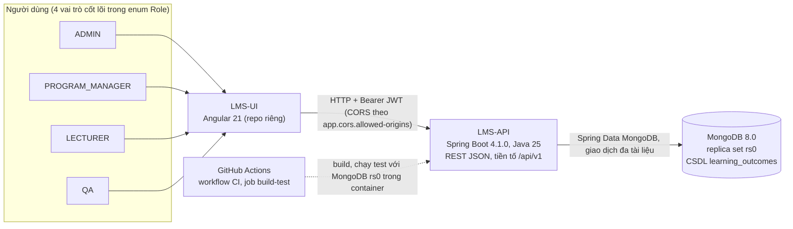

# Sơ đồ ngữ cảnh (context)

> **Dự thảo do AI soạn, đối chiếu mã ngày 2026-11-02 (`main`, commit `54ef80e`)**; sinh viên đọc, kiểm lại từng điểm
> với mã rồi viết lại bằng lời của mình. Sơ đồ chỉ vẽ cái **đã có trong mã**; phần chưa có nằm ở mục 3.

## 1. Sơ đồ

## 2. Giải thích và căn cứ trong mã

| Thành phần | Nội dung | Căn cứ đã đọc |
|---|---|---|
| Người dùng | 4 giá trị `Role` (tinh gọn theo ADR 0014 & OBE Schema v0.7): `ADMIN` (quản trị toàn hệ thống), `PROGRAM_MANAGER` (quản lý CTĐT, đề cương & bài đánh giá mẫu), `LECTURER` (giảng viên lớp học phần, soạn ma trận đề thi lớp, tự khóa ma trận, tải CSV và nhập điểm), `QA` (cán bộ ĐBCL & Khảo thí, xem báo cáo đo lường chất lượng, thẩm định CTĐT). | `enums/Role.java`, `@PreAuthorize` trong `controller/*`, `SecurityConfig`, `ScopeAuthorizationServiceImpl` |
| LMS-UI | Giao diện Angular gọi API qua HTTP; **không** truy cập MongoDB. Quan hệ UI → API vẽ theo thiết kế (`CLAUDE.md`); trạng thái màn hình UI do repo `LMS-UI` ghi | `CLAUDE.md`, rule 02 |
| LMS-API | Ứng dụng Spring Boot, ứng dụng không dùng phiên (stateless), xác thực JWT HS256 (Nimbus OAuth2 Resource Server), CORS cho origin cấu hình bởi `app.cors.allowed-origins` (mặc định `http://localhost:4200,http://localhost:3000`) | `SecurityConfig`, `JwtConfig` |
| MongoDB | Một CSDL `learning_outcomes`, chạy dạng **replica set** `rs0` để dùng transaction; chuỗi kết nối qua `spring.mongodb.uri` (biến `MONGODB_URI`) | `application.properties.example`, `MongoConfig`, `docker/mongo/` |
| GitHub Actions | Workflow `CI`, job `build-test`: checkout, Java 25 (Temurin), khởi động `mongo:8.0` replica set, nạp `doc/database_import.js`, chạy `./mvnw -B verify` | `.github/workflows/ci.yml` |

## 3. Chưa có trong mã (không vẽ như đã tồn tại)

- Không có gửi email, không có WebSocket: `pom.xml` còn `spring-boot-starter-mail` và `spring-boot-starter-websocket` nhưng
  `src/` không có dòng mã nào dùng (đã `grep` `JavaMail`, `MailSender`, `WebSocket`, `SimpMessag`). Xem TD-01 trong `doc/tech-debt.md`.
- Tệp điểm gốc (F05b) lưu trong một thư mục của máy chủ do cấu hình `app.score-import.storage-dir` (ADR 0013, nháp); không có object storage/dịch vụ lưu trữ ngoài.
- Không có hệ thống ngoài khác (không có SSO, không có dịch vụ ML; ML ngoài phạm vi đề tài).
- Môi trường staging/production: **chưa chọn nền tảng** — xem [`05-deployment.md`](05-deployment.md).
