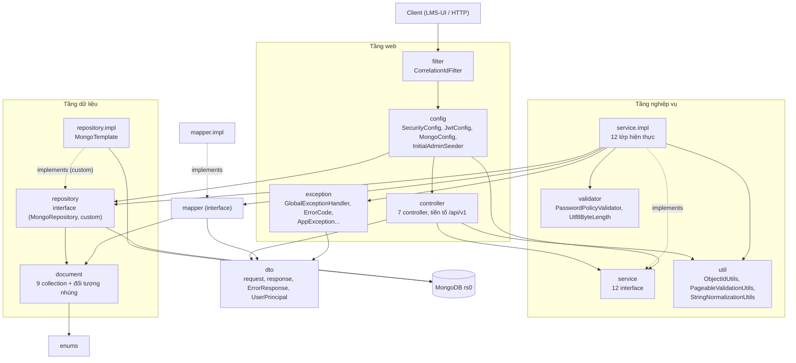

# Sơ đồ thành phần (component) theo package thật

> **Dự thảo do AI soạn, đối chiếu mã gốc và cập nhật thiết kế mục tiêu theo [ADR 0013](../adr/0013-import-ctdt-de-cuong-va-nhap-diem-clo-truc-tiep.md) ngày 2026-11-10.** Gốc package:
> `com.hcmute.lms.lmsapi`. Danh sách lớp cần sửa/xóa trong đợt refactor F03/F04 theo ADR 0013 được đặc tả chi tiết tại [`doc/ke-hoach-sua-doi-theo-nghiep-vu-moi.md`](../ke-hoach-sua-doi-theo-nghiep-vu-moi.md) (xóa `AssessmentApproval`, `ApprovalHistoryEntry`, `AssessmentRubric`, `RubricLevel`, `DataGranularity`, `ItemKind`, `ApprovalAction`; đổi `AssessmentApprovalService` thành cơ chế giảng viên tự khóa/mở khóa ma trận `lock`/`unlock` trong `AssessmentService`; đổi `OutcomeMapping.weight` thành `OutcomeMapping.maxScore`).

## 1. Sơ đồ phân tầng



Ghi chú đọc sơ đồ:
- `filter` chạy trước chuỗi bảo mật (`@Order(HIGHEST_PRECEDENCE)`); `config` ở đây gồm cả `SecurityConfig` (chuỗi bảo
  mật, CORS, xử lý 401/403) nên đứng trước `controller`.
- `exception` (`@RestControllerAdvice` `GlobalExceptionHandler`) chặn lỗi ném ra từ `controller` và `service.impl`; nét liền
  chỉ vẽ phụ thuộc import, không vẽ luồng ném lỗi.
- Mũi tên "implements": `service.impl`, `mapper.impl`, `repository.impl` hiện thực interface ở package gốc tương ứng
  (quy ước của `doc/coding-convention.md` và ADR 0002).

## 2. Lớp trong từng package

| Package | Lớp (đã đọc từ mã) |
|---|---|
| `controller` | `AuthController` (`/api/v1/auth`), `UserController` (`/api/v1/users`), `ProgramController` (`/api/v1/programs`), `ProgramVersionController` (`/api/v1/program-versions`), `PloController` (`…/{programVersionId}/plos`), `PiController` (`…/{programVersionId}/pis`), `CoursePiContributionController` (`…/{programVersionId}/pi-contributions`) |
| `service` (interface) | `AuditService`, `AuthService`, `AuthSessionService`, `CoursePiContributionService`, `PiService`, `PloService`, `ProgramService`, `ProgramVerificationService`, `ProgramVersionService`, `ScopeAuthorizationService`, `ScopeValidationService`, `UserService` |
| `service.impl` | `…Impl` tương ứng cho cả 12 interface trên |
| `repository` | `AuditLogRepository` (+ `AuditLogRepositoryCustom`), `CoursePiContributionRepository`, `CourseRepository`, `CourseSectionRepository`, `PiRepository`, `PloRepository`, `ProgramRepository`, `ProgramVersionRepository`, `UserRepository` (+ `UserRepositoryCustom`), `ProgramReferenceRepository`, `ScopeValidationRepository` |
| `repository.impl` | `AuditLogRepositoryCustomImpl`, `UserRepositoryCustomImpl`, `ProgramReferenceRepositoryImpl`, `ScopeValidationRepositoryImpl` (đều dùng `MongoTemplate`) |
| `mapper` / `mapper.impl` | `AuditLogMapper`, `CoursePiContributionMapper`, `PiMapper`, `PloMapper`, `ProgramMapper`, `ProgramVersionMapper`, `UserMapper`, `VerificationMapper` và `…Impl` |
| `document` | `User`, `Program`, `ProgramVersion`, `Plo`, `Pi`, `Course`, `CoursePiContribution`, `CourseSection`, `AuditLog`; đối tượng nhúng `RoleAssignment`, `UserScope`, `Verification`, `AuditEntity` |
| `dto` | Request/Response của từng nhóm chức năng, `ErrorResponse`, `FieldErrorDetail`, `PageResponse`, `UserPrincipal` |
| `enums` | `Role`, `UserStatus`, `AuditAction`, `AccessType`, `PloCategory`, `ProgramVersionStatus`, `VerificationStatus`, `PiContributionType` |
| `exception` | `AppException`, `BusinessRuleViolationException`, `ResourceNotFoundException`, `PageableValidationException`, `ErrorCode`, `GlobalExceptionHandler` |
| `config` | `SecurityConfig`, `JwtConfig`, `MongoConfig`, `InitialAdminSeeder` |
| `filter` | `CorrelationIdFilter` |
| `util`, `validator` | xem sơ đồ; `validator` còn có `Utf8ByteLength`, `Utf8ByteLengthValidator` |

Bảng endpoint hiện có (đọc từ `@RequestMapping`/`@…Mapping`/`@PreAuthorize`):

| Phương thức, đường dẫn | Quyền (mức web) |
|---|---|
| `POST /api/v1/auth/login` | công khai |
| `POST /api/v1/auth/logout`, `GET /api/v1/auth/me` | đã đăng nhập |
| `GET, POST /api/v1/users`; `GET, PUT /api/v1/users/{id}`; `PUT /api/v1/users/{id}/status` | `ADMIN` (cả `SecurityConfig` lẫn `@PreAuthorize`) |
| `GET /api/v1/programs`, `GET /api/v1/programs/{id}` | đã đăng nhập |
| `POST /api/v1/programs`, `PUT /api/v1/programs/{id}` | `ADMIN` (ADR 0005) |
| `GET /api/v1/program-versions`, `GET /api/v1/program-versions/{id}` | đã đăng nhập |
| `POST /api/v1/program-versions`, `PUT /api/v1/program-versions/{id}` | `PROGRAM_MANAGER` (+ kiểm tra phạm vi chương trình qua SpEL, ADR 0005) |
| `PUT /api/v1/program-versions/{id}/verification` | `QA_OFFICER` (+ kiểm tra phạm vi ở service) |
| `GET …/{pvId}/plos`, `GET …/{pvId}/plos/{id}` (tương tự `pis`) | đã đăng nhập |
| `POST …/{pvId}/plos`, `PUT, DELETE …/{pvId}/plos/{id}` (tương tự `pis`) | `PROGRAM_MANAGER` (+ kiểm tra phạm vi chương trình qua SpEL, ADR 0005) |
| `PUT …/{pvId}/plos/{id}/verification` (tương tự `pis`) | `QA_OFFICER` (+ kiểm tra phạm vi ở service) |
| `GET …/{pvId}/pi-contributions` | đã đăng nhập |
| `POST …/{pvId}/pi-contributions`, `DELETE …/{pvId}/pi-contributions/{id}` | `PROGRAM_MANAGER` (+ kiểm tra phạm vi chương trình qua SpEL, ADR 0005) |
| `GET /actuator/health`, `/actuator/health/**`, `/actuator/info` | công khai (`SecurityConfig`); các endpoint actuator khác cần token và không được mở (`management.endpoints.web.exposure.include=health,info`) |

## 3. Phụ thuộc giữa các package (tự tính từ `import`)

Mỗi hàng: package → các package khác của `com.hcmute.lms.lmsapi` mà nó import. Lệnh tái tạo (chạy ở thư mục
`src/main/java/com/hcmute/lms/lmsapi`):

```
for p in controller service service/impl repository repository/impl mapper mapper/impl document dto enums exception config filter util validator; do
  pk=$(echo $p | tr / .); echo -n "$pk -> "
  grep -h "^import com.hcmute.lms.lmsapi\." $p/*.java | sed -E 's/^import com\.hcmute\.lms\.lmsapi\.//; s/\.[A-Za-z0-9_]+;$//' | sort -u | grep -v "^$pk$" | tr '\n' ' '; echo
done
```

| Package | Import từ |
|---|---|
| `controller` | `dto`, `service`, `util` |
| `service` | `document`, `dto`, `enums` |
| `service.impl` | `config`, `document`, `dto`, `enums`, `exception`, `mapper`, `repository`, `service`, `util`, `validator` |
| `repository` | `document`, `enums` |
| `repository.impl` | `document`, `enums`, `repository` |
| `mapper` | `document`, `dto`, `enums` |
| `mapper.impl` | `document`, `dto`, `enums`, `mapper` |
| `document` | `enums` |
| `dto` | `document`, `enums`, `exception`, `validator` |
| `exception` | `dto` |
| `config` | `document`, `dto`, `enums`, `exception`, `repository`, `service`, `util`, `validator` |
| `util` | `dto`, `exception` |
| `validator` | `exception` |
| `filter` | (không import package nội bộ nào) |
| `enums` | (không) |

Điểm đối chiếu với quy ước ở `doc/coding-convention.md` §2 (quan sát, không phải kết luận đúng/sai):
- `controller` không import `repository` hay `document` (đúng quy ước "không nhảy cóc tầng").
- `service.impl` import `config` (cụ thể `JwtConfig` trong `AuthServiceImpl`), và `AuthService`/`AuditServiceImpl` phụ thuộc
  Servlet API (`HttpServletRequest`, `RequestContextHolder`) — lệch với câu "service không phụ thuộc Servlet" trong quy ước.
- `dto` import `document` (`UserProfileResponse.from(User)`, `UserPrincipal.from(User)`) và `exception` import `dto`
  (`ErrorResponse`), tạo vòng `dto ↔ exception` ở mức package.
- `ScopeAuthorizationService.canAccessProgram` được gọi duy nhất từ `ProgramVerificationServiceImpl`;
  `canAccessSection` **không** được lớp production nào gọi (chỉ test gọi qua controller thử nghiệm).

**Mô hình phân quyền F03 (ADR 0010 thay thế ADR 0009):** `ScopeAuthorizationService` cung cấp kiểm soát truy cập phân cấp:
- Master Catalog `courses`: Chỉ `ADMIN` (Phòng Đào tạo) tạo/sửa/xóa (`hasRole('ADMIN')`). Thu hồi quyền tạo/sửa môn của `PROGRAM_MANAGER`.
- Đề cương môn học (`syllabi`) & CLO (`clos`): `ScopeAuthorizationService.canAccessCourse(principal, courseId)` kiểm tra tập hợp $O(1)$ trực tiếp: `principal.getScope().getCourseIds().contains(courseId)` với vai trò `DEPARTMENT_HEAD` (Trưởng bộ môn) hoặc `LECTURER` (Giảng viên được phân công). Giảng viên chỉ soạn khi đề cương ở `DRAFT`; Trưởng bộ môn duyệt chuyển trạng thái sang `CONFIRMED`. `PROGRAM_MANAGER` không có quyền can thiệp vào đề cương/CLO (bị chặn 403).
- Liên kết CLO–PI (`clo_pi_links`): `PROGRAM_MANAGER` thiết lập ma trận liên kết cho CTĐT của ngành mình qua `@scopeAuthorizationService.canAccessProgramVersion(principal, programVersionId)`.
- Thẩm định CLO–PI: `QA_OFFICER` kiểm tra theo `canAccessProgramVersion` (ADR 0004). Bảng endpoint và sơ đồ lớp sẽ được cập nhật khi mã F03 được tích hợp vào nhánh chứa tài liệu này.

**Thành phần F05a (lớp học phần, sinh viên, ghi danh; `doc/plan/F05a-hoc-ky-lop-sinh-vien.md` §11):**

| Lớp | Vai trò | Phụ thuộc chính |
|---|---|---|
| `SectionController` (`/api/v1/sections`) | Mở lớp, sửa giảng viên, đổi trạng thái, liệt kê/đọc lớp | `SectionService`; kiểm quyền bằng `@PreAuthorize` gọi `ScopeAuthorizationService` |
| `SectionServiceImpl` | Kiểm tham chiếu (học phần, đề cương cùng học phần và `CONFIRMED`, học kỳ `OPEN`, giảng viên `ACTIVE` vai trò `LECTURER`); lọc danh sách theo quyền đọc | `CourseSectionRepository`, `CourseRepository`, `SyllabusRepository`, `TermRepository`, `UserRepository`, `ScopeAuthorizationService` |
| `EnrollmentController` (`/api/v1/sections/{id}/enrollments[/import]`, `/api/v1/enrollments/{id}/status`) | Xem danh sách ghi danh, nhập CSV, rút/ghi danh lại | `EnrollmentService` |
| `EnrollmentServiceImpl` | Nhập CSV một thao tác thống nhất (`@Transactional`), tính lại `course_sections.enrolledCount`, đóng băng ghi danh khi lớp/học kỳ không `OPEN` | `EnrollmentRepository`, `StudentRepository`, `CourseSectionRepository`, `TermRepository`, `EnrollmentCsvParser` |
| `EnrollmentCsvParser` (`util`) | Đọc cú pháp CSV (UTF-8, `,`/`;`, nháy kép), chỉ lấy `studentRef`, `cohort`, `majorCode` | không phụ thuộc lớp nào khác (chỉ `exception`) |

Phân quyền thêm vào `ScopeAuthorizationService`: `canManageCourseSections`/`canManageSection` (ADMIN, hoặc PROGRAM_MANAGER có CTĐT chứa học phần trong
`scope.programIds`), `canAccessLoadedSection` (như `canAccessSection` nhưng nhận lớp đã nạp để lọc danh sách không truy vấn lặp), `canAccessEnrollment`
(suy quyền từ lớp của ghi danh). Collection mới: `students` (chỉ `studentRef`, `cohort`, `majorCode`, `status`), `enrollments` (unique `sectionId + studentId`).

**Thành phần F04 (bài đánh giá, `doc/plan/F04-bai-danh-gia.md` §11):**

| Lớp | Vai trò | Phụ thuộc chính |
|---|---|---|
| `AssessmentController` (`/api/v1/syllabi/{id}/assessment-templates`, `/sections/{id}/assessments`, `/assessments/{id}[/items\|/coverage\|/submit\|/approve\|/reject]`) | Khung theo đề cương, bài của lớp, items, độ phủ, quy trình duyệt | `AssessmentService`, `AssessmentApprovalService`; kiểm quyền bằng `ScopeAuthorizationService` |
| `AssessmentServiceImpl` | Tạo/sửa khung và bản lớp, sao chép khung thành snapshot, khóa sửa khi đã gửi duyệt/duyệt | `AssessmentRepository`, `SyllabusRepository`, `CourseSectionRepository`, `CloRepository`, `AssessmentItemValidator`, `AssessmentCoverageCalculator`, `AssessmentMapper` |
| `AssessmentItemValidator` | Quy tắc items: Σ weight = 1, CLO không trùng và thuộc đề cương, rubric 1–4 | `CloRepository` (đọc) |
| `AssessmentCoverageCalculator` | Độ phủ theo CLO và Bloom (lớp thuần, không truy cập CSDL) | không |
| `AssessmentApprovalServiceImpl` | Gửi duyệt, duyệt, từ chối trong transaction; ghi `audit_logs` | `AssessmentRepository`, `AuditService` |

Phân quyền thêm: `canAccessAssessment` (bản lớp theo quyền trên lớp, khung theo quyền trên đề cương) và `canReviewAssessment` (chỉ DEPARTMENT_HEAD có học phần
của đề cương trong `scope.courseIds`, ADMIN không có). Collection `assessments` có thêm trường `revision` (khóa lạc quan, xem plan F04 §11 D7).


**Thành phần F05b (nhập điểm từ tệp CSV; `doc/plan/F05b-nhap-diem.md` §11, ADR 0013 nháp):**

| Lớp | Vai trò | Phụ thuộc chính |
|---|---|---|
| `ImportBatchController` (`/api/v1/sections/{s}/assessments/{a}/import-batches`, `/api/v1/import-batches/{id}[/errors\|/validate\|/confirm\|/rollback]`) | Tải tệp, xem lô/lỗi, kiểm tra, xác nhận, hủy | `ImportBatchService`; kiểm quyền bằng `ScopeAuthorizationService` (`hasRole('LECTURER')` cho ghi) |
| `ImportBatchServiceImpl` | Luồng 3 bước; kiểm điều kiện nhập (bài, lớp, học kỳ); `confirmBatch` là một `@Transactional` ghi `scores`, lô, trạng thái bài và `audit_logs` | `ImportBatchRepository`, `ImportRowErrorRepository`, `ScoreRepository`, `AssessmentRepository`, `CourseSectionRepository`, `TermRepository`, `EnrollmentRepository`, `StudentRepository`, `ImportFileStorage`, `ScoreRowValidator`, `AuditService`, `ImportBatchMapper` |
| `ScoreRowValidator` | Kiểm tra từng dòng/cột, sinh bản ghi điểm dự kiến (lớp thuần, nhận dữ liệu đã nạp, không truy cập CSDL) | `ScoreCsvParser` (chỉ kiểu dữ liệu) |
| `ScoreCsvParser` (`util`) | Đọc CSV điểm thành bảng + số dòng vật lý; dùng lại `EnrollmentCsvParser#splitLine/detectDelimiter/stripBom` | `EnrollmentCsvParser` |
| `ImportFileStorage` / `LocalImportFileStorage` | Lưu/đọc/xóa tệp gốc trong thư mục `app.score-import.storage-dir`; `fileRef` đúng mẫu `<24 hex>.csv` | hệ tệp của máy chủ |
| `ChecksumUtils` (`util`) | SHA-256 của tệp | `java.security.MessageDigest` |

Phân quyền thêm vào `ScopeAuthorizationService`: `canAccessImportBatch` (suy quyền từ lớp của lô, `canAccessSection`). Collection mới có `document`:
`import_batches`, `import_row_errors`, `scores` (xem `03-erd-collection.md` mục 6). Không thêm dependency Maven nào.
