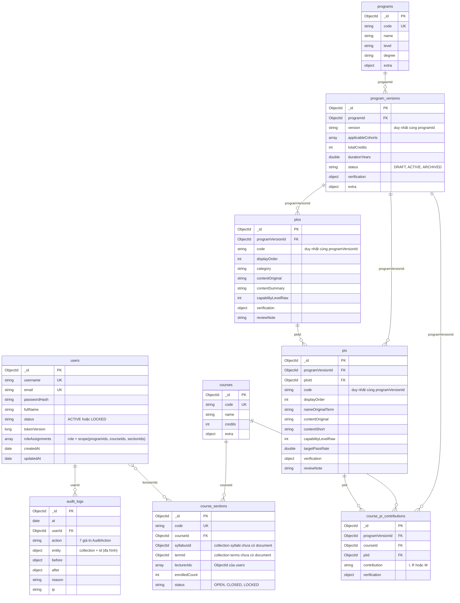
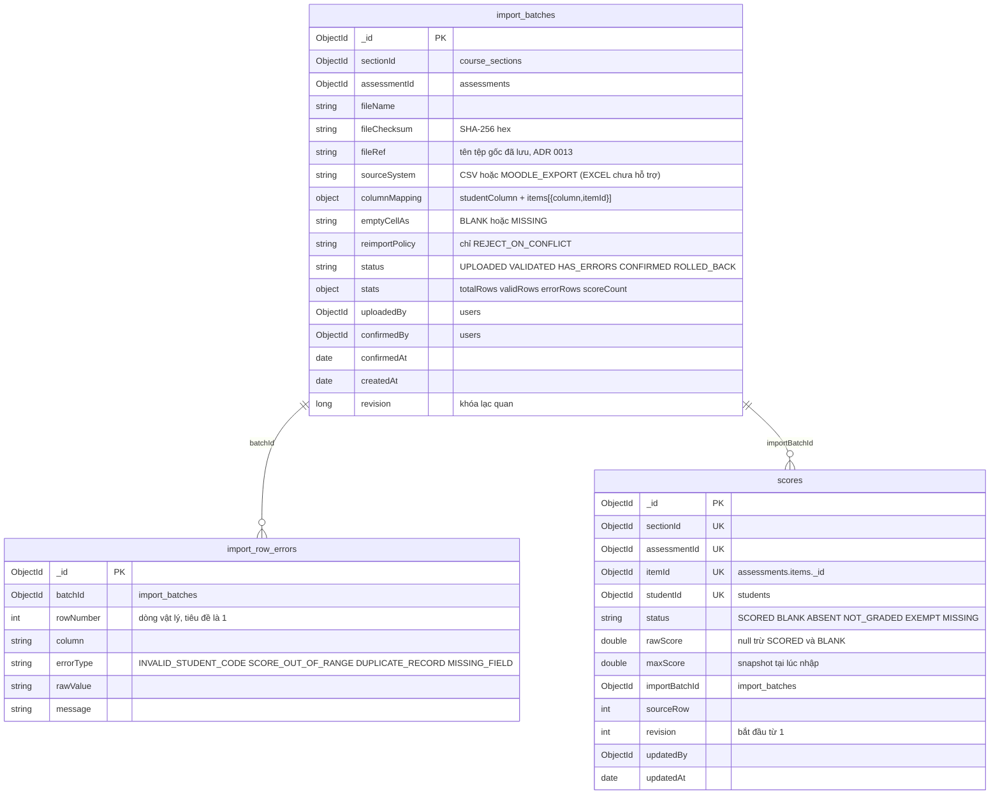

# Sơ đồ ERD / class của các collection đã có `document`

> **Dự thảo do AI soạn, đối chiếu mã ngày 2026-11-02 (`main`, commit `54ef80e`).** Chỉ vẽ **9 collection có lớp `@Document`**
> trong `src/main/java/com/hcmute/lms/lmsapi/document`, đối chiếu với validator/chỉ mục trong `doc/database_import.js`.
> 21 collection còn lại của `database_import.js` (tổng 30) **chưa có `document`** nên không vẽ (mục 4). MongoDB không có khóa
> ngoại: quan hệ dưới đây là tham chiếu bằng `ObjectId`, do tầng service kiểm tra trước khi ghi.

## 1. Sơ đồ

## 2. Đối tượng nhúng và tham chiếu không vẽ thành đường nối

| Đối tượng nhúng (class) | Nằm trong | Trường |
|---|---|---|
| `RoleAssignment` | `users.roleAssignments[]` | `role` (enum `Role`), `scope` |
| `UserScope` | `RoleAssignment.scope` | `programIds[]`, `courseIds[]`, `sectionIds[]` (ObjectId; tham chiếu `programs`, `courses`, `course_sections`). "Scope rỗng" = `scope` null hoặc cả ba mảng rỗng (`UserScope.isEmpty()`) |
| `Verification` | `program_versions`, `plos`, `pis`, `course_pi_contributions` | `status` (`UNVERIFIED`, `VERIFIED`, `NEEDS_CLARIFICATION`), `verifiedBy` (ObjectId của `users`), `verifiedAt`, `note` |
| `AuditEntity` | `audit_logs.entity` | `collection` (tên collection bất kỳ), `id` (chuỗi) — tham chiếu đa hình, không phải khóa ngoại |

Tham chiếu có trong mã nhưng không vẽ để tránh rối: `users.roleAssignments[].scope.*` → `programs`/`courses`/`course_sections`
(kiểm tra tồn tại bởi `ScopeValidationServiceImpl`); `Verification.verifiedBy` → `users`.

## 3. Chỉ mục (đối chiếu `@CompoundIndex` / `@Indexed` với `database_import.js`)

| Collection | Chỉ mục duy nhất | Chỉ mục khác |
|---|---|---|
| `users` | `username`; `email` | — |
| `programs` | `code` | — |
| `program_versions` | `(programId, version)` | — |
| `plos` | `(programVersionId, code)` | — |
| `pis` | `(programVersionId, code)` | `ploId` |
| `courses` | `code` | — |
| `course_pi_contributions` | `(programVersionId, courseId, piId)` | `piId` |
| `course_sections` | `code` | `(courseId, termId)`; `lecturerIds` |
| `audit_logs` | — | `(entity.collection, entity.id, at desc)`; `(userId, at desc)` |

Trong `database_import.js` mỗi collection có `$jsonSchema` với `validationAction: 'error'` (lỗi mã 121 được
`GlobalExceptionHandler` đổi thành 422). Hai file (`@Document` và script) là hai nơi định nghĩa độc lập: khi đổi
một bên phải đối chiếu bên kia. Script là "hợp đồng dữ liệu" (`doc/plan/README.md` §3).

## 4. Collection có trong `database_import.js` (25 collections theo CSDL v0.7 — ADR 0014)

Tổng số collection trong `database_import.js` v0.7 là **25 collections** (đã loại bỏ `ml_experiments`, loại bỏ hoàn toàn 3 collection ngân hàng câu hỏi `question_banks`, `question_categories`, `questions`, và loại bỏ `measurement_rules` theo [ADR 0014](../adr/0014-import-ctdt-de-cuong-va-do-luong-4-cap-clo-pi-plo.md)).

Các collection đã có `@Document` trong `src/main` (F01–F05a): `users`, `programs`, `program_versions`, `plos`, `pis`, `courses`, `program_courses`, `course_pi_contributions`, `syllabi`, `clos`, `clo_pi_links`, `assessments`, `terms`, `course_sections`, `students`, `enrollments`, `audit_logs` (17 collections).

Các collection của F05b–F08 (8 collections): `import_batches`, `import_row_errors`, `scores` (khóa duy nhất `{sectionId, assessmentId, itemId, cloId, studentId}`, `rawScore >= 0`), `calculation_runs`, `student_results` (kết quả 4 cấp `['ASSESSMENT_CLO', 'CLO', 'PI', 'PLO']` có `assessmentId`), `aggregate_results` (4 cấp, scope `ASSESSMENT`, `SECTION`, `COHORT`, `PROGRAM`), `reports`, `improvement_actions`.

## 5. Khác biệt đã thấy giữa thiết kế dữ liệu và `document` (để sinh viên rà)

- `database_import.js` yêu cầu `programId`, `programVersionId`... kiểu `objectId`; trong `document` các trường này khai báo
  `String` kèm `@Field(targetType = FieldType.OBJECT_ID)` để Spring Data ghi đúng kiểu `ObjectId`. Sơ đồ ghi theo kiểu lưu trong MongoDB.
- Plan F02 §3 vẫn ghi `courses.departmentId`; trường này đã bị bỏ khỏi cả `Course` lẫn validator (commit `9a281b8`), nên
  sơ đồ không có.
- `users.createdAt/updatedAt` và `fullName` có trong `document` nhưng không nằm trong danh sách `required` của validator
  (chỉ `username, email, passwordHash, status, roleAssignments` là bắt buộc).

## 6. Nhập điểm (F05b): `import_batches`, `import_row_errors`, `scores`

Ba collection này có `document` từ nhánh F05b (`ImportBatch`, `ImportRowError`, `Score`); các mục 1–5 ở trên chưa được
làm mới cho F04/F05a nên không vẽ chung. Đối chiếu với `doc/database_import.js` (khối `import_batches`, `import_row_errors`, `scores`).

Chỉ mục (`@CompoundIndex` khớp `database_import.js`): `import_batches(sectionId, assessmentId, createdAt desc)`, `import_batches(fileChecksum)`,
`import_row_errors(batchId, rowNumber)`, `scores(sectionId, assessmentId, itemId, studentId)` **duy nhất**. Khác biệt cần biết: `import_batches.revision`
và `createdAt` không nằm trong `properties` của validator (validator không cấm trường thừa); `columnMapping` lưu danh sách thay vì map vì tên cột
trong tệp có thể chứa dấu chấm; `rawScore = null` không được ghi xuống MongoDB (Spring Data bỏ trường null), validator chấp nhận trường vắng mặt.
