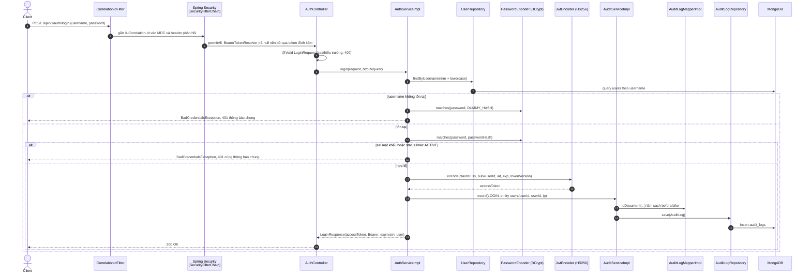
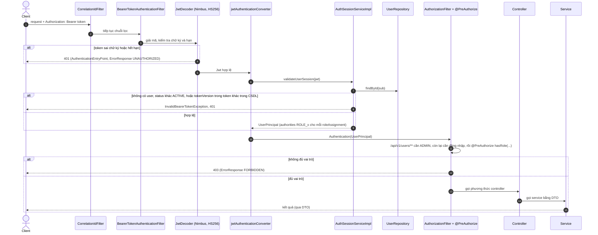
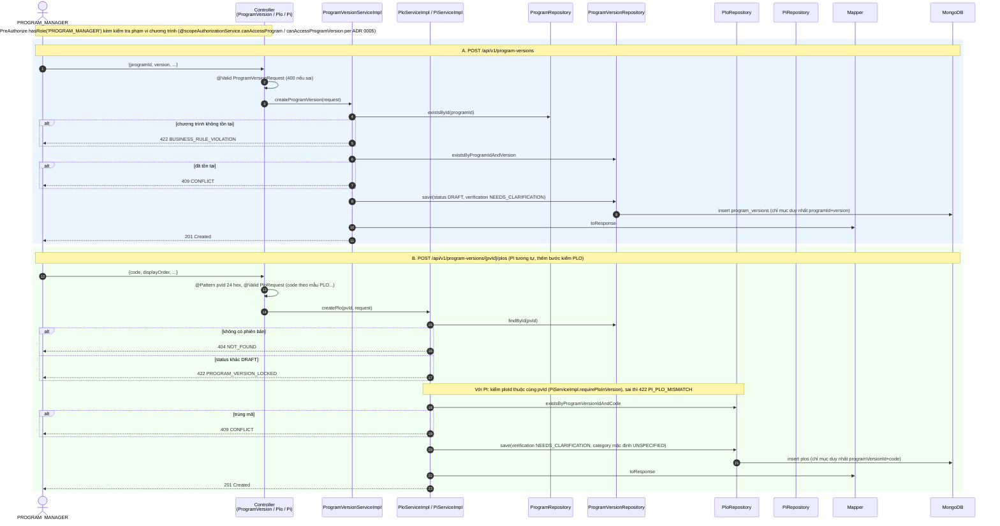
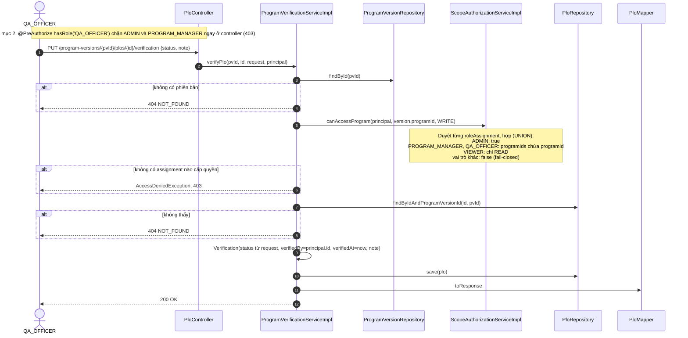
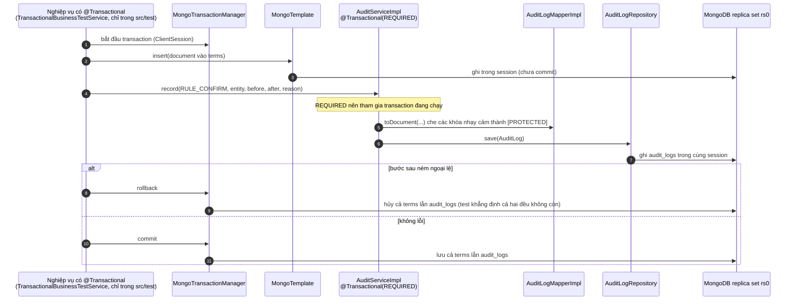
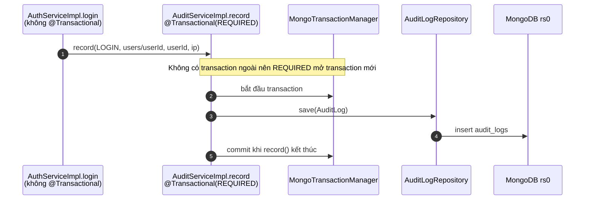

# Sơ đồ tuần tự (sequence) của các luồng đã có mã

> **Dự thảo do AI soạn, đối chiếu mã ngày 2026-11-02 (`main`, commit `54ef80e`).** Mỗi sơ đồ dưới đây được viết sau khi đọc
> đúng các lớp nêu ở mục "Căn cứ"; tên lớp, phương thức, mã lỗi là tên thật trong mã. Sinh viên đọc lại từng bước với mã
> (hội đồng sẽ đối chiếu ngẫu nhiên). Luồng chưa có mã nằm ở mục 9, không vẽ.

Quy ước lỗi (từ `ErrorCode`, `GlobalExceptionHandler`): 400 `VALIDATION_ERROR`, 401 `UNAUTHORIZED`, 403 `FORBIDDEN`,
404 `NOT_FOUND`, 409 `CONFLICT`, 422 `BUSINESS_RULE_VIOLATION`, 500 `INTERNAL_ERROR`; thân lỗi là `ErrorResponse`.

## 1. Đăng nhập, cấp JWT và ghi audit `LOGIN` (US-01)

Căn cứ: `AuthController.login`, `AuthServiceImpl.login`, `AuditServiceImpl.record`, `AuditLogMapperImpl`, `JwtConfig`.



Điểm cần nhớ khi vấn đáp:
- Khi username không tồn tại vẫn gọi `matches` với hash giả để thời gian xử lý gần như nhau (chống dò tài khoản).
- Kiểm tra mật khẩu **trước** kiểm tra trạng thái; ba trường hợp lỗi cùng trả 401 với cùng thông điệp.
- `AuthServiceImpl.login` **không** có `@Transactional`; `AuditServiceImpl.record` có `@Transactional(REQUIRED)` nên bước ghi audit tự mở một
  transaction riêng (xem mục 5).
- Token chứa `sub` và `tokenVersion`, **không** chứa vai trò (vai trò nạp từ CSDL ở mỗi request, mục 2).

## 2. Mỗi request có token: kiểm tra JWT, nạp quyền, kiểm tra vai trò (US-01/AC-5, US-03)

Căn cứ: `SecurityConfig` (`bearerTokenResolver`, `jwtAuthenticationConverter`, `authorizeHttpRequests`),
`AuthSessionServiceImpl.validateUserSession`, `UserPrincipal.getAuthorities`, `@PreAuthorize` trong controller.



Điểm cần nhớ:
- Mỗi request đọc lại `users` từ CSDL (không tin vai trò trong token) nên đổi vai trò/khóa tài khoản có hiệu lực ngay, và
  `logout`/khóa tăng `tokenVersion` làm mọi token cũ bị 401.
- Kiểm tra **phạm vi dữ liệu** (scope) không nằm ở bước này mà ở service khi cần (mục 4 là ví dụ duy nhất hiện có).
- F03 (ADR 0010 thay thế ADR 0009): Admin quản lý Master Catalog `courses`; Trưởng bộ môn (`DEPARTMENT_HEAD`) nhận scope `courseIds` từ Admin và phân công cho Giảng viên (`LECTURER`) trong bộ môn biên soạn đề cương/CLO ở trạng thái `DRAFT`; Trưởng bộ môn thẩm định và duyệt `CONFIRMED`. Trưởng ngành (`PROGRAM_MANAGER`) quản lý đưa môn vào CTĐT (`program_courses`) và tạo liên kết $CLO \to PI$ (`clo_pi_links`) theo `scope.programIds`. Các kiểm tra scope đều thực hiện fail-closed qua `ScopeAuthorizationService`.

## 3. Tạo phiên bản CTĐT, PLO, PI (US-05, US-06)

Căn cứ: `ProgramVersionController`, `ProgramVersionServiceImpl.createProgramVersion`, `PloController`, `PloServiceImpl.createPlo`,
`PiServiceImpl.createPi`. (Tạo `program` ở `ProgramServiceImpl.createProgram` do `ADMIN` thực hiện theo ADR 0005: kiểm tra mã trùng rồi lưu.)



Điểm cần nhớ:
- Cả ba thao tác **không** có `@Transactional` (mỗi lần chỉ ghi một document) và **không** ghi `audit_logs`
  (`AuditAction` hiện chỉ có `SCORE_UPDATE`, `IMPORT_CONFIRM`, `ASSESSMENT_APPROVE`, `ASSESSMENT_REJECT`, `RUN_CALCULATION`,
  `RULE_CONFIRM`, `LOGIN`; chưa có hành động cho CTĐT/PLO/PI). Đã kiểm bằng `grep auditService` trong `src/main`: chỉ `AuthServiceImpl` gọi.
- Trùng khóa vừa được kiểm trước khi ghi (`exists…`), vừa được chặn bởi chỉ mục duy nhất; nếu hai yêu cầu chạy đồng thời,
  `DuplicateKeyException` được bắt và đổi thành 409.
- Mọi thay đổi PLO/PI chỉ được khi phiên bản ở `DRAFT`; `ProgramVersion` đã `ACTIVE` bị khóa nội dung.
- Controller không chạm repository; service trả DTO qua mapper.

## 4. Xác nhận nội dung bởi QA_OFFICER có kiểm tra phạm vi (US-08, ADR 0004)

Căn cứ: `PloController.verifyPlo`, `ProgramVerificationServiceImpl.verifyPlo`, `ScopeAuthorizationServiceImpl.canAccessProgram`.
Phiên bản CTĐT và PI đi theo cùng khuôn (`verifyProgramVersion`, `verifyPi`).



Điểm cần nhớ:
- Hai lớp chặn: vai trò ở controller (`QA_OFFICER`), phạm vi chương trình ở service (`scope.programIds`). `ADMIN` được
  `canAccessProgram` cho qua nhưng bị controller chặn trước, đúng ADR 0004 (tách người soạn khỏi người xác nhận).
  Đề xuất này **chờ Q08**; chưa phải quyết định đã duyệt.
- Đây là nơi duy nhất trong mã production gọi `canAccessProgram`; `canAccessSection` (quyền trên lớp học phần) chưa có
  lớp production nào gọi, chỉ có test dùng qua controller thử nghiệm.

## 5. Ghi audit trong transaction (US-39/AC-2)

Căn cứ: `MongoConfig` (`MongoTransactionManager`, `@EnableTransactionManagement`), `AuditServiceImpl.record`
(`@Transactional(propagation = REQUIRED)`), `TransactionRollbackIntegrationTest`.

> **Phạm vi trung thực:** chưa có nghiệp vụ production nào bọc `@Transactional` rồi gọi `AuditService`. Sơ đồ A là cơ chế
> được kiểm bằng `TransactionalBusinessTestService`, một `@TestComponent` chỉ có trong `src/test`, ghi collection `terms`.
> Sơ đồ B là điều xảy ra thật hôm nay ở đăng nhập.

**A. Cơ chế (kiểm bởi test, nghiệp vụ gọi là lớp thử nghiệm)**



**B. Thực tế hôm nay (đăng nhập)**



Điểm cần nhớ: replica set là điều kiện để transaction hoạt động (MongoDB standalone sẽ lỗi); vì vậy dev dùng image `docker/mongo`
và CI khởi động `rs0`. `AuditServiceImpl` kiểm `SCORE_UPDATE` bắt buộc `reason`, nên khi F05b có mã, sửa điểm phải truyền lý do.

## 6. Nhập danh sách lớp từ CSV (US-20)

Căn cứ: `EnrollmentController#importEnrollments`, `EnrollmentServiceImpl#importEnrollments`, `EnrollmentCsvParser#parse`,
`GlobalExceptionHandler#handleImportValidation`, `EnrollmentImportIntegrationTest`. Thao tác là **một transaction**: có dòng lỗi thì
không ghi gì (nhánh `alt`), nên mẫu số `enrolledCount` không bao giờ lệch nửa chừng.

```mermaid
sequenceDiagram
    autonumber
    participant C as Client (giảng viên lớp)
    participant CT as EnrollmentController
    participant SA as ScopeAuthorizationServiceImpl
    participant S as EnrollmentServiceImpl<br/>@Transactional
    participant P as EnrollmentCsvParser
    participant DB as MongoDB replica set rs0

    C->>CT: POST /sections/{id}/enrollments/import (multipart file)
    CT->>SA: canAccessSection(principal, id, WRITE)
    alt không phải giảng viên của lớp / ADMIN
        SA-->>CT: false
        CT-->>C: 403
    end
    CT->>S: importEnrollments(id, InputStream, actor)
    S->>DB: đọc lớp; đọc học kỳ của lớp
    alt lớp hoặc học kỳ không OPEN
        S-->>C: 422 (mẫu số đã đóng băng)
    end
    S->>P: parse(InputStream)
    alt tệp rỗng / thiếu cột studentRef / quá 5000 dòng
        P-->>C: 400 VALIDATION_ERROR
    end
    S->>DB: đọc students theo studentRef, enrollments hiện có của lớp
    S->>S: validateRows: thiếu, sai mẫu, quá dài, trùng trong tệp, đã ghi danh, đã rút
    alt có dòng lỗi
        S-->>C: 422 + fieldErrors[line N] (chưa ghi gì)
    else tất cả hợp lệ
        S->>DB: saveAll(students mới)
        S->>DB: saveAll(enrollments ENROLLED)
        S->>DB: count(ENROLLED) rồi ghi course_sections.enrolledCount
        S-->>C: 200 {totalRows, newStudents, reusedStudents, sectionEnrolledCount, ignoredColumns}
    end
```

## 7. Duyệt ma trận bài đánh giá bản lớp (NEW-01, ADR 0001)

Căn cứ: `AssessmentController#submit/approve/reject`, `AssessmentApprovalServiceImpl`, `ScopeAuthorizationServiceImpl#canReviewAssessment`,
`AuditServiceImpl#record`, `AssessmentIntegrationTest`. Gửi duyệt, duyệt và từ chối mỗi thao tác là một transaction; `status` và `isLocked`
được ghi trong cùng một lần `save`, `revision` (`@Version`) và WriteConflict của MongoDB bảo đảm hai người cùng duyệt chỉ một người thắng.

```mermaid
sequenceDiagram
    autonumber
    participant GV as Giảng viên của lớp
    participant TBM as Trưởng bộ môn (đúng scope.courseIds)
    participant C as AssessmentController
    participant SA as ScopeAuthorizationServiceImpl
    participant S as AssessmentApprovalServiceImpl<br/>@Transactional
    participant AU as AuditServiceImpl
    participant DB as MongoDB replica set rs0

    GV->>C: POST /assessments/{id}/submit
    C->>SA: canAccessAssessment(WRITE) (lớp của giảng viên)
    C->>S: submit(id, actor)
    S->>DB: đọc bài; phải là SECTION và DRAFT
    alt chưa có phần tử / totalPoints thiếu hoặc lệch Σ maxScore từ 0,001
        S-->>GV: 422
    end
    S->>DB: save(SUBMITTED, approval.submittedBy/At, history SUBMIT)

    TBM->>C: POST /assessments/{id}/approve
    C->>SA: canReviewAssessment (DEPARTMENT_HEAD, courseId của đề cương trong scope)
    alt không đúng vai trò / phạm vi (kể cả ADMIN)
        SA-->>TBM: 403
    end
    C->>S: approve(id, actor)
    S->>DB: đọc bài; phải đang SUBMITTED, nếu không 422
    alt actor là người đã gửi duyệt
        S-->>TBM: 403
    end
    S->>DB: save(APPROVED, isLocked = true, reviewedBy/At, history APPROVE) kiểm revision
    S->>AU: record(ASSESSMENT_APPROVE, before, after)
    AU->>DB: ghi audit_logs trong cùng transaction
    alt người duyệt khác ghi trước (revision đổi / WriteConflict 112)
        DB-->>TBM: 409
    else thành công
        S-->>TBM: 200 (items[] bị khóa)
    end
```

Từ chối (`/reject`) giống nhánh duyệt nhưng bắt buộc `reviewNote`, đặt `REJECTED`, `isLocked = false`, ghi `ASSESSMENT_REJECT`. Giảng viên sửa
bài `REJECTED` thì bài tự về `DRAFT` (`AssessmentServiceImpl#reopenIfRejected`) rồi mới gửi duyệt lại được.

## 8. Bảng đối chiếu nhanh sơ đồ ↔ mã

| Sơ đồ | Lớp/phương thức cần mở để đối chiếu |
|---|---|
| 1 | `AuthController#login`, `AuthServiceImpl#login`, `AuthServiceImpl.DUMMY_HASH`, `AuditServiceImpl#record` |
| 2 | `SecurityConfig#securityFilterChain`, `#bearerTokenResolver`, `#jwtAuthenticationConverter`; `AuthSessionServiceImpl#validateUserSession`; `UserPrincipal#getAuthorities` |
| 3 | `ProgramVersionServiceImpl#createProgramVersion`; `PloServiceImpl#createPlo`, `#requireDraftableVersion`; `PiServiceImpl#createPi`, `#requirePloInVersion` |
| 4 | `ProgramVerificationServiceImpl#verifyPlo`, `#requireProgramAccess`; `ScopeAuthorizationServiceImpl#canAccessProgram`, `#checkProgramAssignment` |
| 5 | `MongoConfig#transactionManager`; `AuditServiceImpl#record`; `TransactionRollbackIntegrationTest` |
| 6 | `EnrollmentController#importEnrollments`; `EnrollmentServiceImpl#importEnrollments`, `#validateRows`, `#recountEnrolled`; `EnrollmentCsvParser#parse`; `GlobalExceptionHandler#handleImportValidation` |
| 7 | `AssessmentController#submit/approve/reject`; `AssessmentApprovalServiceImpl#submit`, `#approve`, `#reject`, `#requireNotSubmitter`; `ScopeAuthorizationServiceImpl#canReviewAssessment`; `AssessmentServiceImpl#requireEditable`, `#reopenIfRejected` |

## 9. Thiết kế mục tiêu (chưa có mã)

Các luồng **nhập điểm từ tệp** (F05b: tải tệp, ánh xạ cột, kiểm tra, xác nhận trong transaction có ghi `IMPORT_CONFIRM`/`SCORE_UPDATE`)
và **chạy đo lường** (F06: CLO → PI → PLO theo `measurement_rules`, ghi `RUN_CALCULATION`) **chưa có mã** trong `src/main`
nên không có sơ đồ ở đây. Khi có mã, thêm sơ đồ vào file này ngay trong PR đó (rule 05: sơ đồ khớp mã, cập nhật cùng thay đổi).
Mô tả dự kiến nằm ở [`doc/plan/F05b-nhap-diem.md`](../plan/F05b-nhap-diem.md) và [`doc/plan/F06-do-luong.md`](../plan/F06-do-luong.md)
(bản nháp chưa ký, không phải thiết kế đã được chấp nhận).
