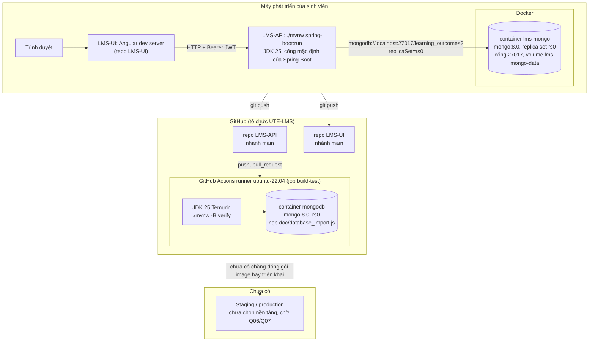

# Sơ đồ triển khai (deployment)

> **Dự thảo do AI soạn, đối chiếu mã ngày 2026-11-02 (`main`, commit `54ef80e`).** Chỉ vẽ môi trường **đã có trong repo**:
> máy phát triển (Docker cho MongoDB) và CI trên GitHub Actions. **Môi trường staging/production chưa chọn nền tảng**, nên
> không vẽ như thể đã tồn tại.

## 1. Sơ đồ (môi trường đã có)

## 2. Chi tiết và căn cứ

### 2.1 Máy phát triển
- MongoDB chạy bằng image `lms-mongo` build từ `docker/mongo/Dockerfile` (nền `mongo:8.0`, `entrypoint.sh` khởi tạo replica
  set `rs0` một node và nạp `doc/database_import.js`). Lệnh dựng và chạy: `README.md`, mục "MongoDB bằng Docker".
  Cổng nghe trong container phải trùng cổng publish (`MONGO_PORT`); container **không bật xác thực**, chỉ dùng cục bộ.
- Ứng dụng API chạy trực tiếp trên máy (`./mvnw spring-boot:run`); **không có Dockerfile cho API** (thư mục `docker/` chỉ có `mongo/`).
  `application.properties.example` không đặt `server.port`, nên dùng cổng mặc định của Spring Boot.
- Cấu hình qua biến môi trường: `MONGODB_URI`, `JWT_SECRET`, `INITIAL_ADMIN_USERNAME`, `INITIAL_ADMIN_EMAIL`,
  `INITIAL_ADMIN_PASSWORD` (tên biến từ `application.properties.example` và `ci.yml`). Giá trị thật không commit.
- UI gọi API qua HTTP; origin được CORS cho phép mặc định là `http://localhost:4200` và `http://localhost:3000`
  (`app.cors.allowed-origins`). Cách chạy UI do repo `LMS-UI` mô tả.

### 2.2 CI (`.github/workflows/ci.yml`)
- Workflow `CI`, job `build-test`, runner `ubuntu-22.04` (ghim vì kernel của `ubuntu-latest` khi ấy làm `mongod 8.x` thoát — ghi chú trong workflow).
- Các bước: checkout; Java 25 (Temurin, cache Maven); khởi động container `mongo:8.0` với `--replSet rs0`, `rs.initiate`, chờ primary,
  nạp `doc/database_import.js`; sao chép `application.properties.example` thành `application.properties`; `./mvnw -B verify` với
  biến `MONGODB_URI`, `SPRING_MONGODB_URI`, `JWT_SECRET` (giá trị thử nghiệm đặt thẳng trong workflow), `INITIAL_ADMIN_*` rỗng.
- Kích hoạt: `push` mọi nhánh và `pull_request` mọi nhánh; `concurrency` hủy run cũ của cùng nhánh (trừ `main`).
- **Chưa có** trong workflow: lint/phân tích tĩnh, quét secret và phụ thuộc, đóng gói Docker, gắn phiên bản, triển khai, tải
  báo cáo coverage lên (đối chiếu TD-07, TD-08, TD-09). Rule 04 yêu cầu ≥ 6 chặng; hiện mới có chặng build + test.
- Repo `LMS-UI` có workflow riêng (job cũng tên `build-test`: `npm ci`, lint, test kèm coverage, build, `npm audit`); xem repo đó.

### 2.3 Staging / production
**Chưa chọn nền tảng — chờ Q06/Q07** (`doc/GiaiThich_CoSoDuLieu.md` §8: "Phiên bản công nghệ; nơi lưu mã, tệp, môi trường",
trạng thái "Chưa hỏi"). Khi có quyết định: ghi ADR, cập nhật sơ đồ này, và tham chiếu `doc/deploy/staging.md` nếu tài liệu đó được tạo
(tại thời điểm soạn, thư mục `doc/deploy/` **chưa tồn tại** nên sơ đồ không dựa vào nó). Các việc rule 04 yêu cầu cho môi trường
này và hiện chưa có: health check sau triển khai (`/actuator/health` đã có trong mã), log tập trung, cảnh báo, rollback có tài liệu,
secret qua cơ chế của nền tảng.
